> **原文：** Simon Boehm, *How to Optimize a CUDA Matmul Kernel for cuBLAS-like Performance: a Worklog*  
> **发表：** 2022 年 12 月  
> **原文链接：** [https://siboehm.com/articles/22/CUDA-MMM](https://siboehm.com/articles/22/CUDA-MMM)  
> **配套代码：** [siboehm/SGEMM_CUDA](https://github.com/siboehm/SGEMM_CUDA)  
> **评测框架来源：** [wangzyon/NVIDIA_SGEMM_PRACTICE](https://github.com/wangzyon/NVIDIA_SGEMM_PRACTICE)

本文是对上述经典 CUDA 入门教材的**专业化中文译本 + 面向初学者的文本加注**。

- 原文的结构、表格、公式、代码片段、边注和**全部原图**均予保留。
- 图片使用原文原图嵌入（已下载到本目录 `images/`，对应原文路径 `https://siboehm.com/assets/img/CUDA-MMM/`）。
- 每个 kernel 章节都嵌入 [SGEMM_CUDA/src/kernels](https://github.com/siboehm/SGEMM_CUDA/tree/master/src/kernels) 中的完整实现，以及 `src/runner.cu` 中的启动配置。
- 灰色引用块中的 **【初学者加注】** 是给第一次接触 CUDA 的读者准备的白话讲解；**【原文边注】** 是原文页边注释的中译。

---

<!-- more -->

## 如何阅读这份文档

如果你几乎没有写过 CUDA，建议按这个顺序读：

1. 先读「写给初学者的背景」和 Kernel 1，搞清楚：线程、block、grid、以及矩阵乘到底在算什么。
2. Kernel 2 是第一个真正的 GPU 知识点：**合并访存（coalescing）**。
3. Kernel 3 引入 **共享内存 tiling**，这是所有高性能 GEMM 的骨架。
4. Kernel 4–5 是同一招的加强：**每个线程算更多结果**，提高算术强度。
5. Kernel 6 以后是工程细节：向量化、bank conflict、自动调参、warp tiling。
6. 仓库里的 Kernel 7、8、11、12 原文没有展开，本文在对应位置补上实现与说明。

硬件背景：原文所有数字都在 **NVIDIA RTX A6000（Ampere，计算能力 8.6）** 上测得，矩阵规模约 $4092 \times 4092$ 的 FP32。换一张卡，绝对 GFLOPs 会变，但优化思路不变。

---

## 写给初学者的背景

> **【初学者加注】**  
> **矩阵乘在干什么？** 给定 $A$ 是 $M \times K$，$B$ 是 $K \times N$，结果 $C$ 是 $M \times N$。$C$ 的第 $i$ 行第 $j$ 列等于 $A$ 的第 $i$ 行和 $B$ 的第 $j$ 列做点积：  
> $$
 C_{ij} = \sum_{k=0}^{K-1} A_{ik}\, B_{kj}$$  
> 每个输出元素需要 $K$ 次乘加。乘加在硬件上常常合成一条 **FMA（fused multiply-add）** 指令，但仍按 **2 次浮点运算（FLOP）** 计数。所以总计算量约为 $2MNK$。
>
> **SGEMM 是什么？** BLAS 里的单精度通用矩阵乘，计算的是  
> $$C \leftarrow \alpha AB + \beta C $$  
> 不是单纯的 $C=AB$。$\alpha,\beta$ 是标量。cuBLAS 的 `cublasSgemm` 做的就是这件事。
>
> **为什么深度学习几乎全是矩阵乘？** 全连接层是矩阵乘；卷积可以变成 im2col + 矩阵乘；注意力里的 $QK^\top$ 和 $PV$ 也是矩阵乘。所以把 GEMM 写快，等于把现代 GPU 上最重要的那块计算写快。
>
> **GPU 和 CPU 的关键差别：** CPU 靠大缓存和复杂调度把少量线程跑得很聪明；GPU 靠**海量线程**把内存延迟藏起来。CUDA kernel 不是「一个函数跑一遍」，而是「同一个函数被成千上万个线程同时执行，每个线程用自己的 `threadIdx` / `blockIdx` 决定自己负责哪一块数据」。

---

## 原文引言

本文将逐步优化一个用 CUDA 编写的矩阵乘法实现。  
我的目标不是做 cuBLAS 的替代品，而是**深入理解现代深度学习所用 GPU 最重要的性能特征**。这包括：全局内存合并访存、共享内存缓存、占用率（occupancy）优化等等。

> **【原文边注 1】**  
> 所有 kernel 的代码都可以从 [Github](https://github.com/siboehm/SGEMM_CUDA) 下载。评测框架参考了 [wangzyon’s repo](https://github.com/wangzyon/NVIDIA_SGEMM_PRACTICE)。

> **【原文边注 2】**  
> 这篇比我平时的文章更粗糙，边注也更多。我把它当成写 kernel 时的草稿纸，所以叫它 worklog。

GPU 上的矩阵乘法，可能是当前最重要的算法——它几乎构成了大模型训练和推理时的全部 FLOP。  
那么，从零写一个高性能的 CUDA **SGEMM** 到底有多难？

> **【原文边注 3】**  
> SGEMM 在单精度（32 bit）下执行 $C=\alpha AB+\beta C$。

我将从最朴素的 kernel 开始，一步步加优化，直到在「运气好的日子」达到 cuBLAS（NVIDIA 官方矩阵库）性能的约 95%。

> **【原文边注 4】**  
> 这里的 cuBLAS 指 **FP32**。若改用 TF32 或 BF16，cuBLAS 可以走 Tensor Core，FLOPS 大约再高 2.5× 或 3.5×。Tensor Core / warp matrix 函数可能以后另写一篇。

| Kernel | GFLOPs/s | 相对 cuBLAS |
| :--- | ---: | :--- |
| 1: Naive | `309.0` | `1.3%` |
| 2: GMEM Coalescing | `1986.5` | `8.5%` |
| 3: SMEM Caching | `2980.3` | `12.8%` |
| 4: 1D Blocktiling | `8474.7` | `36.5%` |
| 5: 2D Blocktiling | `15971.7` | `68.7%` |
| 6: Vectorized Mem Access | `18237.3` | `78.4%` |
| 9: Autotuning | `19721.0` | `84.8%` |
| 10: Warptiling | `21779.3` | `93.7%` |
| 0: cuBLAS | `23249.6` | `100.0%` |

仓库 README 还给出了原文未列入总表、但代码里存在的几个 kernel（同一块 A6000、$4096\times 4096$）：

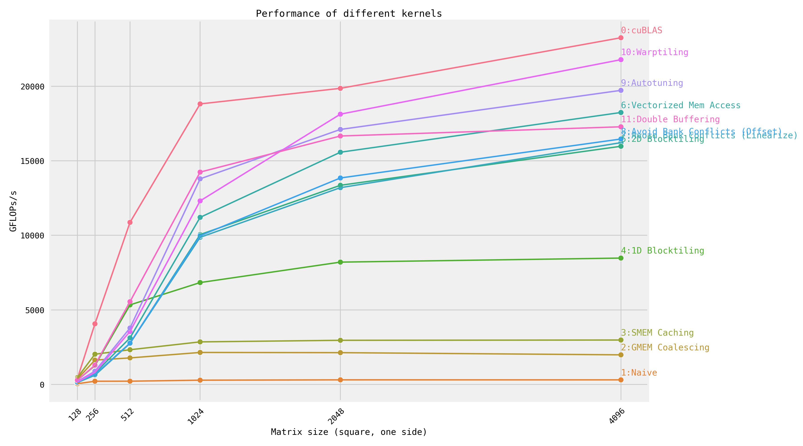

| Kernel | GFLOPs/s | 相对 cuBLAS |
| :--- | ---: | :--- |
| 7: Avoid Bank Conflicts (Linearize) | `16213.4` | 69.7% |
| 8: Avoid Bank Conflicts (Offset) | `16459.2` | 70.8% |
| 11: Double Buffering | `17278.3` | 74.3% |

> **【初学者加注】**  
> 读这张表时抓住两件事：
> 1. **前几步涨得最快。** Naive → 合并访存，大约 6×；再加 1D/2D tiling，又是数倍。这就是「80% 的收益来自少数几个众所周知的优化」。
> 2. **最后 20% 非常贵。** 从 78% 到 94% 花了自动调参 + warptiling，原文后来说又花了四个周末。这是高性能计算里典型的幂律。

---

## Kernel 1：朴素实现

CUDA 编程模型把计算组织成**三层**：

- 每次从 Host 启动一个 kernel，会创建一个 **grid**；
- grid 由多个 **block** 组成；
- 每个 block 最多 1024 个 **thread**。

同一 block 里的线程可以访问同一块 **共享内存（SMEM）**。

> **【原文边注 5】**  
> 这些上限可以在 [CUDA Programming Guide 的 compute capabilities](https://docs.nvidia.com/cuda/cuda-c-programming-guide/index.html#compute-capabilities) 里查到。

block 内的线程数用 `blockDim` 配置，它是一个三维整型向量，分别指定 `blockDim.x / y / z`：

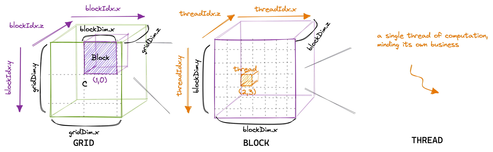

grid 里有多少个 block，则由 `gridDim` 配置。从 host 启动 kernel 时，会创建一个 grid，其中的 block 和 thread 数量就是你指定的那些。

> **【原文边注 6】**  
> 加速器术语里，**host** 指 CPU，**device** 指加速器，这里就是 GPU。

> **【原文边注 7】**  
> 后文只讨论 2D 的 grid 和 block。一是 3D 结构很少用，二是 3D 图画起来太难。

要记住：刚才这套层次主要管**正确性**。后面会看到，为了性能，**不能把同一 block 里的线程都当成平等的个体**——硬件真正调度的单位是 warp。

第一个 kernel 的想法极简单：用 grid / block / thread 给结果矩阵 $C$ 的每个元素分配**恰好一个线程**。该线程计算 $A$ 对应行和 $B$ 对应列的点积，写回 $C$。因为每个位置只被一个线程写，所以不需要同步。

启动方式如下：

```cpp
// 创建足够多的 block，覆盖整个 C
dim3 gridDim(CEIL_DIV(M, 32), CEIL_DIV(N, 32), 1);
// 32 * 32 = 1024 threads per block
dim3 blockDim(32, 32, 1);
// 在 device 上异步启动 kernel；这个调用在 host 上立刻返回
sgemm_naive<<<gridDim, blockDim>>>(M, N, K, alpha, A, B, beta, C);
```

> **【初学者加注】**  
> `<<<gridDim, blockDim>>>` 是 CUDA 的 kernel 启动语法，不是普通 C++。  
> `CEIL_DIV(M, 32)` 的意思是「把 M 个元素按 32 一份向上取整」：`((M)+(32)-1)/32`。如果 $M$ 不是 32 的倍数，最后一排 block 会有一部分线程越界，所以 kernel 里必须有 `if (x < M && y < N)`。  
> 启动是**异步**的：CPU 发出「请 GPU 去算」之后立刻继续往下走，不会傻等。要拿结果必须 `cudaDeviceSynchronize()` 或用 CUDA Event。

CUDA 代码是从**单个线程的视角**写的。kernel 里读 `blockIdx` 和 `threadIdx` 这两个内建变量，不同线程会读到不同的值。

> **【原文边注 8】**  
> 本例中 `threadIdx.x` 和 `threadIdx.y` 随线程在 block 中的位置从 0 变到 31。`blockIdx.x / y` 则随该线程所在 block 在 grid 中的位置，从 0 变到 `CEIL_DIV(N, 32)` 或 `CEIL_DIV(M, 32)`。

> **【原文边注 9】**  
> 后文会大量按 stride 去索引内存中的矩阵。Edward Yang 的 [PyTorch Internals](http://blog.ezyang.com/2019/05/pytorch-internals/) 对 strided tensor 有很好的解释。

### 原文中的朴素 kernel

```cuda
__global__ void sgemm_naive(int M, int N, int K, float alpha, const float *A,
                            const float *B, float beta, float *C) {
  // 计算本线程负责的 C 的位置
  const uint x = blockIdx.x * blockDim.x + threadIdx.x;
  const uint y = blockIdx.y * blockDim.y + threadIdx.y;

  // 当 M 或 N 不是 32 的倍数时，这个 if 是必须的
  if (x < M && y < N) {
    float tmp = 0.0;
    for (int i = 0; i < K; ++i) {
      tmp += A[x * K + i] * B[i * N + y];
    }
    // C = α*(A@B)+β*C
    C[x * N + y] = alpha * tmp + beta * C[x * N + y];
  }
}
```

可视化如下：

> **【原文边注 10】**  
> 如果矩阵尺寸不能被 block 尺寸整除，就要多启动一些 block 处理余数。比如下图会创建 9 个同样大小的 block，但只有 4 个能把 1024 个线程全部用满。这种边角浪费叫 [tile quantization](https://docs.nvidia.com/deeplearning/performance/dl-performance-matrix-multiplication/index.html#tile-quant)。只要用固定大小的 tile 去覆盖可变大小的输入，就会出现。
>
> 


这个 kernel 在作者的 A6000 上，处理三个 $4092^2$ 的 fp32 矩阵大约要 0.5 秒。

> **【初学者加注】**  
> 图里红色小格子是一个线程负责的 $C_{xy}$。它要扫完 $A$ 的一整行（长度 $K$）和 $B$ 的一整列（长度 $K$）。  
> 注意仓库实现里的索引：`A[x * K + i]`、`B[i * N + y]`、`C[x * N + y]`。这是把 `x` 当行、`y` 当列的 **row-major** 公式。社区里有人指出这和 CUDA 编程指南示例里「`threadIdx.x` 对应列」的习惯不完全一致，也和 cuBLAS 默认的 column-major 不同。读代码时不要死记「x 一定是列」，以实际下标公式为准。相关讨论见 [Issue #15](https://github.com/siboehm/SGEMM_CUDA/issues/15)。

### 仓库完整实现

来源：[`src/kernels/1_naive.cuh`](https://github.com/siboehm/SGEMM_CUDA/blob/master/src/kernels/1_naive.cuh)

```cuda
#pragma once

#include <cstdio>
#include <cstdlib>
#include <cublas_v2.h>
#include <cuda_runtime.h>

/*
Matrix sizes:
MxK * KxN = MxN
*/

__global__ void sgemm_naive(int M, int N, int K, float alpha, const float *A,
                            const float *B, float beta, float *C) {
  const uint x = blockIdx.x * blockDim.x + threadIdx.x;
  const uint y = blockIdx.y * blockDim.y + threadIdx.y;

  // if statement is necessary to make things work under tile quantization
  if (x < M && y < N) {
    float tmp = 0.0;
    for (int i = 0; i < K; ++i) {
      tmp += A[x * K + i] * B[i * N + y];
    }
    // C = α*(A@B)+β*C
    C[x * N + y] = alpha * tmp + beta * C[x * N + y];
  }
}
```

启动代码来自 [`src/runner.cu`](https://github.com/siboehm/SGEMM_CUDA/blob/master/src/runner.cu)：

```cpp
void run_sgemm_naive(int M, int N, int K, float alpha, float *A, float *B,
                     float beta, float *C) {
  dim3 gridDim(CEIL_DIV(M, 32), CEIL_DIV(N, 32));
  dim3 blockDim(32, 32);
  sgemm_naive<<<gridDim, blockDim>>>(M, N, K, alpha, A, B, beta, C);
}
```

### 最快运行时间的下界

对两个 $4092^2$ 矩阵相乘，再加一个 $4092^2$ 矩阵（构成 [GEMM](https://en.wikipedia.org/wiki/Basic_Linear_Algebra_Subprograms#Level_3)）：

1. 总 FLOPS：`2*4092³ + 4092² = 137 GFLOPS`
2. 最少需要读的数据：`3 * 4092² * 4B = 201MB`
3. 需要写回的数据：`4092² * 4B = 67MB`

> **【原文边注 11】**  
> $C$ 的每个元素都要对两个长度为 4092 的向量做点积，每一步一次乘、一次加。「先乘后加」经常映射成一条 FMA，但仍算两次 FLOP。

所以任何实现至少要从/向 GPU **全局内存**搬运 268MB（假设缓存够大）。

> **【原文边注 12】**  
> 全局内存是 GPU 的主存。NVIDIA 宣传「80GB 显存、1TB/s 带宽」时，说的就是全局内存的容量和带宽。后面还会谈到共享内存等物理上完全不同、性能特征也完全不同的区域。

> **【原文边注 13】**  
> cuBLAS 整个计算过程只从 GMEM 读了约 500MB。后面会看到，提高算术强度才能把访存量压到这么低。

来算一下性能上界。A6000 标称 30 TFLOPs/s 的 fp32 算力和 768 GB/s 的全局内存带宽。如果真能跑满：

- 计算需要 4.5 ms
- 内存搬运需要 0.34 ms

> **【原文边注 14】**  
> 提醒：峰值 FLOPs 是一个很粗糙的指标，它取决于指令组合。如果你的浮点运算是 DIV，不可能摸到 30 TFLOPs。但矩阵乘主要用 FMA，而 FMA 往往是最快的那种 FLOP，所以我们有机会接近峰值。

> **【原文边注 15】**  
> 带宽同理：只有访存模式匹配硬件时，才能摸到峰值带宽。

草稿纸结论：计算大约比访存慢 10 倍。因此，**只要最终搬运的内存不超过最少 278MB 的 10 倍，最终优化后的 kernel 就会是计算瓶颈（compute-bound）**。

> **【原文边注 16】**  
> A6000 的 Tensor Core 标称 309 TFLOPs/s。如果 fp32 矩阵乘也能用 Tensor Core，计算只需 0.44 ms，一个优化过的 $4092^2$ kernel 几乎肯定仍是内存瓶颈。这能让人直观感受到 Tensor Core 有多快。

> **【初学者加注】**  
> 这就是 **Roofline 模型** 的朴素版本：
> - 算法有一个「算术强度」= FLOP 数 / 字节数。
> - 机器有一条「屋顶」：左边被带宽限制（memory-bound），右边被算力限制（compute-bound）。  
    > Naive kernel 每个输出都反复从全局内存读整行整列，算术强度极低，所以会远远低于 30 TFLOPs。我们后面所有优化，本质上都是：**让读进来的每个字节被重复使用更多次**。

### 朴素 kernel 的访存模式

同一 block 里 ThreadId 为 $(0,0)$ 和 $(0,1)$ 的两个线程，会加载 **同一列 $B$**、**不同行 $A$**。  
若假设最坏情况——完全没有缓存——则每个线程要从全局内存加载 `2*4092+1` 个 float。总共 $4092^2$ 个线程，访存量高达 **548 GB**。

下图以红色线程 A 和绿色线程 B 为例：

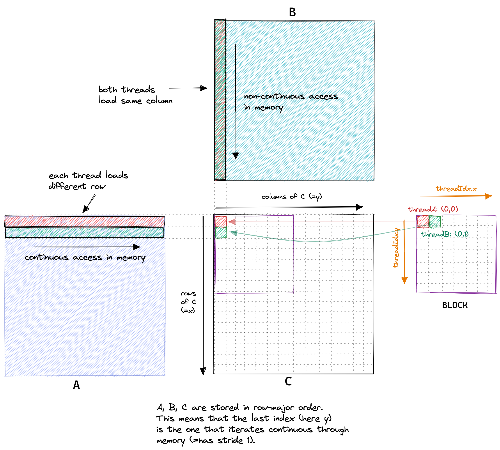

在 A6000 上，这个 kernel 乘两个 $4092\times 4092$ 的 float32 矩阵大约只有 **300 GFLOPs**。考虑到 A6000 标称接近 30 TFLOPs，这非常糟糕。

> **【原文边注 17】**  
> 对比一下：300 GFLOPs 大约等于作者[上一篇 CPU 矩阵乘文章](https://siboehm.com/articles/22/Fast-MMM-on-CPU)里，2015 年 Haswell CPU 上优化过的 BLAS 的水平。

如何开始加速？一条路是优化访存模式，让全局内存访问能够被**合并（coalesce）**成更少的事务。

---

## Kernel 2：全局内存合并访存

在讲合并访存之前，必须先认识 **warp**。

block 里的线程在执行时会被分成 warp，每个 warp **32 个线程**。warp 被交给 **warp scheduler**（物理上的调度/执行核心）。每个 SM 有四个 warp scheduler。

分组依据是连续的 `threadId`。如果 `blockDim` 是多维的，线性 threadId 这样算：

```
threadId = threadIdx.x + blockDim.x * (threadIdx.y + blockDim.y * threadIdx.z)
```

`threadId` 相邻的线程进入同一个 warp。下图用「warp 大小 = 8」来示意（真实 warp 永远是 32）：

> **【原文边注 18】**  
> Volta 之前，一个 warp 里的所有线程来自同一条指令流。遇到分支时，没走该分支的线程用 active mask 关掉。Volta 之后，不能再依赖这种「warp-synchronous」行为：同一 warp 内，不同分支的指令甚至可能交错执行。

> **【原文边注 19】**  
> 我喜欢把 `threadId` 的三维 `x,y,z` 想成「列主序」，因为第一维 `x` 在「warp 空间」里是连续的。不知道别人用不用这个词，但对我很有帮助。

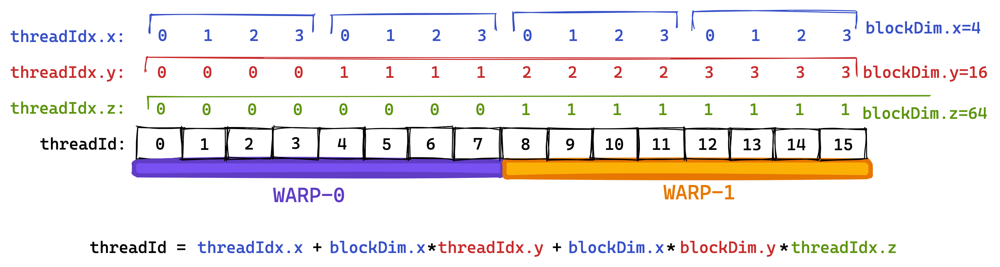

warp 之所以和本 kernel 有关，是因为：**同一 warp 内线程对连续地址的访存，可以被合并成一次事务**。这就是 **global memory coalescing**。它是把 GMEM 访存推向峰值带宽时，最重要的一件事。

下例中，同一 warp 的连续访存被合并，8 次访问只需 2 次 32B load：

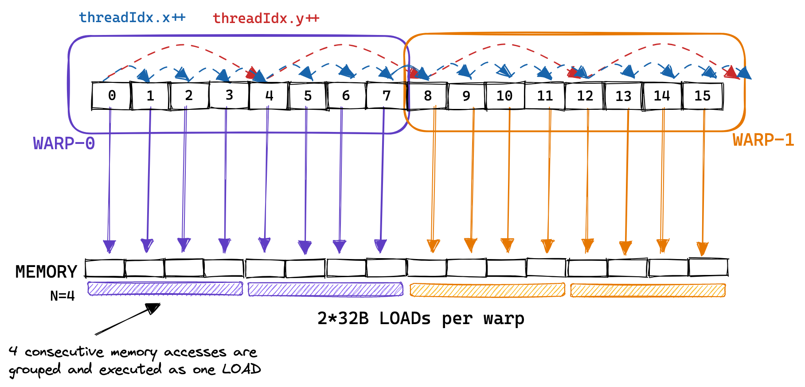

实际硬件支持 32B、64B、128B 的内存事务。若每个线程从全局内存读一个 32-bit float，warp scheduler（大概是 MIO）可以把这次 `32*4B=128B` 的负载合并成**一次事务**。前提是：这些 float 在内存中连续，并且访问对齐。

> **【原文边注 20】**  
> 优化 GPU 合并访存，和优化 CPU 的 cache line 利用率非常像。有趣的是：warp 内线程必须访问连续地址才能合并，但**这些访问在 warp 内部不必按线程号顺序**。如下图：
>
> 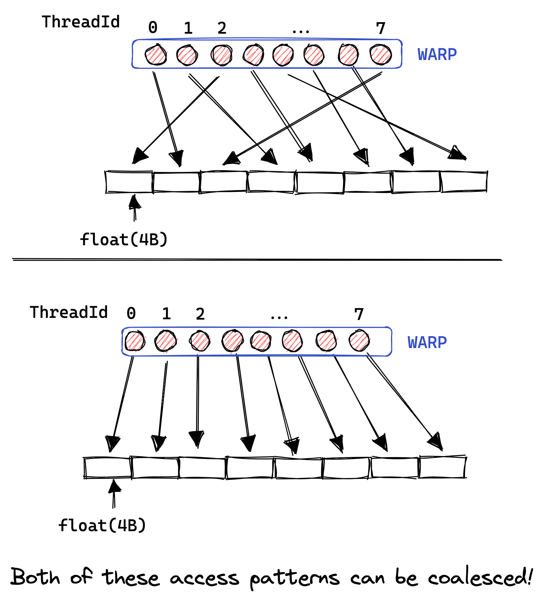

若不连续或因其它原因无法合并，GPU 会发出尽可能多的 32B load 去把 float 取齐，带宽大量浪费。  
Profiling 朴素 kernel 时，GMEM 吞吐只有 **15 GB/s**，就是非合并访问的恶果。

回头看上一版，线程被这样映射到 $C$ 的元素：

```cuda
const uint x = blockIdx.x * blockDim.x + threadIdx.x;
const uint y = blockIdx.y * blockDim.y + threadIdx.y;
```

因此同一 warp 的线程（`threadIdx.x` 连续）从内存里**非连续地**加载 $A$ 的行。朴素 kernel 访问 $A$ 更像这样：

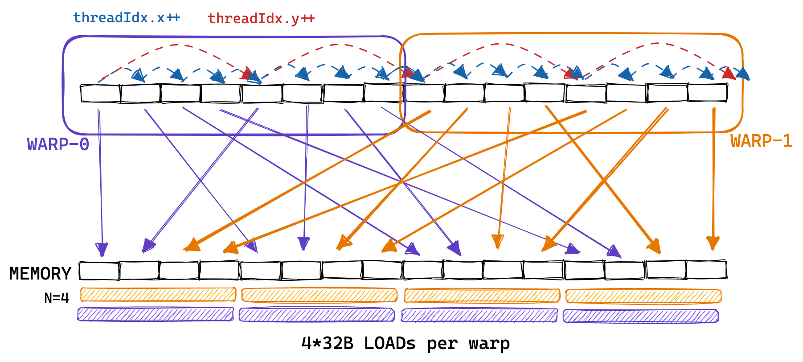

要启用合并，只需改变「哪个线程负责 $C$ 的哪个位置」。改变后的全局访存模式如下：

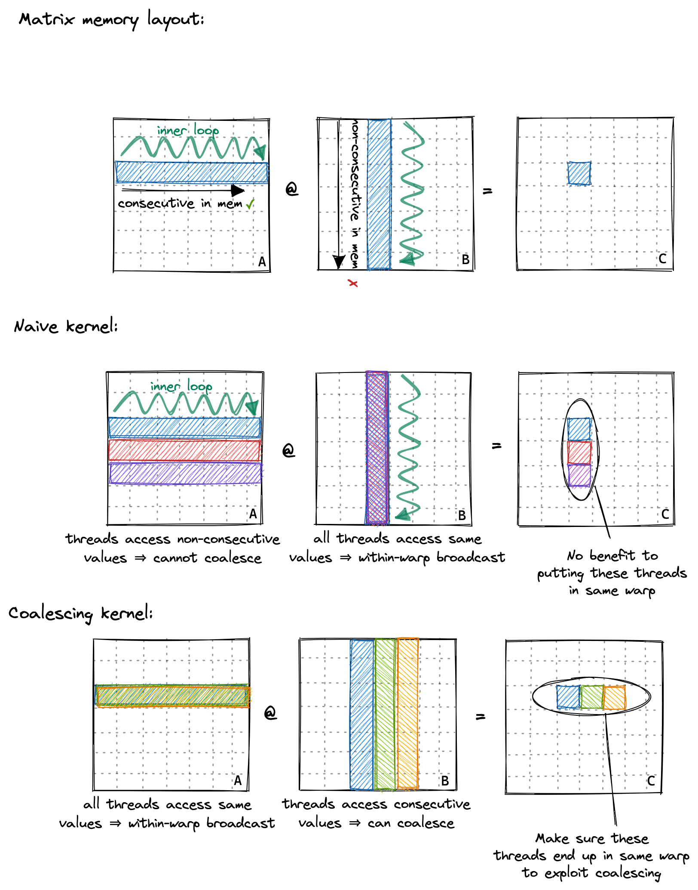

实现上只改头两行，并把 block 改成一维：

```cuda
const int x = blockIdx.x * BLOCKSIZE + (threadIdx.x / BLOCKSIZE);
const int y = blockIdx.y * BLOCKSIZE + (threadIdx.x % BLOCKSIZE);

if (x < M && y < N) {
  float tmp = 0.0;
  for (int i = 0; i < K; ++i) {
    tmp += A[x * K + i] * B[i * N + y];
  }
  C[x * N + y] = alpha * tmp + beta * C[x * N + y];
}
```

启动：

```cpp
// gridDim 不变
dim3 gridDim(CEIL_DIV(M, 32), CEIL_DIV(N, 32));
// blockDim 改成一维，线程总数不变
dim3 blockDim(32 * 32);
sgemm_coalescing<<<gridDim, blockDim>>>(M, N, K, alpha, A, B, beta, C);
```

> **【原文边注 21】**  
> 这一点我一开始没立刻意识到：启用 GMEM coalescing **不会改变汇编**（SASS 在 Godbolt 上可以看到）。合并是 kernel **运行时由硬件**完成的。这说得通，因为合并需要对齐访问，而矩阵指针是函数参数，编译期无法保证。另外：尽管循环次数 `K` 编译期未知，汇编里内层循环仍被部分展开。有意思。

合并访存把内存吞吐从 15 GB/s 提升到 **110 GB/s**。性能达到 **2000 GFLOPS**，相对朴素 kernel 的 300 GFLOPS 是一次巨大提升。  
下一步，我们要用 GPU 片上的快速内存——共享内存——来缓存会被重复使用的数据。

> **【初学者加注】**  
> 用一句人话记住 coalescing：  
> **「同一个 warp 的 32 个线程，最好去访问内存里挨在一起的 32 个 float。」**
>
> 为什么原来不行？因为 `threadIdx.x` 连续的线程，在 2D `blockDim(32,32)` 下是同一行里相邻的 x，却被拿去当「行号」，于是他们读 $B$ 时步长是整行宽度 $N$，每次都跳很远。  
> 改成一维 `threadIdx.x` 之后：
> - `threadIdx.x % 32` → 列号（连续）
> - `threadIdx.x / 32` → 行号（同一个 warp 内不变）  
    > 于是 32 个线程同时读 $B$ 的同一行里连续 32 列，硬件就能合成一次 128B 事务。  
    > $A$ 的同一行会被整个 warp 广播式地重复读，这正好能吃 cache。

### 仓库完整实现

来源：[`src/kernels/2_kernel_global_mem_coalesce.cuh`](https://github.com/siboehm/SGEMM_CUDA/blob/master/src/kernels/2_kernel_global_mem_coalesce.cuh)

```cuda
#pragma once

#include <cassert>
#include <cstdio>
#include <cstdlib>
#include <cublas_v2.h>
#include <cuda_runtime.h>

template <const uint BLOCKSIZE>
__global__ void sgemm_global_mem_coalesce(int M, int N, int K, float alpha,
                                          const float *A, const float *B,
                                          float beta, float *C) {
  const int cRow = blockIdx.x * BLOCKSIZE + (threadIdx.x / BLOCKSIZE);
  const int cCol = blockIdx.y * BLOCKSIZE + (threadIdx.x % BLOCKSIZE);

  // if statement is necessary to make things work under tile quantization
  if (cRow < M && cCol < N) {
    float tmp = 0.0;
    for (int i = 0; i < K; ++i) {
      tmp += A[cRow * K + i] * B[i * N + cCol];
    }
    C[cRow * N + cCol] = alpha * tmp + beta * C[cRow * N + cCol];
  }
}
```

```cpp
void run_sgemm_coalesce(int M, int N, int K, float alpha, float *A, float *B,
                        float beta, float *C) {
  dim3 gridDim(CEIL_DIV(M, 32), CEIL_DIV(N, 32));
  dim3 blockDim(32 * 32);
  sgemm_global_mem_coalesce<32>
      <<<gridDim, blockDim>>>(M, N, K, alpha, A, B, beta, C);
}
```

注意仓库里用模板参数 `BLOCKSIZE=32`，并把输出坐标命名为 `cRow` / `cCol`，和原文片段里的 `x` / `y` 是同一件事。

---

## Kernel 3：共享内存 Cache-Blocking

除了巨大的全局内存，GPU 还有一块物理上位于芯片上的小得多的内存，叫 **共享内存（SMEM）**。物理上每个 SM 有一份共享内存。

> **【原文边注 22】**  
> 下面是 A100 内存层次的示意图（[来源](https://developer.nvidia.com/blog/cuda-refresher-cuda-programming-model/)）：
>
> 

逻辑上，这份共享内存被划分给各个 block。因此，一个线程可以通过共享内存和**同一 block 内的其它线程**通信。在 A6000 上，每个 block 最多 48KB 共享内存。

> **【原文边注 23】**  
> SMEM 容量可配置：用更大的共享内存换更小的 L1。细节见 [compute capability 文档](https://docs.nvidia.com/cuda/cuda-c-programming-guide/index.html#compute-capability-8-x)。也可以用动态共享内存让单个 block 用超过 48KB。

共享内存在片上，延迟更低、带宽更高。作者没找到 Ampere 的好基准，但 2017 年 Volta 的[这篇论文](https://arxiv.org/abs/1804.06826)给出：全局内存约 750 GiB/s，共享内存约 **12,080 GiB/s**。

> **【原文边注 24】**  
> 这些数字看起来从 Volta 到现在没变太多。NVIDIA 给 A6000（Ampere）报的最大 GMEM 带宽也大约是 750 GB/s。

本 kernel 的做法：从全局内存把 $A$ 的一块和 $B$ 的一块搬进共享内存，然后在这两块上做尽可能多的计算。每个线程仍然只负责 $C$ 的一个元素。我们沿着 $A$ 的列方向、$B$ 的行方向移动这些块，对 $C$ 做部分和，直到算完。

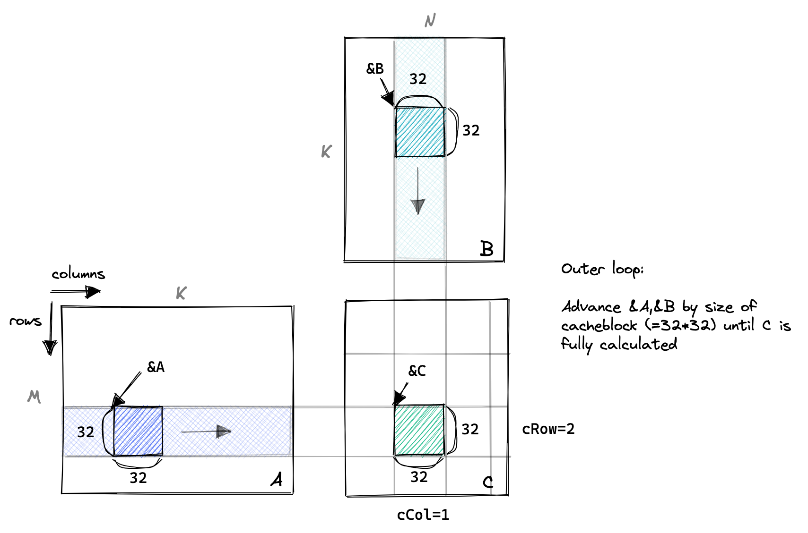

关键代码如下，变量名与上图对应：

> **【原文边注 25】**  
> 一般来说，我没有把代码写成对任意 $M,N,K$ 都正确，因为边界检查会引入大量杂讯，也没什么意思。为了保证正确，我会用随机数据和几种矩阵尺寸，对照 cuBLAS 测试。

```cuda
// 把指针推进到本 block 负责的起始位置
A += cRow * BLOCKSIZE * K;                    // row=cRow, col=0
B += cCol * BLOCKSIZE;                        // row=0, col=cCol
C += cRow * BLOCKSIZE * N + cCol * BLOCKSIZE; // row=cRow, col=cCol

float tmp = 0.0;
// 外层循环沿 A 的列、B 的行推进，直到把 C 算完
for (int bkIdx = 0; bkIdx < K; bkIdx += BLOCKSIZE) {
  // 每个线程从 GMEM 搬一个 A 元素、一个 B 元素进 SMEM
  // 让 threadCol (=threadIdx.x) 作为连续下标，以便合并访存
  As[threadRow * BLOCKSIZE + threadCol] = A[threadRow * K + threadCol];
  Bs[threadRow * BLOCKSIZE + threadCol] = B[threadRow * N + threadCol];

  // 等整个 block 把 cache 填满
  __syncthreads();

  // 指针迈向下一块
  A += BLOCKSIZE;
  B += BLOCKSIZE * N;

  // 在当前缓存块上做点积
  for (int dotIdx = 0; dotIdx < BLOCKSIZE; ++dotIdx) {
    tmp += As[threadRow * BLOCKSIZE + dotIdx] *
            Bs[dotIdx * BLOCKSIZE + threadCol];
  }
  // 结尾还要再同步一次，避免快线程把下一块搬进来时，慢线程还在用旧数据
  __syncthreads();
}
C[threadRow * N + threadCol] =
    alpha * tmp + beta * C[threadRow * N + threadCol];
```

这个 kernel 达到约 **2200 GFLOPS**，比上一版快 50%。

> **【原文边注 26】**  
> 只有 50%，部分是因为上一版已经有相当不错的 L1 hit rate。

我们离 GPU 能提供的 ~30 TFLOPs 还很远。从下面的 roofline 图可以一眼看出来：

> **【原文边注 27】**  
> 注意我们达到的内存带宽比 cuBLAS 还高。但因为每个从内存加载的字节上做的计算更少（算术强度更低），总体性能反而更差。

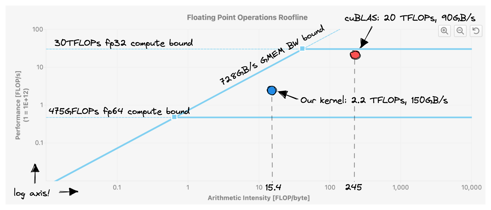

CHUNKSIZE=32 时，共享内存用量是 `2*32*32*4B=8KB`。

> **【原文边注 28】**  
> 这个信息也可以用 `--ptxas-options=-v` 编译得到：`Used 37 registers, 8192 bytes smem, 400 bytes cmem[0]`。

A6000 每个 block 最多 48KB SMEM，我们离上限还很远。这不一定是问题，因为提高每 block 的 SMEM 用量有副作用。每个 SM 最多 100KB SMEM。如果改 kernel 用满 48KB，每个 SM 同时只能驻留两个 block。用 CUDA 的话说：提高每 block 的 SMEM 用量可能降低 [occupancy](https://docs.nvidia.com/cuda/cuda-c-best-practices-guide/index.html#occupancy)。

**Occupancy** = 每个 SM 上活跃 warp 数 / 该 SM 允许的最大活跃 warp 数。

高 occupancy 有用，因为它让我们有更大的「可发射指令池」，从而掩盖操作的高延迟。

> **【原文边注 29】**  
> GPU 上 FMA 延迟约 4 个周期，在 1.5 GHz 下等于 2.6 ns。对比近期 x86：FMA 6 周期延迟，3.5 GHz 下约 1.8 ns。

限制一个 SM 能同时装下多少活跃 block 的，主要有三样：寄存器数量、warp 数量、SMEM 容量。下面用当前 kernel 做一次计算。

> **【初学者加注】**  
> `__syncthreads()` 是 **block 内屏障**：block 里所有线程都要走到这里，才能一起继续。  
> 为什么要两次？
> - 第一次：保证 `As`/`Bs` 已经填好，再开始算。
> - 第二次：保证所有人用完当前块，再覆盖成下一块。  
    > 如果漏掉第二次，快线程会把下一轮数据写进 SMEM，慢线程还在用旧下标读，结果就错了。
>
> 这个算法的本质是教材里的 **tiled GEMM**：把大矩阵切成 $32\times 32$ 的小块，沿 $K$ 维一块块滑过去。每一小块被整个 block 共享，于是 $A$ 的一行不再被 32 个线程各从 GMEM 读 32 遍，而是进 SMEM 之后大家一起用。

### Kernel 3 的占用率计算

下面是作者 GPU 的相关硬件参数，来自 `cudaGetDeviceProperties`（Multiprocessor 就是前面说的 SM）：

> **【原文边注 30】**  
> 共享内存大小可通过 `SharedMemoryCarveout` 配置。所谓 unified data cache 被划分成 L1 和共享内存，所以可以用更少 SMEM 换更多 L1。

| Metric | Value |
| :--- | :--- |
| Name | NVIDIA RTX A6000 |
| Compute Capability | 8.6 |
| max threads per block | 1024 |
| max threads per multiprocessor | 1536 |
| threads per warp | 32 |
| warp allocation granularity | 4 |
| max regs per block | 65536 |
| max regs per multiprocessor | 65536 |
| reg allocation unit size | 256 |
| reg allocation granularity | warp |
| total global mem | 48685 MB |
| max shared mem per block | 48 KB |
| CUDA runtime shared mem overhead per block | 1024 B |
| shared mem per multiprocessor | 102400 B |
| multiprocessor count | 84 |
| max warps per multiprocessor | 48 |

本 kernel 的资源需求：

| 资源 | 用量 |
| :--- | ---: |
| Registers per Thread | 37 |
| SMEM per Block | 8192 B |
| Threads per Block | 1024 |

工作以 **block 粒度**调度到 SM 上。只要资源还够，SM 就会再装更多 block。

> **【原文边注 31】**  
> 我找到很多官方和非官方 occupancy 计算器，但没有官方公式。结果是对的（用 NVIDIA 官方工具核对过），但取整方式可能有小误差。

- **共享内存：** 8192B/Block + 1024B/Block（CUDA runtime）= 9216B/Block。$102400 / 9216 = 11.11$ ⇒ 上限 **11 个 block**。
- **线程：** 每 block 1024 线程，每 SM 最多 1536 ⇒ 上限 **1 个 block**。
- **寄存器：** 37 regs/thread × 32 threads/warp = 1184 regs/warp。寄存器按 warp 以 256 为粒度分配，向上取整到 1280 regs/warp。每 block 有 $1024/32=32$ 个 warp，故 $1280\times 32=40960$ regs/block。每 SM 最多 65536 ⇒ 上限 **1 个 block**。

> **【原文边注 32】**  
> 意外的是：寄存器文件比共享内存还大！每 block 最多 48 KB SMEM，但寄存器有 $65536\times 4B = 262$ KB。

因此本 kernel 被「每 block 线程数」和「每线程寄存器数」卡住，每个 SM 只能装 1 个 block，最终 occupancy = $32 / 48 = 66\%$。

66% 并不算差，所以这还解释不了为什么这么慢。

> **【原文边注 33】**  
> 观察 cuBLAS 能达到约 245 FLOPs/Byte，可知 kernel 可以被优化到很高的算术强度（AI）。在非常高或非常低的 AI 下，并不需要很高 occupancy 就能摸到峰值吞吐。细节见 [V. Volkov 的博士论文](https://www2.eecs.berkeley.edu/Pubs/TechRpts/2016/EECS-2016-143.pdf) 以及它对 “cusp behaviour” 的讨论：
>
> 

看 profiler 能得到一些线索。先看执行指令的组成，大部分居然是内存加载：

> **【原文边注 34】**  
> `LDS` 是共享内存加载。`FMA` 是融合乘加。`IADD3` 是三输入整数加，用来沿 K 维移动指针。


内层循环的 PTX 长这样（原文有 Godbolt 链接）：

```c
ld.shared.f32   %f91, [%r8+3456];
ld.shared.f32   %f92, [%r7+108];
fma.rn.f32      %f93, %f92, %f91, %f90;
```

这不好。内存加载的延迟必然高于一条简单 FMA，而我们知道这个 kernel **本应是计算瓶颈**。  
再看 profiler 对 warp 状态的采样——每个已执行指令平均在各状态下花费多少周期：

> **【原文边注 35】**  
> `Stall Not Selected` 表示该 warp 有资格被调度，但调度器选了另一个合格 warp。这支持我们前面的判断：occupancy 目前不是问题。

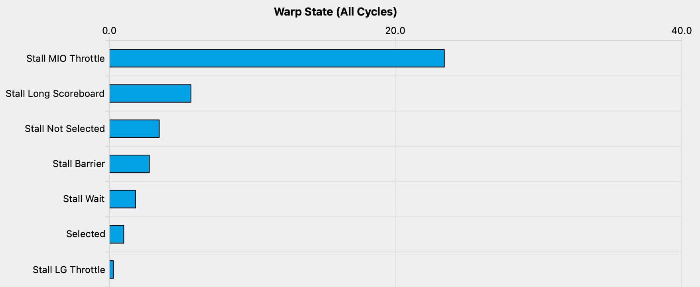

各状态含义见 [Kernel Profiling Guide](https://docs.nvidia.com/nsight-compute/ProfilingGuide/index.html#metrics-reference)。对 `Stall MIO Throttle` 的说明是：

> Warp was stalled waiting for the MIO (memory input/output) instruction queue to be not full. This stall reason is high in cases of extreme utilization of the MIO pipelines, which include special math instructions, dynamic branches, as well as shared memory instructions.

我们没用特殊数学指令，也没有动态分支，所以显然是在等 **SMEM 访问返回**。  
如何让 kernel 少发 SMEM 指令？一个办法是让每个线程计算**不止一个**输出元素，从而把更多工作放在寄存器里，少依赖 SMEM。

### 仓库完整实现

来源：[`src/kernels/3_kernel_shared_mem_blocking.cuh`](https://github.com/siboehm/SGEMM_CUDA/blob/master/src/kernels/3_kernel_shared_mem_blocking.cuh)

```cuda
#pragma once

#include <algorithm>
#include <cstdio>
#include <cstdlib>
#include <cublas_v2.h>
#include <cuda_runtime.h>

#define CEIL_DIV(M, N) (((M) + (N)-1) / (N))

template <const int BLOCKSIZE>
__global__ void sgemm_shared_mem_block(int M, int N, int K, float alpha,
                                       const float *A, const float *B,
                                       float beta, float *C) {
  // the output block that we want to compute in this threadblock
  const uint cRow = blockIdx.x;
  const uint cCol = blockIdx.y;

  // allocate buffer for current block in fast shared mem
  // shared mem is shared between all threads in a block
  __shared__ float As[BLOCKSIZE * BLOCKSIZE];
  __shared__ float Bs[BLOCKSIZE * BLOCKSIZE];

  // the inner row & col that we're accessing in this thread
  const uint threadCol = threadIdx.x % BLOCKSIZE;
  const uint threadRow = threadIdx.x / BLOCKSIZE;

  // advance pointers to the starting positions
  A += cRow * BLOCKSIZE * K;                    // row=cRow, col=0
  B += cCol * BLOCKSIZE;                        // row=0, col=cCol
  C += cRow * BLOCKSIZE * N + cCol * BLOCKSIZE; // row=cRow, col=cCol

  float tmp = 0.0;
  for (int bkIdx = 0; bkIdx < K; bkIdx += BLOCKSIZE) {
    // Have each thread load one of the elements in A & B
    // Make the threadCol (=threadIdx.x) the consecutive index
    // to allow global memory access coalescing
    As[threadRow * BLOCKSIZE + threadCol] = A[threadRow * K + threadCol];
    Bs[threadRow * BLOCKSIZE + threadCol] = B[threadRow * N + threadCol];

    // block threads in this block until cache is fully populated
    __syncthreads();
    A += BLOCKSIZE;
    B += BLOCKSIZE * N;

    // execute the dotproduct on the currently cached block
    for (int dotIdx = 0; dotIdx < BLOCKSIZE; ++dotIdx) {
      tmp += As[threadRow * BLOCKSIZE + dotIdx] *
             Bs[dotIdx * BLOCKSIZE + threadCol];
    }
    // need to sync again at the end, to avoid faster threads
    // fetching the next block into the cache before slower threads are done
    __syncthreads();
  }
  C[threadRow * N + threadCol] =
      alpha * tmp + beta * C[threadRow * N + threadCol];
}
```

```cpp
void run_sgemm_shared_mem_block(int M, int N, int K, float alpha, float *A,
                                float *B, float beta, float *C) {
  dim3 gridDim(CEIL_DIV(M, 32), CEIL_DIV(N, 32));
  dim3 blockDim(32 * 32);
  // L1 cache becomes useless, since we access GMEM only via SMEM, so we carve
  // out all of L1 to SMEM. This doesn't currently make a difference, since
  // occupancy is limited by reg and thread count, but it's good to do anyway.
  cudaFuncSetAttribute(sgemm_shared_mem_block<32>,
                       cudaFuncAttributePreferredSharedMemoryCarveout,
                       cudaSharedmemCarveoutMaxShared);
  sgemm_shared_mem_block<32>
      <<<gridDim, blockDim>>>(M, N, K, alpha, A, B, beta, C);
}
```

> **【初学者加注】**  
> `cudaFuncSetAttribute(..., cudaSharedmemCarveoutMaxShared)` 的意思是：反正 GMEM 都经由 SMEM 走，L1 没什么用了，把 unified cache 尽量划给 SMEM。原文注释也说，当前 occupancy 被寄存器和线程数卡住，这一步暂时没带来差异，但习惯上仍值得做。

---

## Kernel 4：一维 Blocktiling，每线程计算多个结果

下一个 kernel 和上一版类似，但多了一层内循环：每个线程计算 $C$ 的多个元素。  
SMEM 缓存大小变为 `BM*BK + BN*BK = 64*8 + 64*8 = 1024` 个 float，每 block 共 4KB。

下图高亮了两个线程以及它们在内层循环中访问的值（橙、红）。

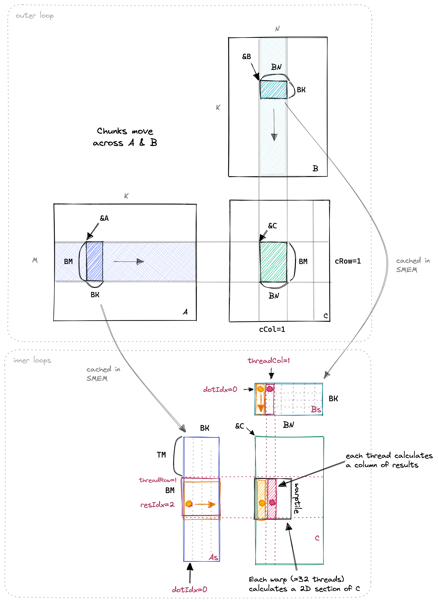

重要变化都发生在内层循环。GMEM→SMEM 的加载大体不变：

```c++
// 在寄存器文件里给本线程的结果开一块本地缓存
float threadResults[TM] = {0.0};

// 外层循环扫过各个 block tile
for (uint bkIdx = 0; bkIdx < K; bkIdx += BK) {
  // 填充 SMEM（和以前一样）
  As[innerRowA * BK + innerColA] = A[innerRowA * K + innerColA];
  Bs[innerRowB * BN + innerColB] = B[innerRowB * N + innerColB];
  __syncthreads();

  // 外层循环推进 blocktile
  A += BK;
  B += BK * N;

  // 计算本线程的多个结果
  for (uint dotIdx = 0; dotIdx < BK; ++dotIdx) {
    // 把点积循环放在外层，便于复用 Bs 的同一个元素，把它缓存在临时变量里
    float Btmp = Bs[dotIdx * BN + threadCol];
    for (uint resIdx = 0; resIdx < TM; ++resIdx) {
      threadResults[resIdx] +=
          As[(threadRow * TM + resIdx) * BK + dotIdx] * Btmp;
    }
  }
  __syncthreads();
}
```

这个 kernel 达到约 **8600 GFLOPs**，比上一版快 2.2×。

上一版每个线程只算 1 个结果时的访存：

- GMEM：外层循环 $K/32$ 次 × 2 次加载
- SMEM：外层循环 $K/32$ 次 × BLOCKSIZE(=32) × 2 次加载
- **每个结果：** $K/16$ 次 GMEM，$K\times 2$ 次 SMEM

本版每个线程算 8 个结果：

- GMEM：外层循环 $K/8$ 次 × 2 次加载
- SMEM：外层循环 $K/8$ 次 × BK(=8) × (1 + TM(=8))
- **每个结果：** $K/32$ 次 GMEM，$K\times 9/8$ 次 SMEM

果然，因内存压力而 stall 的周期显著变少：

> **【原文边注 37】**  
> 小心：坐标轴和上一张图不一样了。

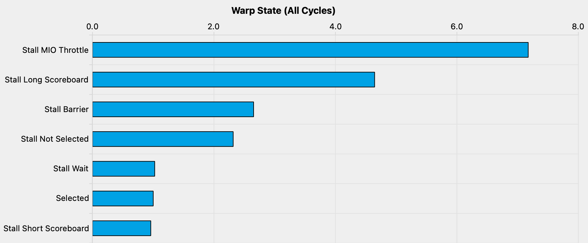

> **【初学者加注】**  
> 为什么「每线程多算几个」会快这么多？  
> 看橙色线程：它要算同一列上的 TM=8 个 $C$ 元素。这 8 个元素**共用 $B$ 的同一个值**，只是 $A$ 的行不同。于是 `Btmp` 从 SMEM 读一次，就能乘 8 次。  
> 这就是在寄存器里做 **1D tiling**。寄存器是每个线程私有的、最快的存储。把热点数据留在寄存器，SMEM 指令就会变少，MIO 队列就不会堵死。

### 关于编译器优化的边注

上面我们显式把 $B$ 的元素缓存在 `Btmp`，并重排了两层内循环。如果不这么做：

```c++
for (uint resIdx = 0; resIdx < TM; ++resIdx) {
  for (uint dotIdx = 0; dotIdx < BK; ++dotIdx) {
    threadResults[resIdx] +=
      As[(threadRow * TM + resIdx) * BK + dotIdx] * Bs[dotIdx * BN + threadCol];
  }
}
```

有趣的是，这对性能没有负面影响。这很意外，因为现在两层内循环会产生 BK(=8)×TM(=8)×2 = **128** 次 SMEM 访问，而不是之前的 72 次。

看汇编就明白了：编译器把两层循环都展开，然后消掉了对 `Bs` 的重复 SMEM 加载，最终 SMEM 次数和我们手写优化版一样。

> **【原文边注 38】**  
> 编译器能展开，是因为循环次数在编译期已知（它们是模板常量）。

当 PTX 再被编译成 SASS 时，从 `Bs` 的 SMEM 加载还会被向量化：

> **【原文边注 39】**  
> 这已经在暗示后面的优化：把 `As` 转置，以便那些加载也能向量化。

```c
LDS     R26, [R35.X4+0x800] // 从 As 做一次 32b 加载
LDS.128 R8,  [R2]           // 从 Bs 做一次 128b 加载
LDS.128 R12, [R2+0x20]
LDS     R24, [R35.X4+0x900]
LDS.128 R20, [R2+0x60]
LDS     R36, [R35.X4+0xb00]
LDS.128 R16, [R2+0x40]
LDS.128 R4,  [R2+0x80]
LDS     R38, [R35.X4+0xd00]
```

### 改进方向：算术强度

当前 kernel 仍有和 Kernel 3 一样的「等内存」问题，只是程度轻一些。所以我们再做一次同样的优化：每线程算更多结果。这能让 kernel 更快的主要原因是它提高了**算术强度**。

> **【原文边注 40】**  
> 算术强度 = 执行的 FLOP 数 / GMEM 与 SMEM 之间传输的字节数（加载 + 存储！）。

下图更直观地说明：为什么每线程多算结果能提高算术强度。

> **【原文边注 41】**  
> 每线程算「一块正方形结果」比算「一列结果」更高效，因为输入可以共享得更多：
>
> 

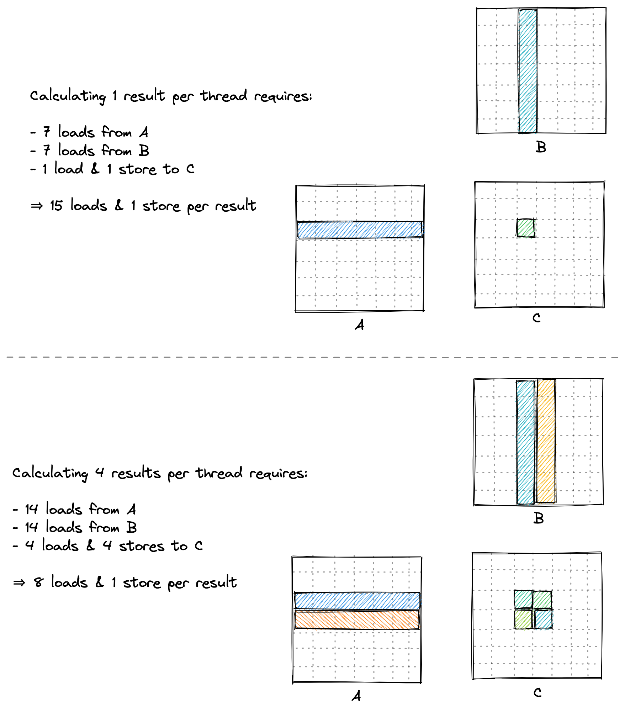

结论：所有 kernel 的 FLOP 数相同，但可以通过每线程多算结果来减少 GMEM 访问。只要还是 memory-bound，我们就继续朝这个方向优化。

### 仓库完整实现

来源：[`src/kernels/4_kernel_1D_blocktiling.cuh`](https://github.com/siboehm/SGEMM_CUDA/blob/master/src/kernels/4_kernel_1D_blocktiling.cuh)

```cuda
#pragma once

#include <algorithm>
#include <cassert>
#include <cstdio>
#include <cstdlib>
#include <cublas_v2.h>
#include <cuda_runtime.h>

#define CEIL_DIV(M, N) (((M) + (N)-1) / (N))

template <const int BM, const int BN, const int BK, const int TM>
__global__ void sgemm1DBlocktiling(int M, int N, int K, float alpha,
                                   const float *A, const float *B, float beta,
                                   float *C) {
  // If we flip x and y here we get ~30% less performance for large matrices.
  // The current, 30% faster configuration ensures that blocks with sequential
  // blockIDs access columns of B sequentially, while sharing the same row of A.
  // The slower configuration would share columns of A, but access into B would
  // be non-sequential. So the faster configuration has better spatial locality
  // and hence a greater L2 hit rate.
  const uint cRow = blockIdx.y;
  const uint cCol = blockIdx.x;

  // each warp will calculate 32*TM elements, with 32 being the columnar dim.
  const int threadCol = threadIdx.x % BN;
  const int threadRow = threadIdx.x / BN;

  // allocate space for the current blocktile in SMEM
  __shared__ float As[BM * BK];
  __shared__ float Bs[BK * BN];

  // Move blocktile to beginning of A's row and B's column
  A += cRow * BM * K;
  B += cCol * BN;
  C += cRow * BM * N + cCol * BN;

  // todo: adjust this to each thread to load multiple entries and
  // better exploit the cache sizes
  assert(BM * BK == blockDim.x);
  assert(BN * BK == blockDim.x);
  const uint innerColA = threadIdx.x % BK; // warp-level GMEM coalescing
  const uint innerRowA = threadIdx.x / BK;
  const uint innerColB = threadIdx.x % BN; // warp-level GMEM coalescing
  const uint innerRowB = threadIdx.x / BN;

  // allocate thread-local cache for results in registerfile
  float threadResults[TM] = {0.0};

  // outer loop over block tiles
  for (uint bkIdx = 0; bkIdx < K; bkIdx += BK) {
    // populate the SMEM caches
    As[innerRowA * BK + innerColA] = A[innerRowA * K + innerColA];
    Bs[innerRowB * BN + innerColB] = B[innerRowB * N + innerColB];
    __syncthreads();

    // advance blocktile
    A += BK;
    B += BK * N;

    // calculate per-thread results
    for (uint dotIdx = 0; dotIdx < BK; ++dotIdx) {
      // we make the dotproduct loop the outside loop, which facilitates
      // reuse of the Bs entry, which we can cache in a tmp var.
      float tmpB = Bs[dotIdx * BN + threadCol];
      for (uint resIdx = 0; resIdx < TM; ++resIdx) {
        threadResults[resIdx] +=
            As[(threadRow * TM + resIdx) * BK + dotIdx] * tmpB;
      }
    }
    __syncthreads();
  }

  // write out the results
  for (uint resIdx = 0; resIdx < TM; ++resIdx) {
    C[(threadRow * TM + resIdx) * N + threadCol] =
        alpha * threadResults[resIdx] +
        beta * C[(threadRow * TM + resIdx) * N + threadCol];
  }
}
```

```cpp
void runSgemm1DBlocktiling(int M, int N, int K, float alpha, float *A, float *B,
                           float beta, float *C) {
  const uint BM = 64;
  const uint BN = 64;
  const uint BK = 8;
  const uint TM = 8;
  dim3 gridDim(CEIL_DIV(N, BN), CEIL_DIV(M, BM));
  dim3 blockDim((BM * BN) / TM);
  sgemm1DBlocktiling<BM, BN, BK, TM>
      <<<gridDim, blockDim>>>(M, N, K, alpha, A, B, beta, C);
}
```

> **【初学者加注】**  
> 仓库注释里有一句很值钱的话：若把 `blockIdx.x/y` 对调，大矩阵会慢约 30%。原因是 L2 局部性——连续 `blockIdx` 最好沿着 $B$ 的列顺序走（$B$ 是行主序时，同一行的相邻列在内存里连续），同时共享 $A$ 的同一行。
>
> 模板参数的读法：
> - `BM, BN`：本 block 负责的 $C$ 子块高和宽（64×64）
> - `BK`：每次沿 $K$ 维切多厚（8）
> - `TM`：每个线程沿 M 方向算几个结果（8）
> - 线程数 = $(BM \times BN)/TM = 512$
>
> `assert(BM * BK == blockDim.x)` 的含义：填充 `As` 时，刚好一人搬一个元素。这是一种简单的加载方案，后面 2D tiling 里线程数不再等于 SMEM 元素数，就要循环加载多次。

---

## Kernel 5：用二维 Blocktiling 继续提高算术强度

Kernel 5 的基本想法：每个线程计算 $C$ 上 $8\times 8$ 的一块。  
第一阶段，所有线程合作填满 SMEM。每个线程会加载多个元素：

> **【原文边注 42】**  
> GMEM 加载的图形表示：
>
> 

```c++
for (uint loadOffset = 0; loadOffset < BM; loadOffset += strideA) {
  As[(innerRowA + loadOffset) * BK + innerColA] =
      A[(innerRowA + loadOffset) * K + innerColA];
}
for (uint loadOffset = 0; loadOffset < BK; loadOffset += strideB) {
  Bs[(innerRowB + loadOffset) * BN + innerColB] =
      B[(innerRowB + loadOffset) * N + innerColB];
}
__syncthreads();
```

SMEM 填好之后，每个线程把相关 SMEM 条目相乘，累加到本地寄存器。  
下图画出了（未变的）沿输入矩阵的外层循环，以及点积、`TN`、`TM` 三维内层循环：

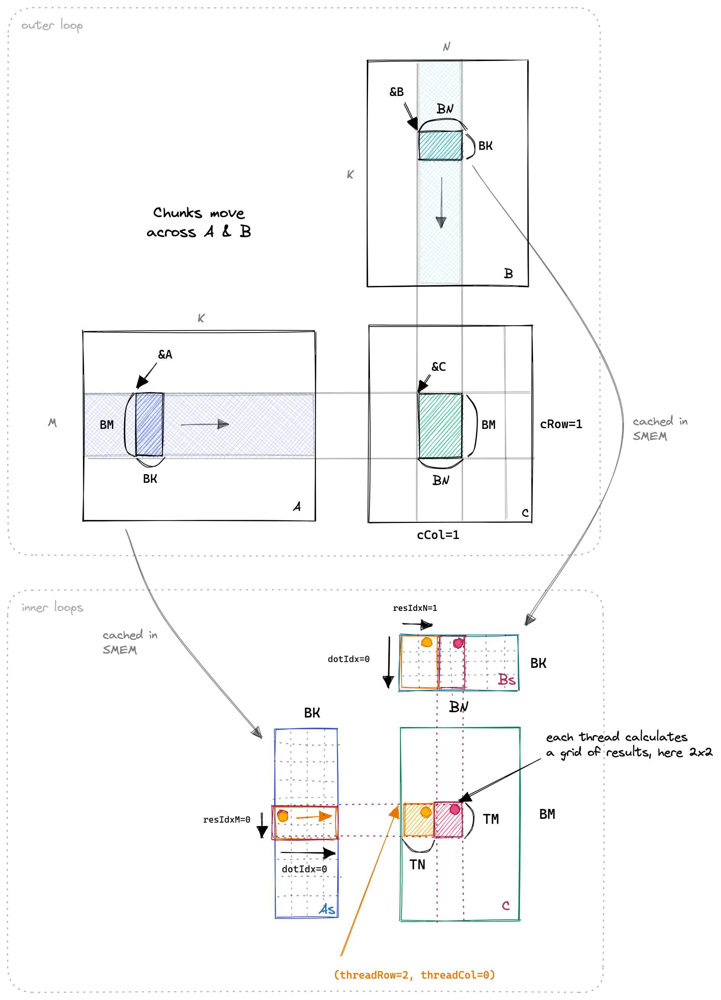

有意思的部分如下：

```c++
// 寄存器文件里缓存本线程的全部结果
float threadResults[TM * TN] = {0.0};
// As、Bs 的寄存器缓存
float regM[TM] = {0.0};
float regN[TN] = {0.0};

// 最外层：沿 K 维滑动 block tile
for (uint bkIdx = 0; bkIdx < K; bkIdx += BK) {
  // 填充 SMEM
  for (uint loadOffset = 0; loadOffset < BM; loadOffset += strideA) {
    As[(innerRowA + loadOffset) * BK + innerColA] =
        A[(innerRowA + loadOffset) * K + innerColA];
  }
  for (uint loadOffset = 0; loadOffset < BK; loadOffset += strideB) {
    Bs[(innerRowB + loadOffset) * BN + innerColB] =
        B[(innerRowB + loadOffset) * N + innerColB];
  }
  __syncthreads();

  // 推进 blocktile
  A += BK;     // A 向右移 BK 列
  B += BK * N; // B 向下移 BK 行

  // 计算本线程结果
  for (uint dotIdx = 0; dotIdx < BK; ++dotIdx) {
    // 把当前要用的 As、Bs 装进寄存器
    for (uint i = 0; i < TM; ++i) {
      regM[i] = As[(threadRow * TM + i) * BK + dotIdx];
    }
    for (uint i = 0; i < TN; ++i) {
      regN[i] = Bs[dotIdx * BN + threadCol * TN + i];
    }
    // 在寄存器缓存上做外积，累加进 threadResults
    for (uint resIdxM = 0; resIdxM < TM; ++resIdxM) {
      for (uint resIdxN = 0; resIdxN < TN; ++resIdxN) {
        threadResults[resIdxM * TN + resIdxN] +=
            regM[resIdxM] * regN[resIdxN];
      }
    }
  }
  __syncthreads();
}
```

内层循环里，把 `dotIdx` 放到最外，并显式把两层内循环需要的值装进寄存器，可以减少 SMEM 访问。  
下图按时间画出 `dotIdx` 循环，看每一步哪些 SMEM 条目被装进线程私有寄存器：

> **【原文边注 44】**  
> 为了好画，缩小了一些维度。kernel 里实际是 `BK=TM=TN=8`。

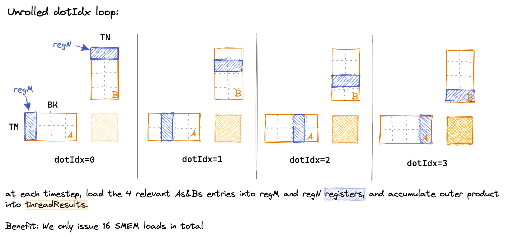

结果：**16 TFLOPs**，又快了约 2×。  
再算一遍访存。现在每线程算 `TM*TN = 8*8 = 64` 个结果：

- GMEM：$K/8$（外层次数）× 2（A+B）× $1024/256$（SMEM 大小 / 线程数）次加载
- SMEM：$K/8$ × 8（dotIdx）× 2（A+B）× 8 次加载
- **每个结果：** $K/64$ 次 GMEM，$K/4$ 次 SMEM

性能开始像样了，但因内存流水线拥堵造成的 warp stall 仍然太频繁。Kernel 6 会采取两个措施：转置 `As` 以启用 SMEM 加载的自动向量化，以及向编译器承诺 GMEM 访问是对齐的。

> **【初学者加注】**  
> 把 Kernel 4 的「一列」扩成「一块正方形」，是 GEMM 优化里最重要的几何直觉：
>
> - 算 8 个点（1D）：每次 FMA 需要 8 个 A 和 1 个 B，共 9 次 SMEM。
> - 算 64 个点（2D）：每次 FMA 需要 8 个 A 和 8 个 B，共 16 次 SMEM，但做了 64 次乘加。
>
> 算术强度大约从「每次 SMEM 换 8 次 FMA」变成「每次 SMEM 换 4 次 FMA 再乘上更大的复用」——原文的计算是每结果 SMEM 从 $K\times 9/8$ 降到 $K/4$。
>
> `regM[TM]` × `regN[TN]` 的双重循环就是在寄存器里做 **外积（outer product）**：一根长度为 TM 的列向量乘一根长度为 TN 的行向量，得到 TM×TN 的小矩阵。CUTLASS / Tensor Core 的 MMA 指令，做的也是这个外积，只是换成了硬件矩阵单元。

### 仓库完整实现

来源：[`src/kernels/5_kernel_2D_blocktiling.cuh`](https://github.com/siboehm/SGEMM_CUDA/blob/master/src/kernels/5_kernel_2D_blocktiling.cuh)

```cuda
#pragma once

#include <algorithm>
#include <cassert>
#include <cstdio>
#include <cstdlib>
#include <cublas_v2.h>
#include <cuda_runtime.h>

#define CEIL_DIV(M, N) (((M) + (N)-1) / (N))

template <const int BM, const int BN, const int BK, const int TM, const int TN>
__global__ void __launch_bounds__((BM * BN) / (TM * TN), 1)
    sgemm2DBlocktiling(int M, int N, int K, float alpha, const float *A,
                       const float *B, float beta, float *C) {
  const uint cRow = blockIdx.y;
  const uint cCol = blockIdx.x;

  const uint totalResultsBlocktile = BM * BN;
  // A thread is responsible for calculating TM*TN elements in the blocktile
  const uint numThreadsBlocktile = totalResultsBlocktile / (TM * TN);

  // ResultsPerBlock / ResultsPerThread == ThreadsPerBlock
  assert(numThreadsBlocktile == blockDim.x);

  // BN/TN are the number of threads to span a column
  const int threadCol = threadIdx.x % (BN / TN);
  const int threadRow = threadIdx.x / (BN / TN);

  // allocate space for the current blocktile in smem
  __shared__ float As[BM * BK];
  __shared__ float Bs[BK * BN];

  // Move blocktile to beginning of A's row and B's column
  A += cRow * BM * K;
  B += cCol * BN;
  C += cRow * BM * N + cCol * BN;

  // calculating the indices that this thread will load into SMEM
  const uint innerRowA = threadIdx.x / BK;
  const uint innerColA = threadIdx.x % BK;
  // calculates the number of rows of As that are being loaded in a single step
  // by a single block
  const uint strideA = numThreadsBlocktile / BK;
  const uint innerRowB = threadIdx.x / BN;
  const uint innerColB = threadIdx.x % BN;
  // for both As and Bs we want each load to span the full column-width, for
  // better GMEM coalescing (as opposed to spanning full row-width and iterating
  // across columns)
  const uint strideB = numThreadsBlocktile / BN;

  // allocate thread-local cache for results in registerfile
  float threadResults[TM * TN] = {0.0};
  // register caches for As and Bs
  float regM[TM] = {0.0};
  float regN[TN] = {0.0};

  // outer-most loop over block tiles
  for (uint bkIdx = 0; bkIdx < K; bkIdx += BK) {
    // populate the SMEM caches
    for (uint loadOffset = 0; loadOffset < BM; loadOffset += strideA) {
      As[(innerRowA + loadOffset) * BK + innerColA] =
          A[(innerRowA + loadOffset) * K + innerColA];
    }
    for (uint loadOffset = 0; loadOffset < BK; loadOffset += strideB) {
      Bs[(innerRowB + loadOffset) * BN + innerColB] =
          B[(innerRowB + loadOffset) * N + innerColB];
    }
    __syncthreads();

    // advance blocktile
    A += BK;     // move BK columns to right
    B += BK * N; // move BK rows down

    // calculate per-thread results
    for (uint dotIdx = 0; dotIdx < BK; ++dotIdx) {
      // block into registers
      for (uint i = 0; i < TM; ++i) {
        regM[i] = As[(threadRow * TM + i) * BK + dotIdx];
      }
      for (uint i = 0; i < TN; ++i) {
        regN[i] = Bs[dotIdx * BN + threadCol * TN + i];
      }
      for (uint resIdxM = 0; resIdxM < TM; ++resIdxM) {
        for (uint resIdxN = 0; resIdxN < TN; ++resIdxN) {
          threadResults[resIdxM * TN + resIdxN] +=
              regM[resIdxM] * regN[resIdxN];
        }
      }
    }
    __syncthreads();
  }

  // write out the results
  for (uint resIdxM = 0; resIdxM < TM; ++resIdxM) {
    for (uint resIdxN = 0; resIdxN < TN; ++resIdxN) {
      C[(threadRow * TM + resIdxM) * N + threadCol * TN + resIdxN] =
          alpha * threadResults[resIdxM * TN + resIdxN] +
          beta * C[(threadRow * TM + resIdxM) * N + threadCol * TN + resIdxN];
    }
  }
}
```

```cpp
void runSgemm2DBlocktiling(int M, int N, int K, float alpha, float *A, float *B,
                           float beta, float *C) {
  const uint BK = 8;
  const uint TM = 8;
  const uint TN = 8;
  if (M >= 128 and N >= 128) {
    const uint BM = 128;
    const uint BN = 128;
    dim3 gridDim(CEIL_DIV(N, BN), CEIL_DIV(M, BM));
    dim3 blockDim((BM * BN) / (TM * TN));
    sgemm2DBlocktiling<BM, BN, BK, TM, TN>
        <<<gridDim, blockDim>>>(M, N, K, alpha, A, B, beta, C);
  } else {
    // this is a hacky solution to the underlying problem
    // of not having proper bounds checking in the kernel
    const uint BM = 64;
    const uint BN = 64;
    dim3 gridDim(CEIL_DIV(N, BN), CEIL_DIV(M, BM));
    dim3 blockDim((BM * BN) / (TM * TN));
    sgemm2DBlocktiling<BM, BN, BK, TM, TN>
        <<<gridDim, blockDim>>>(M, N, K, alpha, A, B, beta, C);
  }
}
```

> **【初学者加注】**  
> `__launch_bounds__((BM*BN)/(TM*TN), 1)` 告诉编译器：这个 kernel 每 block 的线程数，以及希望每个 SM 至少驻留 1 个 block。编译器可能因此少分配寄存器。  
> 小矩阵走 `BM=BN=64` 是因为 kernel 几乎没有边界检查；硬用 128 会读到矩阵外面。原文边注 25 已经承认这一点。

---

## Kernel 6：向量化 SMEM 和 GMEM 访问

第一个优化前文已经暗示过：把 `As` **转置**。这样从 `As` 加载时可以使用向量化的 SMEM load（SASS 里的 `LDS.128`）。  
下面是和 Kernel 5 相同的三层内循环示意，但 `As` 在内存中已经转置：

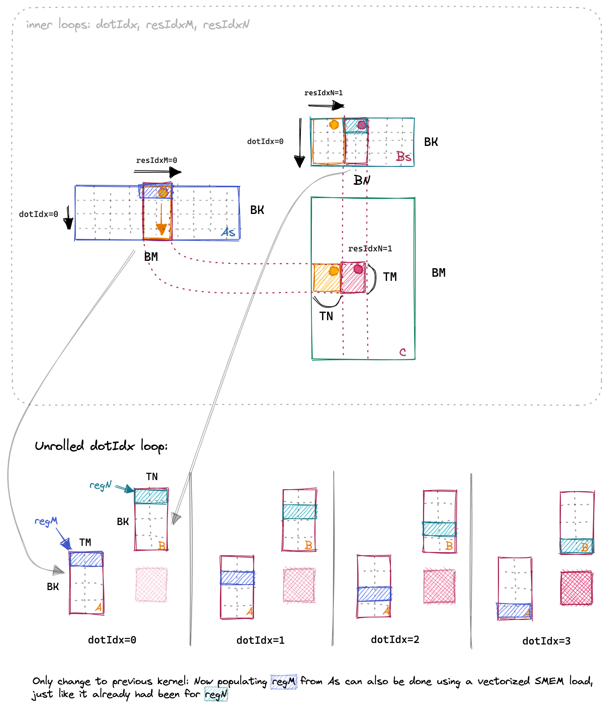

看汇编会发现：把 `As` 装进寄存器，以前是 32b 的 `LDS`，现在也变成 128b 的 `LDS.128`，和 `Bs` 已经享有的待遇一样。这带来约 **500 GFLOPs**、大约 3% 的加速。

下一步，用向量数据类型 `float4` 把所有 GMEM 的 load/store 向量化。参见 NVIDIA 的文章：[Increase Performance with Vectorized Memory Access](https://developer.nvidia.com/blog/cuda-pro-tip-increase-performance-with-vectorized-memory-access/)。

```c++
float4 tmp =
    reinterpret_cast<float4 *>(&A[innerRowA * K + innerColA * 4])[0];
// 在 GMEM→SMEM 传输时顺便转置 A
As[(innerColA * 4 + 0) * BM + innerRowA] = tmp.x;
As[(innerColA * 4 + 1) * BM + innerRowA] = tmp.y;
As[(innerColA * 4 + 2) * BM + innerRowA] = tmp.z;
As[(innerColA * 4 + 3) * BM + innerRowA] = tmp.w;

reinterpret_cast<float4 *>(&Bs[innerRowB * BN + innerColB * 4])[0] =
    reinterpret_cast<float4 *>(&B[innerRowB * N + innerColB * 4])[0];
__syncthreads();
```

于是 32b 的 GMEM 指令（`LDG.E`、`STG.E`）被替换成 128b 的对应物（`LDG.E.128`、`STG.E.128`）。

作者一开始很困惑：为什么

```c++
reinterpret_cast<float4 *>(&Bs[innerRowB * BN + innerColB * 4])[0] =
    reinterpret_cast<float4 *>(&B[innerRowB * N + innerColB * 4])[0];
```

会比手工展开（或 `#pragma unroll`）更快：

```c++
Bs[innerRowB * BN + innerColB * 4 + 0] = B[innerRowB * N + innerColB * 4 + 0];
Bs[innerRowB * BN + innerColB * 4 + 1] = B[innerRowB * N + innerColB * 4 + 1];
Bs[innerRowB * BN + innerColB * 4 + 2] = B[innerRowB * N + innerColB * 4 + 2];
Bs[innerRowB * BN + innerColB * 4 + 3] = B[innerRowB * N + innerColB * 4 + 3];
```

编译器难道不能自己把第二种合并成 128b load 吗？  
作者的判断是：编译器无法验证传入 kernel 的 `float* B` **是 128b 对齐的**，而这是使用 `LDG.E.128` 的前提。`reinterpret_cast` 的唯一目的，就是向编译器承诺：这个指针是对齐的。

> **【原文边注 47】**  
> 对比 SMEM 加载：那里编译器会自动生成向量化 load，因为那块内存不是用户从外面传进来的。

Kernel 6 达到 **19 TFLOPs**。  
Profiler 仍显示一堆问题：共享内存 bank conflict（cuBLAS 避开了）、occupancy 高于必要值、还没做 double buffering（[CUTLASS 文档](https://github.com/NVIDIA/cutlass/blob/master/media/docs/efficient_gemm.md#pipelining)认为这很有用）。

但在处理这些之前，先摘一个更低垂的果实：对 kernel 参数做自动调参。

> **【初学者加注】**  
> **为什么转置 `As`？**  
> Kernel 5 里，每个 `dotIdx` 要从 `As` 取「同一列上连续 TM=8 个元素」。若 `As` 按行存放（`As[row * BK + col]`），同一列的元素步长是 `BK`，硬件只能一次取 32 bit。转置成 `As[col * BM + row]` 后，这 8 个元素在内存里连续，一次 `LDS.128` 就能取 4 个 float，两次就够 8 个。
>
> **`float4` 是什么？** 四个 float 绑在一起，共 16 字节。GPU 的全局内存事务天然喜欢 16 字节（128 bit）。用 `float4` 等于明确告诉硬件：「请按 128 bit 来」。
>
> 转置发生在 **GMEM→SMEM 的路上**：从全局内存按行连续读 `float4`（合并访存友好），写进 SMEM 时拆开放到转置后的位置。读是向量化的，写是四个标量；后面计算阶段再享受向量化的 SMEM 读。这是一次划算的交换。

### 仓库完整实现

来源：[`src/kernels/6_kernel_vectorize.cuh`](https://github.com/siboehm/SGEMM_CUDA/blob/master/src/kernels/6_kernel_vectorize.cuh)

```cuda
#pragma once

#include <algorithm>
#include <cassert>
#include <cstdio>
#include <cstdlib>
#include <cublas_v2.h>
#include <cuda_runtime.h>

#define CEIL_DIV(M, N) (((M) + (N)-1) / (N))

template <const int BM, const int BN, const int BK, const int TM, const int TN>
__global__ void sgemmVectorize(int M, int N, int K, float alpha, float *A,
                               float *B, float beta, float *C) {
  const uint cRow = blockIdx.y;
  const uint cCol = blockIdx.x;

  // BN/TN are the number of threads to span a column
  const int threadCol = threadIdx.x % (BN / TN);
  const int threadRow = threadIdx.x / (BN / TN);

  // allocate space for the current blocktile in smem
  __shared__ float As[BM * BK];
  __shared__ float Bs[BK * BN];

  // Move blocktile to beginning of A's row and B's column
  A += cRow * BM * K;
  B += cCol * BN;
  C += cRow * BM * N + cCol * BN;

  // calculating the indices that this thread will load into SMEM
  // we'll load 128bit / 32bit = 4 elements per thread at each step
  const uint innerRowA = threadIdx.x / (BK / 4);
  const uint innerColA = threadIdx.x % (BK / 4);
  const uint innerRowB = threadIdx.x / (BN / 4);
  const uint innerColB = threadIdx.x % (BN / 4);

  // allocate thread-local cache for results in registerfile
  float threadResults[TM * TN] = {0.0};
  float regM[TM] = {0.0};
  float regN[TN] = {0.0};

  // outer-most loop over block tiles
  for (uint bkIdx = 0; bkIdx < K; bkIdx += BK) {
    // populate the SMEM caches
    // transpose A while loading it
    float4 tmp =
        reinterpret_cast<float4 *>(&A[innerRowA * K + innerColA * 4])[0];
    As[(innerColA * 4 + 0) * BM + innerRowA] = tmp.x;
    As[(innerColA * 4 + 1) * BM + innerRowA] = tmp.y;
    As[(innerColA * 4 + 2) * BM + innerRowA] = tmp.z;
    As[(innerColA * 4 + 3) * BM + innerRowA] = tmp.w;

    reinterpret_cast<float4 *>(&Bs[innerRowB * BN + innerColB * 4])[0] =
        reinterpret_cast<float4 *>(&B[innerRowB * N + innerColB * 4])[0];
    __syncthreads();

    // advance blocktile
    A += BK;     // move BK columns to right
    B += BK * N; // move BK rows down

    // calculate per-thread results
    for (uint dotIdx = 0; dotIdx < BK; ++dotIdx) {
      // block into registers
      for (uint i = 0; i < TM; ++i) {
        regM[i] = As[dotIdx * BM + threadRow * TM + i];
      }
      for (uint i = 0; i < TN; ++i) {
        regN[i] = Bs[dotIdx * BN + threadCol * TN + i];
      }
      for (uint resIdxM = 0; resIdxM < TM; ++resIdxM) {
        for (uint resIdxN = 0; resIdxN < TN; ++resIdxN) {
          threadResults[resIdxM * TN + resIdxN] +=
              regM[resIdxM] * regN[resIdxN];
        }
      }
    }
    __syncthreads();
  }

  // write out the results
  for (uint resIdxM = 0; resIdxM < TM; resIdxM += 1) {
    for (uint resIdxN = 0; resIdxN < TN; resIdxN += 4) {
      // load C vector into registers
      float4 tmp = reinterpret_cast<float4 *>(
          &C[(threadRow * TM + resIdxM) * N + threadCol * TN + resIdxN])[0];
      // perform GEMM update in reg
      tmp.x = alpha * threadResults[resIdxM * TN + resIdxN] + beta * tmp.x;
      tmp.y = alpha * threadResults[resIdxM * TN + resIdxN + 1] + beta * tmp.y;
      tmp.z = alpha * threadResults[resIdxM * TN + resIdxN + 2] + beta * tmp.z;
      tmp.w = alpha * threadResults[resIdxM * TN + resIdxN + 3] + beta * tmp.w;
      // write back
      reinterpret_cast<float4 *>(
          &C[(threadRow * TM + resIdxM) * N + threadCol * TN + resIdxN])[0] =
          tmp;
    }
  }
}
```

写回 $C$ 时也用 `float4`：先把旧的 $C$ 向量读进寄存器，在寄存器里做 $\alpha\cdot\mathrm{acc}+\beta\cdot C$，再一次性写回。这既减少 store 次数，也保持合并访存。

---

## 原文跳过、仓库保留：Kernel 7 / 8（消除共享内存 Bank Conflict）

> **【原文边注 48】**  
> 我跳过了 Kernel 7 和 8。那是我在摸索如何最好地消除共享内存 bank conflict 时写的。它们确实消除了 conflict，但总体仍然更慢，所以正文不讲。

仓库基准：Kernel 7 为 16213 GFLOPs（69.7%），Kernel 8 为 16459 GFLOPs（70.8%），都低于 Kernel 6 的 18237 GFLOPs。所以「消除 conflict」本身是对的，但这两次尝试的布局变换伤害了向量化或增加了索引开销，得不偿失。

> **【初学者加注】**  
> **Bank conflict 是什么？**  
> 共享内存被分成 32 个 bank（刚好一个 warp 的宽度）。同一时刻，一个 warp 里如果有两个线程访问**同一个 bank 的不同地址**，访问就会被串行化，带宽减半、再减半……最坏变成 32 次。  
> 转置后的 `As` 以及按列取 `Bs`，很容易让 32 个线程踩在同一组 bank 上。  
> 常见修法有两种：
> 1. **改布局（linearize / swizzle）**：把数据按 XOR 或交错方式重排，让连续线程落到不同 bank。这是 Kernel 7。
> 2. **加 padding（extra column）**：每行多分配几列，破坏「下标 % 32 总撞车」的周期性。这是 Kernel 8，`extraCols = 5`。
>
> 为什么修完反而更慢？因为向量化的 `float4` 路径被打乱了，或 SMEM 变大影响 occupancy。cuBLAS/CUTLASS 用更精致的 swizzle，能在「无 conflict」和「仍能向量化」之间取得平衡。原文把这件事留到了「以后」。

### Kernel 7：线性化 Bs 的布局

来源：[`src/kernels/7_kernel_resolve_bank_conflicts.cuh`](https://github.com/siboehm/SGEMM_CUDA/blob/master/src/kernels/7_kernel_resolve_bank_conflicts.cuh)

核心差异在把 `Bs` 存进 SMEM 时做了重排：

```cuda
// "linearize" Bs while storing it
tmp = reinterpret_cast<float4 *>(&B[innerRowB * N + innerColB * 4])[0];
Bs[((innerColB % 2) * 4 + innerRowB * 8 + 0) * 16 + innerColB / 2] = tmp.x;
Bs[((innerColB % 2) * 4 + innerRowB * 8 + 1) * 16 + innerColB / 2] = tmp.y;
Bs[((innerColB % 2) * 4 + innerRowB * 8 + 2) * 16 + innerColB / 2] = tmp.z;
Bs[((innerColB % 2) * 4 + innerRowB * 8 + 3) * 16 + innerColB / 2] = tmp.w;
```

计算阶段对应地改为：

```cuda
regN[i] = Bs[(dotIdx * 8 + i) * 16 + threadCol];
```

完整文件见本目录 [`kernels/7_kernel_resolve_bank_conflicts.cuh`](kernels/7_kernel_resolve_bank_conflicts.cuh)。

### Kernel 8：给 Bs 加额外列

来源：[`src/kernels/8_kernel_bank_extra_col.cuh`](https://github.com/siboehm/SGEMM_CUDA/blob/master/src/kernels/8_kernel_bank_extra_col.cuh)

```cuda
const int extraCols = 5;
__shared__ float Bs[BK * (BN + extraCols)];
// ...
Bs[innerRowB * (BN + extraCols) + innerColB * 4 + 0] = tmp.x;
// ...
regN[i] = Bs[dotIdx * (BN + extraCols) + threadCol * TN + i];
```

完整文件见 [`kernels/8_kernel_bank_extra_col.cuh`](kernels/8_kernel_bank_extra_col.cuh)。

`runner.cu` 中两者的启动配置与 Kernel 6 相同：`BM=BN=128, BK=TM=TN=8`（小矩阵则 64）。

---

## Kernel 9：自动调参

到这里已经积累了五个模板参数：

- `BM`、`BN`、`BK`：从 GMEM 缓存进 SMEM 的块大小
- `TM`、`TN`：从 SMEM 缓存进寄存器的块大小

Kernel 6 用的是 `BM=BN=128`，`BK=TM=TN=8`。  
作者写了一个 bash 脚本，搜索所有「说得通」的组合并测时间。这要求：

1. 事先知道哪些组合是 sensible 的，跳过其它。
2. kernel 实现对剩下约 400 组超参都正确。

> **【原文边注 49】**  
> 不合理配置的例子：希望所有 SMEM 加载都向量化，因此 `BM * BK`（As 的大小）必须能被 `4 * NUM_THREADS` 整除——因为填充 GMEM→SMEM 时，每个线程每次发一次 4 宽加载。

必要的代码改动花了不少时间。

最优参数随 GPU 型号变化很大。

> **【原文边注 50】**  
> 大概这就是 [Triton](https://github.com/openai/triton) 这类编译器提供 autotune 例程的原因。不知道 cuBLAS 怎么做，他们大概在二进制里存了一张从 {GPU 型号, 矩阵尺寸, dtype, …} 到最优 GEMM 实现的预计算映射。

在 A6000 上，`BM=BN=128, BK=16, TM=TN=8` 把性能从 19 提到 **20 TFLOPs**，约 5%。  
在 A100 SXM4 40GB 上，同一组配置只有 12 TFLOPs，比调参器找到的最优（`BM=BN=64, BK=16, TM=TN=4` 的 12.6 TFLOPs）差 6%。

> **【原文边注 51】**  
> A100 的 fp32 比 A6000 弱，所以绝对 FLOPs 更低（cuBLAS 在 A100 上约 14.7 TFLOPs）。NVIDIA 给 A100 标 19.5 TFLOPs，A6000 标 38.7 TFLOPs。

作者无法解释为什么这几组参数就是最优。自动调参有效，所有高性能库都在用，但体验上很不满足。

> **【原文边注 52】**  
> 我确信：只要有足够时间、足够多的底层性能计数器、再和 NVIDIA 工程师坐一会儿，最终能搞懂。对「[计算机是可以被理解的](https://blog.nelhage.com/post/computers-can-be-understood/)」保持强烈信念是件好事。

> **【初学者加注】**  
> Autotune 不是玄学，它在搜索一个被硬件约束切开的离散空间：
> - SMEM 总量不能超过每 block / 每 SM 上限；
> - 线程数必须整除 tile；
> - 向量化要求尺寸是 4 的倍数；
> - 寄存器太多会降低 occupancy，太少则算不动 8×8 的累加器。  
    > `BK=8` 改成 `BK=16` 意味着每次从 GMEM 搬更厚的一块，外层循环次数减半，但 SMEM 翻倍。A6000 的 SMEM 和寄存器都比较宽裕，所以吃得下；A100 上更小的 `BM=BN=64, TM=TN=4` 反而更好——这就是「换卡就要重搜」的原因。

### 仓库完整实现

来源：[`src/kernels/9_kernel_autotuned.cuh`](https://github.com/siboehm/SGEMM_CUDA/blob/master/src/kernels/9_kernel_autotuned.cuh)

这个文件在 Kernel 6 的向量化基础上，允许一个线程跨越多个「16×TN / 16×TM」的子块（`WMITER` / `WNITER`），以便 `BM`、`BN` 大于单次 thread-tile 能覆盖的范围。完整源码见 [`kernels/9_kernel_autotuned.cuh`](kernels/9_kernel_autotuned.cuh)。启动配置：

```cpp
void runSgemmAutotuned(int M, int N, int K, float alpha, float *A, float *B,
                       float beta, float *C) {
  // A100
  // const uint K9_BK = 16;
  // const uint K9_TM = 4;
  // const uint K9_TN = 4;
  // const uint K9_BM = 64;
  // const uint K9_BN = 64;
  // A6000
  const uint K9_BK = 16;
  const uint K9_TM = 8;
  const uint K9_TN = 8;
  const uint K9_BM = 128;
  const uint K9_BN = 128;
  dim3 blockDim(K9_NUM_THREADS); // 256
  dim3 gridDim(CEIL_DIV(N, K9_BN), CEIL_DIV(M, K9_BM));
  sgemmAutotuned<K9_BM, K9_BN, K9_BK, K9_TM, K9_TN>
      <<<gridDim, blockDim>>>(M, N, K, alpha, A, B, beta, C);
}
```

文件里还有一组 `static_assert`，把「什么样的超参才合法」写成了编译期检查，这正是边注 49 说的那些约束。

---

## Kernel 10：Warptiling

当前循环结构是这样的：


现在在 blocktiling 和 threadtiling 之间再加一层：**warptiling**。  
Warptiling 一开始容易让人困惑，因为和 block、thread 不同，warp **不会在 CUDA 代码里显式出现**。它是硬件概念，在标量 CUDA 软件世界里没有直接对应物。  
一个线程的 warpId 可以算成 `warpId = threadIdx.x / warpSize`（原文写的是 `%`，仓库实现用的是 `/`，后者才是「第几个 warp」；`% 32` 是 warp 内 lane）。`warpSize` 在作者用过的所有 CUDA GPU 上都是 32。

Warp 和性能相关，原因包括：

- Warp 是被映射到 SM 上 warp scheduler 的调度单位。
- 共享内存 bank conflict 只发生在**同一 warp 内**的线程之间。
- 较新的 GPU 有寄存器缓存，更紧的 threadtiling 能提高寄存器缓存局部性。

> **【原文边注 53】**  
> A6000 每个 SM 有四个 warp scheduler。作者想象中的样子：
>
> 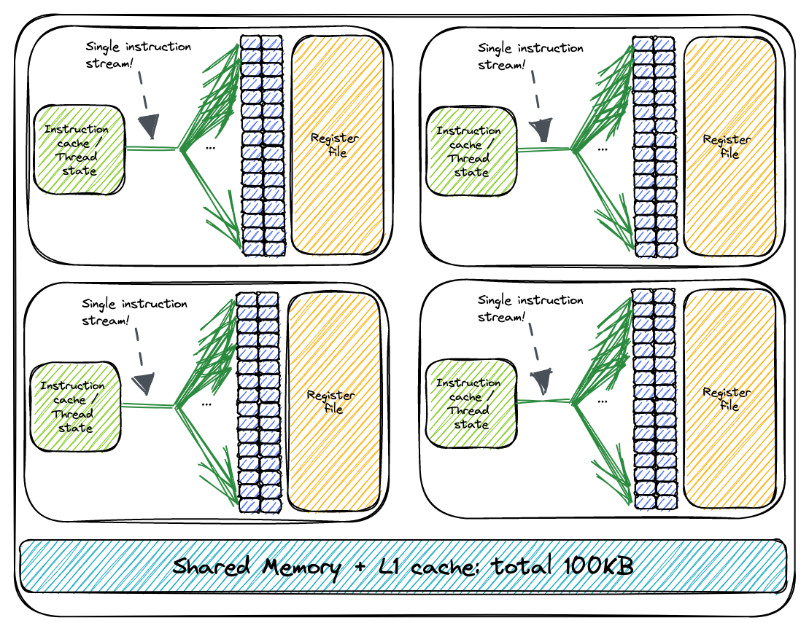

Warptiling 优雅之处在于，它把每一层并行都写明白了：

- **Blocktiling：** 不同 block 可以在不同 SM 上并行。
- **Warptiling：** 不同 warp 可以在不同 warp scheduler 上并行，也可以在同一 scheduler 上并发（交错隐藏延迟）。
- **Threadtiling：** 同一组 CUDA core 上可以并行执行非常有限的指令（指令级并行，ILP）。

CUDA 里 warptiling 长这样：

```cpp
// dotIdx 扫过 SMEM 的内容
for (uint dotIdx = 0; dotIdx < BK; ++dotIdx) {
  // 为本线程在 warptile 中的那一部分填充寄存器
  for (uint wSubRowIdx = 0; wSubRowIdx < WMITER; ++wSubRowIdx) {
    for (uint i = 0; i < TM; ++i) {
      regM[wSubRowIdx * TM + i] =
          As[(dotIdx * BM) + warpRow * WM + wSubRowIdx * WSUBM +
             threadRowInWarp * TM + i];
    }
  }
  for (uint wSubColIdx = 0; wSubColIdx < WNITER; ++wSubColIdx) {
    for (uint i = 0; i < TN; ++i) {
      regN[wSubColIdx * TN + i] =
          Bs[(dotIdx * BN) + warpCol * WN + wSubColIdx * WSUBN +
             threadColInWarp * TN + i];
    }
  }

  // 执行 warptile 矩阵乘。以后这会很好地映射到
  // 在 Tensor Core 上执行的 warp 级矩阵指令。
  for (uint wSubRowIdx = 0; wSubRowIdx < WMITER; ++wSubRowIdx) {
    for (uint wSubColIdx = 0; wSubColIdx < WNITER; ++wSubColIdx) {
      // 带寄存器缓存局部性的逐线程结果
      for (uint resIdxM = 0; resIdxM < TM; ++resIdxM) {
        for (uint resIdxN = 0; resIdxN < TN; ++resIdxN) {
          threadResults[(wSubRowIdx * TM + resIdxM) * (WNITER * TN) +
                        (wSubColIdx * TN) + resIdxN] +=
              regM[wSubRowIdx * TM + resIdxM] *
              regN[wSubColIdx * TN + resIdxN];
        }
      }
    }
  }
}
```

作者尽力把三层 tiling 画在一张图里，结构已经相当复杂。

> **【原文边注 55】**  
> [CUTLASS 关于高效 GEMM 的文档](https://github.com/NVIDIA/cutlass/blob/master/media/docs/efficient_gemm.md) 对 warptiling 讲得更深入，图也更有启发。

每个 warp 计算一块大小为 `(WSUBN * WNITER) × (WSUBM * WMITER)` 的结果。  
每个线程计算 `WNITER * WMITER` 块大小为 `TM*TN` 的小块。

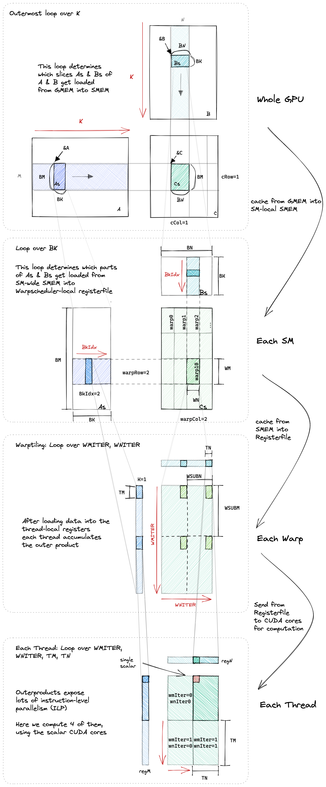

自动调参之后，A100 上性能从 19.7 TFLOPs 提到 **21.7 TFLOPs**。

下面这张图比较了 warptiling kernel 和 cuBLAS 随矩阵尺寸的变化：

> **【原文边注 56】**  
> 这张图在 A100 上生成，所以绝对 FLOPs 数字和 A6000 表格不同。

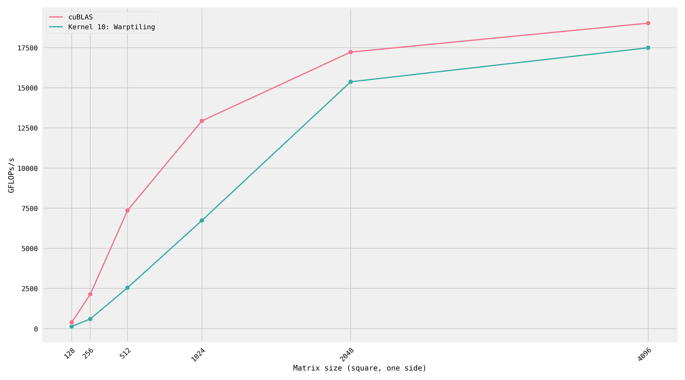

在 2048 和 4096 维上，测得的 FLOPs 只比 cuBLAS 慢几个百分点。  
但小矩阵上比 NVIDIA 的库差很多！  
因为 cuBLAS 里不是一份 SGEMM 实现，而是**几百份**。

> **【原文边注 57】**  
> 大概这就是为什么这个库有 500MB 编译代码。打印所有 kernel：`cuobjdump --list-text <cublas 路径>`。

运行时，cuBLAS 根据尺寸挑选要跑的 kernel。

> **【原文边注 58】**  
> 作者对直到 4096 的所有方阵启动 matmul，发现 16 个不同的 SGEMM kernel。这里有一份[找出 cuBLAS 启动了哪个 kernel 的脚本](https://gist.github.com/Chillee/f86675147366a7a0c6e244eaa78660f7#file-4-matmul-bench-py-L11)（感谢 [Horace He](https://horace.io/)）。

用 Nsight Systems 追踪 cuBLAS 调用，各尺寸启动的 kernel 是：

> **【原文边注 59】**  
> 使用 [Nsight Systems](https://developer.nvidia.com/nsight-systems) CLI。

| Matrix size | Name | Duration |
| ---: | :--- | :--- |
| 128 | `ampere_sgemm_32x32_sliced1x4_nn` | 15.295 μs |
| 256 | `ampere_sgemm_64x32_sliced1x4_nn` *followed by* `splitKreduce_kernel` | 12.416 μs + 6.912 μs |
| 512 | `ampere_sgemm_32x32_sliced1x4_nn` | 41.728 μs |
| 1024 | `ampere_sgemm_128x64_nn` | 165.953 μs |
| 2048 | `ampere_sgemm_128x64_nn` | 1.247 ms |
| 4096 | `ampere_sgemm_128x64_nn` | 9.290 ms |

在维度 256 时它调用了两个 kernel：一个 matmul，再加一个 reduction。

> **【原文边注 60】**  
> Split-K 指把 K 维划分给多个 threadblock。每个 block 只计算 $C$ 的一部分，cuBLAS 再用 reduce kernel 累加最终结果。这需要额外内存存放中间结果。作者想象中的样子（并不确定）：
>
> 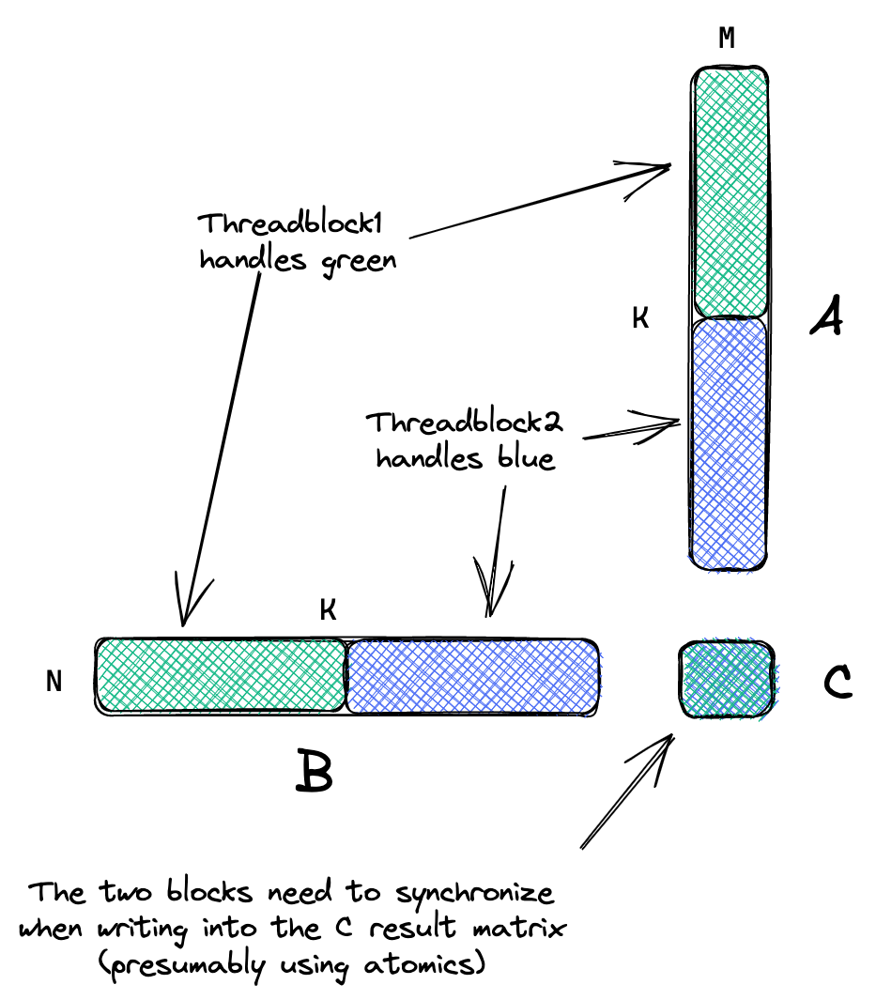

所以，若要写一个对所有形状都快的高性能库，就要为不同形状准备特化，运行时 dispatch 到最合适的那一个。

作者还报告了一个**负面结果**：为本 kernel 实现过 **thread swizzling**。该技术假设 threadblock 按递增 `blockIdx` 启动，并优化 `blockIdx` 到 $C$ 块的映射，以增加 L2 局部性。

> **【原文边注 61】**  
> 记住：L2 是全局内存的缓存，整张 GPU 只有一份。

NVIDIA 这篇[博文](https://developer.nvidia.com/blog/optimizing-compute-shaders-for-l2-locality-using-thread-group-id-swizzling/)有更多信息和图。  
它没有提升性能，大概因为 L2 hit rate 已经高达 80%，所以作者删掉了 swizzling 代码。

> **【原文边注 62】**  
> 有兴趣可看这个 [commit](https://github.com/siboehm/SGEMM_CUDA/commit/9a4dd77232d416649c13401c2382cdf95ded3760)。

把 BK 循环往外移是合理的，因为它符合「先加载一些数据，然后在这些数据上做尽可能多的计算」。  
这进一步意味着 BK 循环内部的**计算**彼此独立，可以并行（例如用 ILP）。  
我们现在也可以开始预取下一轮循环需要的数据，这种技术叫 **double buffering**。

> **【初学者加注】**  
> 把三层名字对上仓库里的模板参数（A6000 配置）：
>
> | 层次 | 参数 | A6000 取值 | 含义 |
> | :--- | :--- | ---: | :--- |
> | Block tile | `BM × BN` | 128×128 | 一个 threadblock 负责的 $C$ 子块 |
> | K 切片 | `BK` | 16 | 每次从 GMEM 搬多厚 |
> | Warp tile | `WM × WN` | 64×64 | 一个 warp 负责的连续子块 |
> | Warp 内迭代 | `WNITER`（`WMITER` 由公式推出） | 4 | warp 把它的大块再切成几次 |
> | Thread tile | `TM × TN` | 8×4 | 每个线程每次累加的小块 |
> | 线程数 | `NUM_THREADS` | 128 | 每 block 4 个 warp |
>
> `warpIdx = threadIdx.x / 32` 得到「我是第几个 warp」；再把 warp 排成 `(BN/WN) × (BM/WM)` 的网格，就得到 `warpRow` / `warpCol`。  
> 一个 warp 内部 32 个 lane 再按 `WSUBN/TN` 排成小网格，得到 `threadRowInWarp` / `threadColInWarp`。
>
> 为什么这比「128 个线程一起扫整个 128×128」更好？因为同一 warp 的 32 个线程访问的 SMEM 更集中，bank conflict 更好分析；累加器也更可能留在同一组寄存器里。不过 [Issue #17](https://github.com/siboehm/SGEMM_CUDA/issues/17) 里有人在 A6000 上把 warptiling 改回「整个 block 一起扫子块」，性能几乎一样——说明收益和具体 GPU、编译器有关，不要把它神化。

### 仓库完整实现

来源：[`src/kernels/10_kernel_warptiling.cuh`](https://github.com/siboehm/SGEMM_CUDA/blob/master/src/kernels/10_kernel_warptiling.cuh)

完整文件约 190 行，已复制到 [`kernels/10_kernel_warptiling.cuh`](kernels/10_kernel_warptiling.cuh)。结构是两个 device 函数 + 一个 kernel：

1. `wt::loadFromGmem`：`float4` 加载并转置 `As`
2. `wt::processFromSmem`：上面那段 warptile 外积
3. `sgemmWarptiling`：外层沿 K 滑动，调用前两者，最后 `float4` 写回

启动配置（A6000）：

```cpp
void runSgemmWarptiling(...) {
  const uint K10_NUM_THREADS = 128;
  const uint K10_BN = 128, K10_BM = 128, K10_BK = 16;
  const uint K10_WN = 64, K10_WM = 64;
  const uint K10_WNITER = 4, K10_TN = 4, K10_TM = 8;
  dim3 blockDim(K10_NUM_THREADS);
  dim3 gridDim(CEIL_DIV(N, K10_BN), CEIL_DIV(M, K10_BM));
  sgemmWarptiling<K10_BM, K10_BN, K10_BK, K10_WM, K10_WN, K10_WNITER, K10_TM,
                  K10_TN, K10_NUM_THREADS>
      <<<gridDim, blockDim>>>(M, N, K, alpha, A, B, beta, C);
}
```

A100 的注释配置是更瘦的 `BM=64, TM=TN=4, WNITER=1`。

---

## 进行中：Kernel 11（以及仓库中的 Kernel 12）

如果作者回到这篇文章，下一步会看：

1. **Double buffering**，让计算和内存加载更好地交错。目前可参考 [CUTLASS Pipelining](https://github.com/NVIDIA/cutlass/blob/master/media/docs/efficient_gemm.md#pipelining)。CUTLASS 在两级做 double buffering：GMEM⇒SMEM，以及 SMEM⇒寄存器文件。
    - Hopper 引入了 warp specialization 的新指令，例如让某些 warp 少用寄存器。再配合「从 GMEM 直接进 SMEM、不经过寄存器」的指令，可以降低寄存器压力。
2. **去掉 SMEM bank conflict**。可以通过[优化 SMEM 中的数据布局](https://github.com/NVIDIA/cutlass/blob/master/media/docs/implicit_gemm_convolution.md#shared-memory-layouts) 来做。
3. 通过看生成的 PTX，更好地理解 [Triton](https://github.com/openai/triton) 里的 GEMM kernel。

仓库后来补了两个 double buffering 实现，基准表里 Kernel 11 为 17278 GFLOPs（74.3%），仍低于向量化 Kernel 6 的 78.4%。这和 Kernel 7/8 类似：方向正确，但这份草稿实现还没赢过更简单的 Kernel 6。

> **【初学者加注】**  
> Double buffering 的生活类比：你有两个菜板。一块在切菜（计算），另一块同时去冰箱拿下一盘菜（加载）。切完立刻交换。
>
> 实现上就是 SMEM 开两倍：`As[2 * BM * BK]`。用 `offset` 和 `1-offset` 在两块之间翻转。加载下一 tile 的同时，计算当前 tile。需要某种异步拷贝或把线程分成「加载组 / 计算组」，再用 barrier 对齐。
>
> **Kernel 11**（`11_kernel_double_buffering.cuh`）：把 block 里一半线程当 loader、一半当 computer，用普通 `__syncthreads()` 同步。  
> **Kernel 12**（`12_kernel_double_buffering.cuh`）：用 `cuda::memcpy_async` + `cuda::barrier` 做真正的异步拷贝，这是 Ampere 以后的 API，也是 CUTLASS pipeline 的简化版。

### Kernel 11 仓库实现（节选）

来源：[`src/kernels/11_kernel_double_buffering.cuh`](https://github.com/siboehm/SGEMM_CUDA/blob/master/src/kernels/11_kernel_double_buffering.cuh)  
完整文件：[`kernels/11_kernel_double_buffering.cuh`](kernels/11_kernel_double_buffering.cuh)

```cuda
__shared__ float As[2 * BM * BK];
__shared__ float Bs[2 * BK * BN];

// setup double buffering split
bool doubleBufferIdx = threadIdx.x >= (NUM_THREADS / 2);

if (doubleBufferIdx == 0) {
  // load first (B0)
  db::loadFromGmem<...>(N, K, A, B, As, Bs, ...);
}
__syncthreads();

for (uint bkIdx = 0; bkIdx < K; bkIdx += 2 * BK) {
  if (doubleBufferIdx == 0) {
    // process B0, then B1; afterwards load B0 of next round
    db::processFromSmem<...>(..., As, Bs, ...);
    __syncthreads();
    if (bkIdx + BK < K)
      db::processFromSmem<...>(..., As + (BM * BK), Bs + (BK * BN), ...);
    __syncthreads();
    if (bkIdx + 2 * BK < K)
      db::loadFromGmem<...>(..., A + 2 * BK, B + 2 * BK * N, As, Bs, ...);
  } else {
    // the other half of the block loads B1 while the first half computes
    if (bkIdx + BK < K)
      db::loadFromGmem<...>(..., A + BK, B + BK * N,
                            As + (BM * BK), Bs + (BK * BN), ...);
    __syncthreads();
    db::processFromSmem<...>(..., As, Bs, ...);
    __syncthreads();
    if (bkIdx + BK < K)
      db::processFromSmem<...>(..., As + (BM * BK), Bs + (BK * BN), ...);
  }
  A += 2 * BK;
  B += 2 * BK * N;
  __syncthreads();
}
```

### Kernel 12 仓库实现（节选）

来源：[`src/kernels/12_kernel_double_buffering.cuh`](https://github.com/siboehm/SGEMM_CUDA/blob/master/src/kernels/12_kernel_double_buffering.cuh)  
完整文件：[`kernels/12_kernel_double_buffering.cuh`](kernels/12_kernel_double_buffering.cuh)

```cuda
auto block = cooperative_groups::this_thread_block();
__shared__ cuda::barrier<cuda::thread_scope::thread_scope_block> frontBarrier;
__shared__ cuda::barrier<cuda::thread_scope::thread_scope_block> backBarrier;

__shared__ float As[2 * BM * BK];
__shared__ float Bs[2 * BK * BN];

// 先异步填第一块
loadFromGmem<...>(..., As + As_offset * BM * BK, Bs + Bs_offset * BK * BN,
                  ..., (*frontBarrierPtr));

for (uint bkIdx = 0; bkIdx < K - BK; bkIdx += BK) {
  // 同时发出下一块的异步拷贝
  loadFromGmem<...>(..., A + BK, B + BK * N,
                    As + (1 - As_offset) * BM * BK,
                    Bs + (1 - Bs_offset) * BK * BN,
                    ..., (*backBarrierPtr));
  // 等当前块就绪再计算
  (*frontBarrierPtr).arrive_and_wait();
  processFromSmem<...>(..., As + As_offset * BM * BK, Bs + Bs_offset * BK * BN, ...);
  As_offset = 1 - As_offset;
  Bs_offset = 1 - Bs_offset;
  std::swap(frontBarrierPtr, backBarrierPtr);
  __syncthreads();
}
```

`loadFromGmem` 内部用的是 `cuda::memcpy_async`。这正是原文「GMEM⇒SMEM 这一级的 double buffering」在 Ampere API 上的样子。

---

## 结论

写这篇文章的体验，和作者[上一篇优化 CPU 上 SGEMM 的文章](https://siboehm.com/articles/22/Fast-MMM-on-CPU)类似：**迭代地优化 SGEMM，是深入理解硬件性能特征最好的办法之一。**  
写 CUDA 时让作者惊讶的是：一旦把「希望 kernel 怎样工作」画清楚，实现代码其实并不难。

另外：**幂律无处不在。**  
前 6 个 kernel 花了两个周末，就到了峰值 FLOPs 的 80%；然后又花四个周末做自动调参和 warptiling，才到 94%。写这些代码时学到的东西同样在递减，所以猎取最后 6% 被留到了未来。

所有代码在 [Github](https://github.com/siboehm/SGEMM_CUDA)。

最后，非常感谢 [Godbolt.org](https://godbolt.org/)（看 PTX 和 SASS）和 [Excalidraw](https://excalidraw.com/)（画 kernel）的作者。这两个工具用起来很愉快，也让作者学得更快。

> **【初学者加注：读完之后你应该带走的地图】**
>
> 1. **先让 warp 走连续地址**（Kernel 2）。不会 coalescing，后面一切都是空中楼阁。
> 2. **用 SMEM 做 tiling，沿 K 滑动**（Kernel 3）。这是所有 GEMM 的骨架。
> 3. **每线程多算，把数据提到寄存器**（Kernel 4–5）。目标是提高算术强度，从 memory-bound 走向 compute-bound。
> 4. **向量化 load/store，必要时转置 SMEM 布局**（Kernel 6）。让硬件走 128 bit 事务。
> 5. **超参是硬件相关的，要搜**（Kernel 9）。
> 6. **按硬件层次显式切 warp tile**（Kernel 10）。为以后的 Tensor Core MMA 打形状。
> 7. **流水线（double buffering）和 bank conflict 是最后 10% 的主战场**（Kernel 7/8/11/12，以及 cuBLAS 比你多出来的那几百个特化 kernel）。
>
> 如果你只想动手，仓库用法是：
>
> ```bash
> git clone https://github.com/siboehm/SGEMM_CUDA.git
> cd SGEMM_CUDA
> # 按自己的 GPU 改 CMakeLists.txt 里的 CUDA_COMPUTE_CAPABILITY
> mkdir build && cd build && cmake .. && cmake --build .
> DEVICE=0 ./sgemm 1    # 跑 naive
> DEVICE=0 ./sgemm 10   # 跑 warptiling
> DEVICE=0 ./sgemm 0    # 跑 cuBLAS 对照
> ```

---

## 进一步的资料与参考文献

- 作者动笔是因为看到了 [wangzyon’s Github 仓库](https://github.com/wangzyon/NVIDIA_SGEMM_PRACTICE)，先拿他的 kernel 做实验，再全部重写。相关的还有这篇 [NVIDIA 关于 CUTLASS 的博文](https://developer.nvidia.com/blog/cutlass-linear-algebra-cuda/)。
- 必读：官方 [CUDA Toolkit Programming Guide](https://docs.nvidia.com/cuda/cuda-c-programming-guide/index.html) 和 [CUDA Best Practices Guide](https://docs.nvidia.com/cuda/cuda-c-best-practices-guide)。[Kernel Profiling Guide](https://docs.nvidia.com/nsight-compute/ProfilingGuide/index.html) 包含更多底层硬件细节（缓存、流水线）以及可采集的各种指标。
- Onur Mutlu 是 ETH 的教授，课程都传到 Youtube。和本文特别相关的是 [Computer Architecture](https://www.youtube.com/playlist?list=PL5Q2soXY2Zi-Mnk1PxjEIG32HAGILkTOF) 和 [Acceleration on Heterogeneous Systems](https://www.youtube.com/playlist?list=PL5Q2soXY2Zi_OwkTgEyA6tk3UsoPBH737)。
- [Understanding Latency Hiding on GPUs](https://www2.eecs.berkeley.edu/Pubs/TechRpts/2016/EECS-2016-143.pdf)，一篇深入讨论如何设计工作负载以吃满带宽和算力的博士论文。写于 2016 年，只覆盖较老的 GPU。关于 warp-synchronous programming 的章节已经过时，见 [using CUDA warp-level primitives](https://developer.nvidia.com/blog/using-cuda-warp-level-primitives/)。
- Lei Mao（NVIDIA 工程师）的 [博客](https://leimao.github.io/tags/CUDA/) 有很好的 CUDA 内容，包括 [正确的 CUDA 错误处理](https://leimao.github.io/blog/Proper-CUDA-Error-Checking/)。
- 似乎没有很好的官方资料来理解 SASS。有 [Nvidia 关于 CUDA binary utilities 的文档](https://docs.nvidia.com/cuda/cuda-binary-utilities/index.html)。更有用的可能是看开源 SASS 汇编器，例如 Da Yan 的 [turingas](https://github.com/daadaada/turingas)。
- 作者在收集「可读、但又经过优化」的 CUDA 代码作为学习材料：
    - ONNX Runtime 的 [CUDA provider](https://github.com/microsoft/onnxruntime/tree/main/onnxruntime/core/providers/cuda)，例如他们的 [softmax 实现](https://github.com/microsoft/onnxruntime/blob/main/onnxruntime/core/providers/cuda/math/softmax_warpwise_impl.cuh)。
    - NVIDIA 开源的 [CUTLASS](https://github.com/NVIDIA/cutlass)，例如他们的 [GEMM 实现](https://github.dev/NVIDIA/cutlass/blob/master/include/cutlass/gemm/device/gemm.h)，其中用 double-buffering 预取最内层维度——这正是本文 kernel 里还缺的。

### 本文之后可以接着读的续篇

原文停在 Ampere 上的 FP32、不用 Tensor Core。后续经典续作包括：

- Pranjal Shankhdhar，[Outperforming cuBLAS on H100: a Worklog](https://cudaforfun.substack.com/p/outperforming-cublas-on-h100-a-worklog)（Tensor Core、TMA、warp group）
- Aleksa Gordić，[Inside NVIDIA GPUs: Anatomy of high performance matmul kernels](https://aleksagordic.com/blog/matmul)

---

## 附录：仓库 kernel 与原文章节对照

| 编号 | 文件 | 原文是否讲解 | A6000 相对 cuBLAS |
| ---: | :--- | :--- | ---: |
| 0 | cuBLAS（`runner.cu` 中 `runCublasFP32`） | 作为对照 | 100% |
| 1 | [`1_naive.cuh`](https://github.com/siboehm/SGEMM_CUDA/blob/master/src/kernels/1_naive.cuh) | 是 | 1.3% |
| 2 | [`2_kernel_global_mem_coalesce.cuh`](https://github.com/siboehm/SGEMM_CUDA/blob/master/src/kernels/2_kernel_global_mem_coalesce.cuh) | 是 | 8.5% |
| 3 | [`3_kernel_shared_mem_blocking.cuh`](https://github.com/siboehm/SGEMM_CUDA/blob/master/src/kernels/3_kernel_shared_mem_blocking.cuh) | 是 | 12.8% |
| 4 | [`4_kernel_1D_blocktiling.cuh`](https://github.com/siboehm/SGEMM_CUDA/blob/master/src/kernels/4_kernel_1D_blocktiling.cuh) | 是 | 36.5% |
| 5 | [`5_kernel_2D_blocktiling.cuh`](https://github.com/siboehm/SGEMM_CUDA/blob/master/src/kernels/5_kernel_2D_blocktiling.cuh) | 是 | 68.7% |
| 6 | [`6_kernel_vectorize.cuh`](https://github.com/siboehm/SGEMM_CUDA/blob/master/src/kernels/6_kernel_vectorize.cuh) | 是 | 78.4% |
| 7 | [`7_kernel_resolve_bank_conflicts.cuh`](https://github.com/siboehm/SGEMM_CUDA/blob/master/src/kernels/7_kernel_resolve_bank_conflicts.cuh) | 跳过，本文补讲 | 69.7% |
| 8 | [`8_kernel_bank_extra_col.cuh`](https://github.com/siboehm/SGEMM_CUDA/blob/master/src/kernels/8_kernel_bank_extra_col.cuh) | 跳过，本文补讲 | 70.8% |
| 9 | [`9_kernel_autotuned.cuh`](https://github.com/siboehm/SGEMM_CUDA/blob/master/src/kernels/9_kernel_autotuned.cuh) | 是 | 84.8% |
| 10 | [`10_kernel_warptiling.cuh`](https://github.com/siboehm/SGEMM_CUDA/blob/master/src/kernels/10_kernel_warptiling.cuh) | 是 | 93.7% |
| 11 | [`11_kernel_double_buffering.cuh`](https://github.com/siboehm/SGEMM_CUDA/blob/master/src/kernels/11_kernel_double_buffering.cuh) | 仅列为 WIP，本文补实现 | 74.3% |
| 12 | [`12_kernel_double_buffering.cuh`](https://github.com/siboehm/SGEMM_CUDA/blob/master/src/kernels/12_kernel_double_buffering.cuh) | 原文未提及 | — |

本地副本：

- 原图：`docs/cuda-mmm/images/`
- kernel 源码：`docs/cuda-mmm/kernels/`

原文图片的在线地址统一为：

`https://siboehm.com/assets/img/CUDA-MMM/<文件名>`

---

*中文整理与加注基于 Simon Boehm 2022 年原文及 MIT 许可的 [SGEMM_CUDA](https://github.com/siboehm/SGEMM_CUDA) 仓库。插图版权归原文作者。*

