## 关于本文

本文记录一个 FP32 SGEMM 项目的优化过程。测试对象是 4096×4096×4096 的方阵，起点是 naive kernel 的 306.7 GFLOPS，终点是 warptiling kernel 的 20405.1 GFLOPS，约为 cuBLAS 的 93.2%。

优化路线、kernel 编号、部分数据组织图和若干性能观察，来自 Simon Boehm 的工作日志 [1]。这篇笔记对理解 GEMM 优化的帮助很大；没有它，这个项目大概不会走到 warptiling。文中的原文图片均来自 [1]，版权归原作者所有，这里仅作学习记录使用。

除特别说明外，本文的性能数字均指 4096 方阵、50 次平均、cudaEvent 计时、与 cuBLAS FP32 对比。93.2% 只对 4096 这一档成立；小尺寸的表现要差得多，“性能分析”一节会单独讨论。

### 主要结果

| 指标 | 数值 |
|---|---:|
| 测试规模 | 4096 × 4096 × 4096，FP32 |
| 最优 kernel | k10 warptiling：20405.1 GFLOPS |
| cuBLAS FP32 | 21882.4 GFLOPS |
| 相对 cuBLAS | 93.2% |
| 相对 naive | 66.5× |
| RTX 3090 FP32 标称峰值 | 约 35.6 TFLOPS |
| k10 占标称峰值 | 57.3% |
| cuBLAS 占标称峰值 | 61.5% |

<!-- more -->

### 目录

项目概况 · 背景 · 优化路线 · 逐站精讲 · 性能分析 · 经验与常见问题 · 结论与展望 · 附录 · 常见问题 · 致谢

---

## 项目概况

### 问题与估算

GEMM 的公式是：

```text
C = α · A × B + β · C
```

A 是 M×K，B 是 K×N，C 是 M×N，均为行主序的 `float`。项目取 M=N=K=4096。

先算一笔账：

- 计算量：`2·M·N·K = 2 × 4096³ ≈ 137.4 GFLOP`。
- 最少数据量：A、B 各读一次，C 读一次、写一次，合计 `4 × 4096² × 4B ≈ 268 MB`。
- 算术强度：`137.4 GFLOP / 0.268 GB ≈ 512 FLOP/B`。

RTX 3090 的机器平衡点约为 `35.6 TFLOPS / 936 GB/s ≈ 38 FLOP/B`。也就是说，只要 kernel 能把数据复用做到 38 FLOP/B 以上，理论上就应该是计算受限的，内存不该成为瓶颈。

naive kernel 的算术强度约为 0.5 FLOP/B，离 38 差得很远，所以它慢得并不意外。后面六个 kernel 的主要工作，就是把这个比值逐步拉回 38 附近。

### 硬件基线

| 项目 | RTX 3090（GA102，sm_86） |
|---|---:|
| SM 数量 | 82 |
| FP32 CUDA Core / SM | 128 |
| Boost 频率 | 约 1.70 GHz |
| FP32 标称峰值 | 约 35.6 TFLOPS |
| 显存 | 24 GB GDDR6X |
| 显存带宽 | 936 GB/s |
| L2 Cache | 6 MB |
| 共享内存 / SM | 100 KB |
| 共享内存 / Block（默认） | 48 KB（可 opt-in 到约 99 KB） |
| 寄存器 / SM | 65536 × 4B = 256 KB |
| 最大线程 / SM | 1536（48 个 warp） |
| 最大线程 / Block | 1024 |
| Warp Scheduler / SM | 4 |

表中数据来自 CUDA C++ Programming Guide 和 `cudaGetDeviceProperties` [2]。几个后面会用到的推论：

1. SMEM 带宽约为 GMEM 的 20 倍。按 128 B/cycle/SM 估算，82 个 SM、1.7 GHz，约为 17.8 TB/s；GMEM 是 936 GB/s。
2. 寄存器文件比 SMEM 大。每个 SM 有 256 KB 寄存器，SMEM 只有 100 KB，这是后期寄存器分块能继续提升的一个前提。
3. 机器平衡点约为 38 FLOP/B。它决定了 tile 要多大才够用。
4. 82 个 SM 是一个硬约束。4096 维、128×128 的 block tile 一共有 1024 个 block；如果每个 SM 同时放 2~3 个，大约就是 4~6 个 wave。小尺寸时 block 数更少，GPU 很难被喂满。

> 说明：本文按图表标注的 RTX 3090 计算。如果实际使用的是 A6000（38.7 TFLOPS、768 GB/s），把峰值和带宽替换即可，定性结论不变，百分比会略有差异。

### 代码结构

```text
SGEMM/
├── cuda-info/
│   ├── sgemm.cu                 # 主程序：解析 kernel 编号、分配矩阵、验证、计时
│   ├── src/
│   │   ├── runner.cu            # kernel launch 封装、工具函数、run_kernel 总调度
│   │   ├── runner.cuh
│   │   ├── kernels.cuh          # 汇总所有 kernel 头文件
│   │   └── kernels/
│   │       ├── 1_naive.cuh
│   │       ├── 2_kernel_global_mem_coalesce.cuh
│   │       ├── 3_kernel_shared_mem_blocking.cuh
│   │       ├── 4_1D_blockTiling.cuh
│   │       ├── 5_2D_blockTiling.cuh
│   │       ├── 6_kernel_vectorize.cuh
│   │       └── 10_kernel_warptiling.cuh
│   ├── CMakeLists.txt
│   └── notes/cuda-compile-ref.md
├── figs/
└── seggestions.txt
```

七个 kernel 的分工：

| 编号 | 文件 | Block tile | 线程/Block | 每线程结果数 | 4096 GFLOPS | 相对 cuBLAS |
|---|---|---|---:|---:|---:|---:|
| k1 | `1_naive.cuh` | 无（每线程 1 个 C） | 1024 | 1 | 306.7 | 1.4% |
| k2 | `2_kernel_global_mem_coalesce.cuh` | 无（每线程 1 个 C） | 1024 | 1 | 2050.8 | 9.4% |
| k3 | `3_kernel_shared_mem_blocking.cuh` | 32×32 | 1024 | 1 | 2961.9 | 13.5% |
| k4 | `4_1D_blockTiling.cuh` | 64×64 | 512 | 8 | 8260.3 | 37.7% |
| k5 | `5_2D_blockTiling.cuh` | 128×128 | 256 | 64 | 15237.5 | 69.6% |
| k6 | `6_kernel_vectorize.cuh` | 128×128 | 256 | 64 | 17354.9 | 79.3% |
| k10 | `10_kernel_warptiling.cuh` | 128×128 | 128 | 128 | 20405.1 | 93.2% |
| k0 | cuBLAS | 厂商调优 | — | — | 21882.4 | 100% |

编号从 6 直接跳到 10，是因为沿用原文的顺序。原文的 k7、k8 是消 bank conflict 的尝试，k9 是自动调参，k10 是 warptiling；本项目保留了 k10 的编号，方便和原文、笔记对照。

`target` 是编译产物，真正的主程序是 `sgemm.cu`。`Makefile` 里只有 `make submit`，作用是 `git add/commit/push`，不负责编译。主程序和计时框架参考了 wangzyon 的 NVIDIA_SGEMM_PRACTICE [6]。

### 计时口径

计时逻辑在 `sgemm.cu` 中：

```cpp
cudaEventRecord(beg);
for (int j = 0; j < repeat_times; j++) {
  run_kernel(kernel_num, m, n, k, alpha, dA, dB, beta, dC, handle);
}
cudaEventRecord(end);
cudaEventSynchronize(beg);
cudaEventSynchronize(end);
cudaEventElapsedTime(&elapsed_time, beg, end);
```

对应的口径：

| 项目 | 设置 |
|---|---|
| 计时方式 | `cudaEvent`，包住 50 次 kernel launch |
| 重复次数 | 50 |
| 预热 | 正式计时前跑一次正确性验证 kernel |
| 同步 | 只在计时区间外同步 |
| 尺寸 | 128、256、512、1024、2048、4096 |
| alpha / beta | 0.5 / 3.0 |
| 参考实现 | cuBLAS `cublasGemmEx`，FP32 |
| FLOPs 计算 | `2·m·n·k` |
| GFLOPS 计算 | `repeat_times × flops × 1e-9 / elapsed_time` |

有三个细节需要说明：

1. 50 次平均对大尺寸足够，对小尺寸偏少。4096 维一次约 6~7 ms，50 次足以让 GPU 把频率拉满；128 维一次只有几十微秒，50 次可能只有一两毫秒，GPU 还处在低功耗状态。
2. 计时循环里没有重置 `dC`。因为 `beta=3.0`，每跑一次 `C = αAB + 3C`，C 就会乘 3。50 次后是 `3^50 ≈ 7.2×10^23`，仍在 FP32 的表示范围内，不会改变指令条数，但这不是一个好习惯。严谨的做法是每次重置 C，或者令 `beta=0`。
3. 验证使用绝对误差 `0.01`。对 4096 长度的点积，这个阈值不随 K 缩放，换一组数据分布可能误判。更稳妥的是相对误差，或者用 double 做参考。

这些细节不影响“k10 在 4096 上达到 93.2%”这个主结论，但会影响对小尺寸数字的解读。“测量”一节会展开。

### 小结

这个项目的目标不是复刻 cuBLAS，而是把 GEMM 优化的几个层次走一遍：访存、共享内存、寄存器分块、向量化、warp 分块。笔者把这个项目停在 k10：再往后，收益开始以个位数百分比计，工作量是另一个量级。

---

## 背景

在看 kernel 之前，需要先建立五个概念：存储层次、warp、合并访存、算术强度、occupancy。它们会在后面反复出现。

### 存储层次

GPU 的存储是分层的：

| 层级 | 典型容量 | 延迟量级 | 带宽量级 | 谁共享 |
|---|---:|---:|---:|---|
| Global Memory（GMEM） | 24 GB | 400~800 cycles | 936 GB/s | 整张卡 |
| L2 Cache | 6 MB | 约 200 cycles | 数 TB/s | 整张卡 |
| Shared Memory（SMEM） | 100 KB / SM | 约 20~30 cycles | 约 17.8 TB/s | 一个 Block |
| Register File | 256 KB / SM | 约 1 cycle | 极高 | 一个线程（逻辑上） |

可以粗略地理解成仓库、中转站、工作台和手边的零件：容量越小，离计算单元越近，速度越快。GEMM 优化的主要内容，就是安排数据在这四层之间怎么搬、搬多少、搬几次。

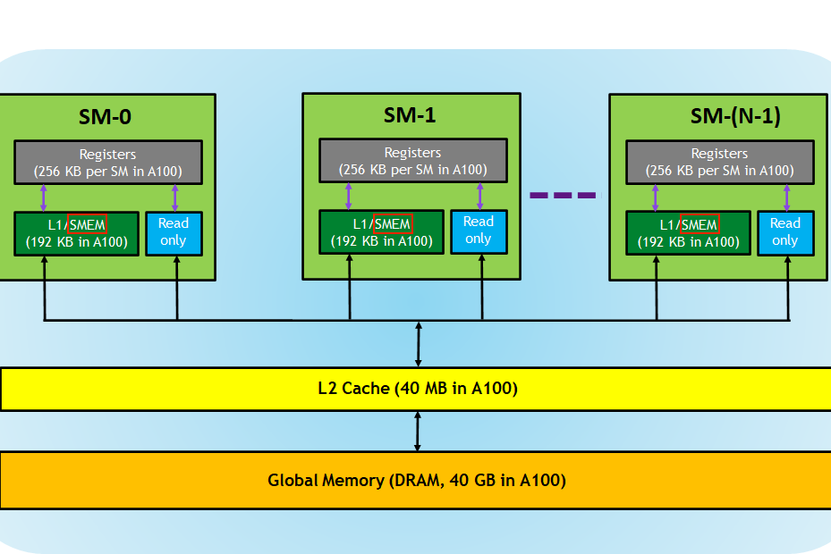

*图 2-1：GPU 的存储层次。越往上容量越小、带宽越高。（原图：Boehm [1]）*

### Warp

CUDA 代码是按单线程写的，硬件却不是按单线程调度的。一个 Block 里的线程会按 `threadIdx` 的连续顺序，每 32 个分成一组，称为一个 warp。warp 被分配给 SM 上的 warp scheduler（每个 SM 有 4 个），由它发射指令。

两个编号需要分清：

```text
warpId = threadIdx.x / 32;   // 第几个 warp
laneId = threadIdx.x % 32;   // warp 内的第几个 lane
```

原文有一处写成 `warpId = threadIdx.x % warpSize`，那实际上是 laneId [1]。代码中使用的是 `/`。记法很简单：除 32 得到“第几组”，模 32 得到“组内第几个”。


*图 2-2：Grid → Block → Thread 的层次。硬件在此基础上再切一层 warp。（原图：Boehm [1]）*


*图 2-3：每个 SM 有 4 个 warp scheduler。warp 是被调度的单位，thread 是执行的单位。（原图：Boehm [1]）*

warp 取 32，和 SMEM 的 32 个 bank、warp scheduler 的发射宽度、以及历史架构的取舍都有关系。这里只需要记住三个后果：

1. 合并访存是按 warp 检查的。同一个 warp 的同一条 load 指令，32 个 lane 的地址如果连续，就能合并成少量事务。
2. bank conflict 只发生在同一个 warp 内。
3. Tensor Core 的矩阵指令是 warp 级（或 warp group 级）的。k10 的 warp tile 也在为将来换 Tensor Core 准备形状。

### 合并访存

GMEM 的事务粒度是 32B 的 sector，一次最多可以合并成 128B 的 transaction。一个 warp 的 32 个 lane，如果每个 lane 读一个 4B 的 float，理想情况是 32×4B=128B，正好一次 transaction。前提是这 32 个地址在内存里连续，并且对齐。


*图 2-4：连续访存被合并成少量 32B load；地址散开时会变成很多次独立的 load。（原图：Boehm [1]）*

合并访存看的是“同一条指令、同一个 warp 的 32 个地址”，不是线程号本身。只要这 32 个地址落在连续的 128B 内，即使 lane 之间顺序打乱，硬件也能合并；反过来，如果地址跨了几个 4KB 页，线程号再连续也合并不了。

回到 k1。线程分配是：

```cpp
const uint x = blockIdx.x * blockDim.x + threadIdx.x;  // 行
const uint y = blockIdx.y * blockDim.y + threadIdx.y;  // 列
```

一个 warp 里 `threadIdx.x` 连续（0~31），所以 32 个 lane 的 `x` 各不相同、`y` 相同。读 A 时地址是 `A[x*K + i]`，相邻 lane 相差 `K*4B = 16KB`——32 个 lane 落在 32 个不同的 128B 段里，一次 load 被拆成 32 次 32B 事务，带宽利用率约为 1/8。读 B 时 32 个 lane 的 `y` 相同，地址完全一样，硬件会广播，反而没有问题。

所以 k1 的瓶颈主要在 A 上。把线程映射换成“warp 内 lane 负责连续的列”，A 变成广播、B 变成连续，问题就反过来了。这是 k2 的工作。


*图 2-5：k1 中两个线程的访存。A 的同一列被不同线程按行读取，跨度是 K；B 的同一列被多个线程重复读，可以广播或缓存。（原图：Boehm [1]）*

### 算术强度与 Roofline

算术强度（Arithmetic Intensity，AI）的定义是：

```text
AI = 执行的 FLOPs / 从 GMEM 搬进 SMEM 的字节数
```

它衡量“每搬 1 字节，能算多少次”。AI 越高，越不容易被内存卡住。

对一个 BM×BN 的 block tile，忽略 C 的读写，每推进一个 BK，FLOPs 是 `2·BM·BN·BK`，搬运字节是 `4·(BM+BN)·BK`，所以：

```text
AI_block ≈ BM·BN / (2·(BM+BN))
```

| Block tile | AI（FLOP/B） | 相对机器平衡点 38 |
|---|---:|---|
| 32×32 | 8 | 远低于，内存受限 |
| 64×64 | 16 | 低于，仍受限 |
| 128×128 | 32 | 刚好在平衡点下方 |
| 256×128 | 42.7 | 高于平衡点 |
| 256×256 | 64 | 远高于，但寄存器和 SMEM 压力很大 |

这张表解释了几件事：

- k3（32×32）只有 2962 GFLOPS，因为它的 AI 只有 8，理论上限就被内存钉住了；再加上 SMEM 指令开销，实际更差。
- k5/k6/k10 都卡在 128×128，因为 128 的 AI=32，离 38 只差一点，再大就要付出寄存器和 SMEM 的代价。
- 256×128 是一个值得尝试的方向，AI=42.7，第一次真正越过平衡点。但它需要 32768 个 C 元素/block，怎么在 128 或 256 个线程里分配，是一个新问题。


*图 2-6：每个线程算 1 个结果需要 15 次 load；算 4 个结果只需要 8 次 load/result。tile 越大，复用越多，AI 越高。（原图：Boehm [1]）*

这个公式是保守的。它假设每个 block 都从 DRAM 重新取数，没有计算 L2 的跨 block 复用。真实情况下，A 的一行会被同一行的多个 block 复用，L2 能接住一部分，所以实际 AI 会高一些。但用它判断“tile 够不够大”已经足够。

### Occupancy 与 ILP

Occupancy 的定义是：

```text
Occupancy = 每个 SM 上活跃的 warp 数 / 该 SM 支持的最大 warp 数（48）
```

它受三样东西限制：寄存器、SMEM、线程数。占用率高，意味着有更多 warp 可以轮流上阵，用 TLP（线程级并行）掩盖延迟。这是教科书里的标准说法，具体的计算方式和限制条件见 CUDA Best Practices Guide [3]。

但在 GEMM 里，这个说法只对了一半。看两个极端：

- k3：1024 线程/block，37 个寄存器/线程，1 个 block/SM，32 个活跃 warp / 48 = 66% occupancy，性能 2961.9 GFLOPS [1]。
- k10：128 线程/block，约 150~170 个寄存器/线程，2~3 个 block/SM，8~12 个活跃 warp / 48 = 17%~25% occupancy，性能 20405.1 GFLOPS。

低占用率反而更快，原因是 k10 的每个线程有 128 个独立的累加器，每个 `dotIdx` 要做 128 次 FMA，这 128 次 FMA 之间没有依赖，可以塞满流水线。这就是 ILP（指令级并行）。当每个 warp 自己就能提供足够的并行度时，不需要那么多 warp 来填延迟。

Occupancy 是手段，不是目标。延迟藏不住的时候，才需要更多 warp；如果 ILP 足够，低 occupancy 反而给寄存器腾出了空间。关于 latency hiding 和 occupancy 的取舍，Volkov 的博士论文讨论得更完整 [7]。

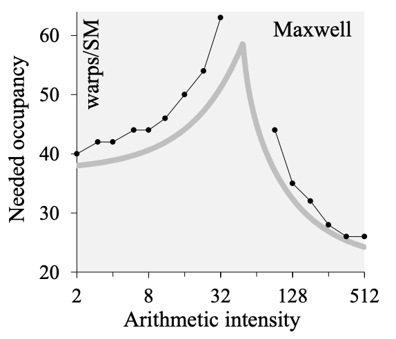

*图 2-7：在很高或很低的算术强度下，达到峰值吞吐并不需要高 occupancy。GEMM 属于高 AI 的一端。（原图：Boehm [1]）*

### 三层并行

把前面的内容串起来，GPU 的并行层次是：

| 层次 | 映射到 | 并行的含义 | 在 k10 里的体现 |
|---|---|---|---|
| Grid / Block | SM | 不同 block 可以在不同 SM 上并行 | 1024 个 block，分给 82 个 SM |
| Warp | Warp Scheduler | 不同 warp 可以在不同 scheduler 上并行，也可以交错 | 4 个 warp，每个负责 64×64 |
| Thread / Lane | CUDA Core | 同一组 CUDA core 上的指令级并行（ILP） | 每个线程 128 个累加器，128 次独立 FMA |

k10 之所以叫 warptiling，是因为它把中间这一层显式写进了代码。k1~k6 里 warp 是隐式的：代码只写了 block 和 thread，warp 由硬件划分。到了 k10，`warpIdx`、`warpRow`、`warpCol`、`threadRowInWarp` 这些变量出现了，warp 第一次有了自己的 tile。

这也是 k10 比前面几个 kernel 复杂的原因：它不是多了一个循环，而是多了一个层次。

---

## 优化路线

### 总表

| 阶段 | 主要瓶颈 | 优化手段 | 4096 GFLOPS | 相对上一级 | 相对 cuBLAS | 相对 k1 |
|---|---|---|---:|---:|---:|---:|
| k1 naive | 全局访存不合并、零复用 | 基线 | 306.7 | — | 1.4% | 1.00× |
| k2 coalesce | 访存地址不连续 | 改线程映射，让 warp 读连续列 | 2050.8 | 6.69× | 9.4% | 6.69× |
| k3 smem | 每个元素仍多次读 GMEM | 共享内存分块 | 2961.9 | 1.44× | 13.5% | 9.66× |
| k4 1D tile | SMEM 读指令太多 | 每线程算 8 个 C，寄存器复用 | 8260.3 | 2.79× | 37.7% | 26.9× |
| k5 2D tile | 1D tile 只复用了 B | 8×8 寄存器 tile，A/B 同时复用 | 15237.5 | 1.84× | 69.6% | 49.7× |
| k6 vectorize | 加载/存储指令条数多 | `float4` 向量化 + 转置 As | 17354.9 | 1.14× | 79.3% | 56.6× |
| k10 warptiling | 线程级 tile 共享不足 | warp 级协作 + 128 结果/线程 | 20405.1 | 1.18× | 93.2% | 66.5× |
| k0 cuBLAS | — | 厂商调优 | 21882.4 | 1.07× | 100% | 71.3× |

### 两条曲线

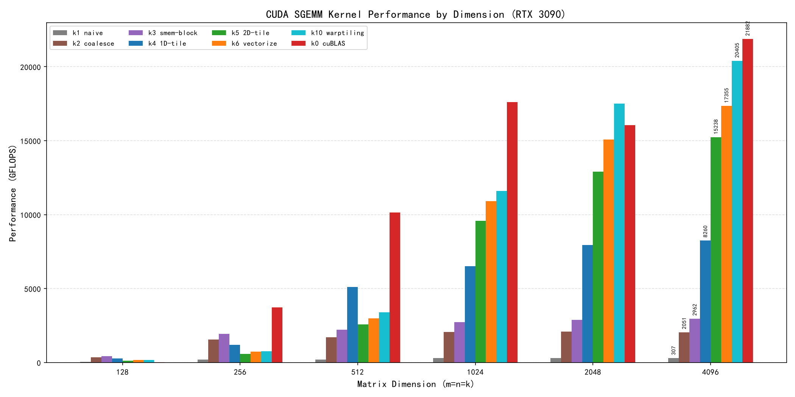

*图 3-1：按尺寸看，k1~k3 长期在几千 GFLOPS 以下；k4 开始抬头；k5、k6、k10 在 1024 维之后才拉开差距。*

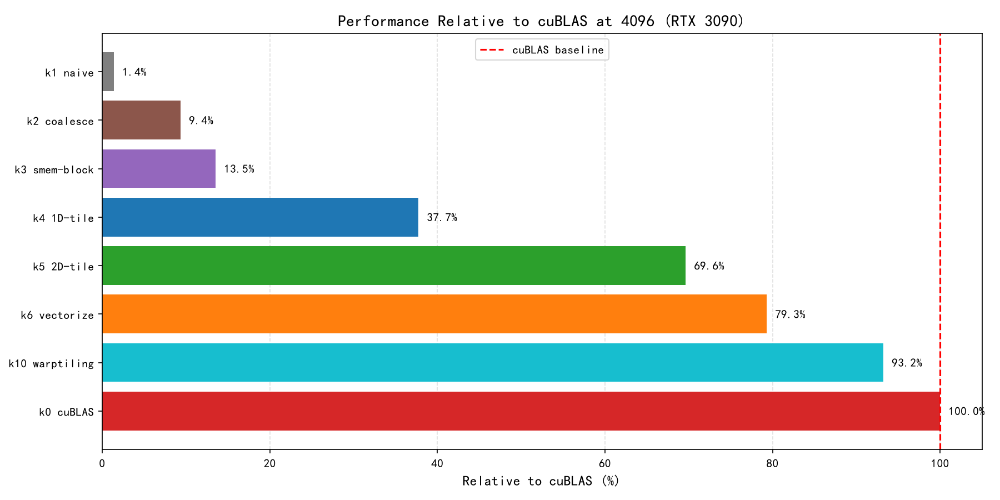

*图 3-2：4096 维、归一化到 cuBLAS。k10 的 93.2% 是这一档的结果，不是整张图的平均。*

两张图要一起看。图 3-1 说明“什么时候开始变快”，图 3-2 说明“最后离 cuBLAS 有多近”。只看后者，容易把 4096 的结果当成普遍结论；只看前者，又会忽略大尺寸才是 k10 的主场。

### 三个阶段

按“动了哪一层”来分，七个 kernel 可以分成三个阶段：

**第一阶段：把地址排对（k1 → k2，6.69×）。**

计算量没有变，线程数没有变，只改了 `x`、`y` 的映射，把“同一个 warp 读 32 个不同行”改成“读同一行的 32 个连续列”。GMEM 事务数降了一个数量级。这是访存模式的收益。

**第二阶段：把数据搬对（k3 → k4，2.79×）。**

从“每个线程算 1 个结果”变成“每个线程算 8 个结果”，把 B 的一个值缓存在寄存器里，复用 8 次；A 的 8 个值也放进寄存器。SMEM 读指令与 FMA 的比例从 2:1 降到 1.125:1。这是寄存器复用的收益。

**第三阶段：把指令压扁（k5 → k6 → k10，累计 1.34×；如果把 k4 也算进来，是 2.47×）。**

k5 用 8×8 的 2D tile 把复用做到 64 个结果；k6 用 `float4` 把每次搬 1 个 float 变成搬 4 个；k10 再把 warp 这一层显式拆出来，让每个线程管 128 个结果。这一阶段的重点是减少指令数和提高 ILP。

### 最大的单步收益

如果看绝对倍数，最大的单步是 k1 → k2 的 6.69×，不是 k3 → k4 的 2.79×。k1 的访存模式问题太严重，修正它带来的收益自然夸张。

如果只看“进入正常优化区间之后”，最大的单步是 k3 → k4 的 2.79×。k3 已经解决了“重复读 GMEM”的问题，接下来的瓶颈是“SMEM 读得太多”，而 k4 第一次让一个操作数被多个 FMA 复用。两种说法都对，只是参照系不同。

### 边际收益递减

把“相对上一级”单独列出来：

```text
6.69× → 1.44× → 2.79× → 1.84× → 1.14× → 1.18× → 1.07×
```

除了 k4 的反弹，整体是递减的。原文提到，前六个 kernel 花了两个周末做到 80%；自动调参和 warptiling 又花了四个周末，才到 94% [1]。最后几个百分点主要靠流水线、bank conflict、shape specialization 和汇编级调度，工程量大，收益有限。

这也是项目停在 k10 的原因：教学目标已经达成，七个层次都走过了；再往下是另一个项目。

---

## 逐站精讲

下面每一站按同样的顺序展开：问题、改动、数据、原因。代码只贴关键片段，完整实现在 `cuda-info/src/kernels/` 下。

### k1：naive

一个线程算一个 C 元素，没有任何复用。

```cpp
__global__ void sgemm_naive(int M, int N, int K, float alpha, const float *A,
                            const float *B, float beta, float *C) {
  const uint x = blockIdx.x * blockDim.x + threadIdx.x;
  const uint y = blockIdx.y * blockDim.y + threadIdx.y;

  if (x < M && y < N) {
    float tmp = 0.0;
    for (int i = 0; i < K; ++i) {
      tmp += A[x * K + i] * B[i * N + y];
    }
    C[x * N + y] = alpha * tmp + beta * C[x * N + y];
  }
}
```

启动配置是 `grid = (ceil(M/32), ceil(N/32))`，`block = (32, 32)`，一个 block 1024 个线程。每个线程沿 K 走一遍，读一行 A、一列 B，点积出 C 的一个元素。


*图 4-1：k1 的映射。每个线程负责 C 的一个格子，沿 K 方向做点积。（原图：Boehm [1]）*

问题主要有三个：

1. **warp 内访存不合并。** 一个 warp 的 32 个 lane 读 A 的 32 个不同行，地址相差 16KB，一次 load 被拆成 32 次 32B 事务。B 那边因为同一列，被广播或缓存接住了。所以 k1 的瓶颈几乎全在 A。
2. **零复用。** 每个线程都独立读 A 的一行、B 的一列。同一行 A 会被 N 个线程重复读，同一列 B 会被 M 个线程重复读。最坏情况下（完全没有 cache），总访存量是 `2·K·M·N` 个 float，4096 维约 550 GB，而理论最少只需要 268 MB。
3. **算术强度低。** 每个结果要做 K 次 FMA，却要搬 2K 个 float，AI 约为 0.5 FLOP/B，离机器平衡点 38 差了 76 倍。

实测 306.7 GFLOPS，耗时约 448 ms。3090 的 FP32 理论峰值是 35.6 TFLOPS，理想计算时间只有 3.9 ms，差了 100 多倍。这个数字和一颗优化良好的 CPU BLAS 在一个量级。

#### Tile quantization

`if (x < M && y < N)` 处理的是 tile quantization：矩阵尺寸不是 32 的倍数时，最后一排 block 会有很多线程闲着。

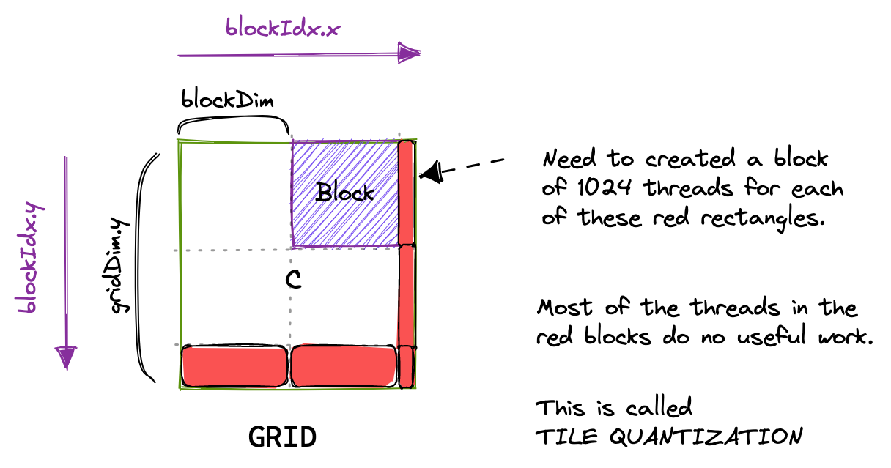

*图 4-2：9 个 block 里只有 4 个是满的。多出来的 block 不干活，但照样占资源。（原图：Boehm [1]）*

项目只测 128、256、512 等 32 的倍数，所以 k1/k2 的 `if` 很少触发。到了 k5/k6/k10，代码里没有边界检查，默认 M、N、K 都是 tile 的整数倍。这是 benchmark 专用实现的一个简化，“经验与常见问题”一节会讨论。

k1 的价值不在性能，而在于它把访存模式和复用这两个问题暴露得足够清楚。

---

### k2：coalesce

把线程的行列映射对调，让同一个 warp 读连续的内存。

只改了两行：

```cpp
const int cRow = blockIdx.x * BLOCKSIZE + (threadIdx.x / BLOCKSIZE);
const int cCol = blockIdx.y * BLOCKSIZE + (threadIdx.x % BLOCKSIZE);
```

同时把 `blockDim` 从 `(32, 32)` 改成一维的 `32 * 32`。这样 `threadIdx.x` 连续的 32 个线程（一个 warp）会有相同的 `cRow`、连续的 `cCol`：

- 读 A：地址是 `A[cRow*K + i]`，32 个 lane 完全一样，硬件广播，一次事务。
- 读 B：地址是 `B[i*N + cCol]`，32 个 lane 连续，合并成 128B，一次事务。
- 写 C：`C[cRow*N + cCol]`，同样连续。


*图 4-3：k1 中 A 的访问是跨行的，warp 内 32 个 lane 落在 32 个不同的 128B 段。（原图：Boehm [1]）*


*图 4-4：A/B/C 的行主序布局、naive kernel 的访存、coalescing kernel 的访存。（原图：Boehm [1]）*

| | k1 | k2 |
|---|---:|---:|
| 4096 GFLOPS | 306.7 | 2050.8 |
| 相对 cuBLAS | 1.4% | 9.4% |
| 相对上一级 | — | 6.69× |
| 耗时 | 448 ms | 67 ms |

计算量没有变，FMA 还是那么多，线程还是那么多。变的是每个 warp 的 32 个地址在内存里的分布：

- k1 读 A：32 个 lane 落在 32 个不同的 128B 段，32 次 32B 事务，实际搬了 `32×32B=1024B`，只用了 `32×4B=128B`，浪费约 8 倍。
- k2 读 A：32 个 lane 读同一个地址，广播，1 次事务。
- k2 读 B：32 个 lane 读连续 128B，1 次 128B 事务，没有浪费。

6.69 倍不是“算得更快”，而是“同样的数据，少搬了 8 倍”。这个数量级和 8 倍浪费是对得上的。

k2 依然有 2K 次 load/线程，依然零复用。它只是去掉了每次 load 的浪费，没有减少 load 的次数。所以它很快撞到 2 TFLOPS 的天花板，图 3-1 里那条棕色的线从 1024 维开始就平了。

访存模式是 GPU 性能的第一道关。不改变计算量，只改变地址顺序，就能快 6.7 倍。后面的 tiling，都是在“已经合并”的基础上，进一步减少搬的次数。

---

### k3：shared memory

一个 block 先把 A、B 的一小块搬进 SMEM，然后反复使用。

k2 的问题是每个线程都独立读一遍。但同一个 block 里的 1024 个线程，读的 A、B 有很大重叠：32×32 的 block tile，只需要 32 行 A 和 32 列 B，共 `32×K + 32×K` 个 float，而不是 `1024×2K` 个。

k3 的做法是：

1. 每个 block 负责 C 的一个 32×32 小块。
2. 沿 K 方向，每次把 A 的 32×32 切片、B 的 32×32 切片搬进 SMEM。
3. `__syncthreads()`，每个线程从 SMEM 做点积。
4. 再 `__syncthreads()`，搬下一片。


*图 4-5：k3 的 block tile。A 的 32×32 切片和 B 的 32×32 切片被搬进 SMEM，C 的 32×32 切片由整个 block 负责。（原图：Boehm [1]）*

关键代码：

```cpp
__shared__ float shared_A[BLOCKSIZE * BLOCKSIZE];
__shared__ float shared_B[BLOCKSIZE * BLOCKSIZE];

A += block_x * BLOCKSIZE * K;                       // 行偏移
B += block_y * BLOCKSIZE;                           // 列偏移
C += block_x * BLOCKSIZE * N + block_y * BLOCKSIZE; // C 的块偏移

for (int i = 0; i < K; i += BLOCKSIZE) {
  shared_A[threadRow * BLOCKSIZE + threadCol] = A[threadRow * K + threadCol];
  shared_B[threadRow * BLOCKSIZE + threadCol] = B[threadRow * N + threadCol];
  __syncthreads();

  A += BLOCKSIZE;
  B += BLOCKSIZE * N;

  for (int j = 0; j < BLOCKSIZE; ++j) {
    tmp += shared_A[threadRow * BLOCKSIZE + j] *
           shared_B[j * BLOCKSIZE + threadCol];
  }
  __syncthreads();
}
```

这里有一个容易写错的细节：指针偏移之后，A 的“宽度”还是 K，而 `shared_A` 的“宽度”是 BLOCKSIZE。所以 `A[threadRow*K + threadCol]` 和 `shared_A[threadRow*BLOCKSIZE + threadCol]` 看起来下标一样，步长不同。

| | k2 | k3 |
|---|---:|---:|
| 4096 GFLOPS | 2050.8 | 2961.9 |
| 相对 cuBLAS | 9.4% | 13.5% |
| 相对上一级 | — | 1.44× |
| 耗时 | 67 ms | 46 ms |

只有 1.44 倍，原因有三个：

1. **k2 的 L1/L2 已经接住了一部分重复读。** k2 的逻辑访存很多，但 A 的同一行会被沿 N 方向的多个 block 重复读，B 的同一列会被沿 M 方向的多个 block 重复读，这些访问很可能在 L1/L2 命中。SMEM 只是把 cache 命中换成了显式缓存，收益没有想象中大。
2. **SMEM 读也要指令。** k3 的每个线程仍然要做 `2×K` 次 `LDS`，才能完成 K 次 FMA。`LDS` 和 `FMA` 是两条指令，SMEM 再快也不能把两条合成一条。profiler 里会看到大量 `LDS`，以及 `Stall MIO Throttle`；对应的指标定义见 Kernel Profiling Guide [4]。
3. **32×32 的 tile 太小，AI 只有 8。** 按 2.4 节的公式，32×32 的 block tile 最多提供 8 FLOP/B 的复用，离 38 还很远。SMEM 减少了 GMEM 流量，但没有改变“每个 A/B 元素只在 32 个结果里被复用”这个事实。

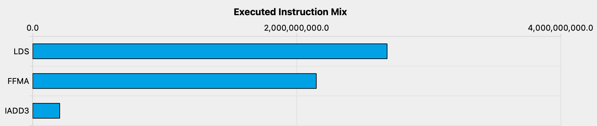

*图 4-6：k3 的指令里，`LDS` 占了很大比例，`FMA` 反而没那么多。（原图：Boehm [1]）*

![k3 的 warp stall 采样（原图：Boehm）]../../img/figs/orig/kernel_3_profiler_warp_stalls.png)

*图 4-7：`Stall MIO Throttle` 很高，说明 warp 在等 SMEM 指令队列。（原图：Boehm [1]）*

SMEM 是缓存，不是计算。它解决“重复读 GMEM”，但不解决“读 SMEM 的次数”。要让每个操作数多干活，需要把数据从 SMEM 再往寄存器搬一层，这是 k4 的工作。

---

### k4：1D blocktiling

每个线程算 C 的一列 8 个元素，B 的一个值复用 8 次。

k3 里每个线程只算 1 个 C 元素，却要读 `2K` 次 SMEM。如果让一个线程算 8 个 C 元素（同一列、8 个不同行），那么：

- 对每个 `dotIdx`，B 只需要读 1 次（`Btmp`），A 读 8 次。
- 一共 9 次 LDS，做 8 次 FMA。
- LDS/FMA 从 2.0 降到 1.125。
- 每个结果分摊的 GMEM 从 `K/16` 降到 `K/32`（block tile 从 32 变成 64）。


*图 4-8：k4 的 block tile 是 64×64，每个线程负责一列 8 个结果（TM=8）。（原图：Boehm [1]）*

#### 指针偏置

k4 里有一段注释，值得单独说明：

```cpp
// very important!!! here the pointer of A has been biased previously
// so you can mentally consider A and As start the same place
// only difference is the width
// which As is BK, A is K
As[threadARow * BK + threadACol] = A[threadARow * K + threadACol];
```

意思是：A 的指针之前已经偏移过，所以可以把 A 和 As 的起点当成同一个地方，区别只是“宽度”：As 的宽度是 BK，A 的宽度是 K。

想象 A 是一张宽 K 列的表；`A += blockRow * BM * K` 之后，指针落在当前 block 的第一行第一列。`As` 是这张表的一个 64×8 窗口，宽 BK=8 列。在窗口里读第 `r` 行第 `c` 列，是 `As[r*BK+c]`；在原表里读同一格，是 `A[r*K+c]`。起点一样，步长不同。

#### 内层循环

```cpp
float ans_container[TM] = {0.0};

for (uint verticalCount = 0; verticalCount < BK; verticalCount++) {
  float targetBElement = Bs[verticalCount * BN + threadCol];

  for (uint i = 0; i < TM; i++) {
    ans_container[i] += targetBElement *
        As[(threadRow * TM + i) * BK + verticalCount];
  }
}
```

`targetBElement` 只读一次，然后在 8 次 FMA 里复用。`ans_container[8]` 是固定大小的数组，循环次数 `TM` 是模板参数，编译期已知，所以 nvcc 会把它展开成 8 个寄存器，而不是在栈上开数组。

| | k3 | k4 |
|---|---:|---:|
| 4096 GFLOPS | 2961.9 | 8260.3 |
| 相对 cuBLAS | 13.5% | 37.7% |
| 相对上一级 | — | 2.79× |
| 耗时 | 46 ms | 17 ms |

2.79 倍的原因可以量化：

- LDS/FMA：2.0 → 1.125，SMEM 读指令少了 44%。
- 每结果 GMEM：`K/16` → `K/32`，少了一半。
- 线程数：1024 → 512，每个线程的寄存器更多，调度开销更小。
- 复用结构：第一次出现“一个操作数（B）被 8 个 FMA 复用”的寄存器级复用。

k3 是“读两个数，做一次 FMA”；k4 是“读 9 个数，做 8 次 FMA”。后者的算术强度立刻上来了。

#### 编译器的作用

原文有一个旁注：如果不手动把 `Btmp` 提出来，而是写成

```cpp
for (uint resIdx = 0; resIdx < TM; ++resIdx) {
  for (uint dotIdx = 0; dotIdx < BK; ++dotIdx) {
    threadResults[resIdx] +=
        As[(threadRow * TM + resIdx) * BK + dotIdx] *
        Bs[dotIdx * BN + threadCol];
  }
}
```

性能其实没有变差。因为 `BK`、`TM` 都是编译期常量，nvcc 会把两层循环展开，然后做公共子表达式消除，把重复的 `Bs` load 合并掉。最后生成的 SASS 和手动提取 `Btmp` 差不多 [1]。

手动写的价值在于可读性和可控性。编译器优化是“它想这么做”，手动写是“明确要求这么做”。在性能关键的代码里，把意图写出来，比赌编译器聪明更稳。

寄存器是离 CUDA Core 最近的存储。让每个操作数在寄存器里多待一会儿、多干几次活，是性价比最高的优化。k4 的 2.79× 不是靠更快的内存，是靠更少的访问。

---

### k5：2D blocktiling

每个线程算 8×8=64 个 C 元素，A 和 B 同时复用。

k4 的 tile 是一根“柱子”：8 行 × 1 列。它只复用了 B，A 的 8 个值每个只用一次。如果把它变成方阵：8 行 × 8 列，那么：

- 每个 `dotIdx` 读 8 个 A + 8 个 B = 16 个操作数。
- 做 8×8=64 次 FMA。
- LDS/FMA 从 1.125 降到 0.25，约 4.5 倍。
- 每个结果分摊的 GMEM 从 `K/32` 降到 `K/64`。

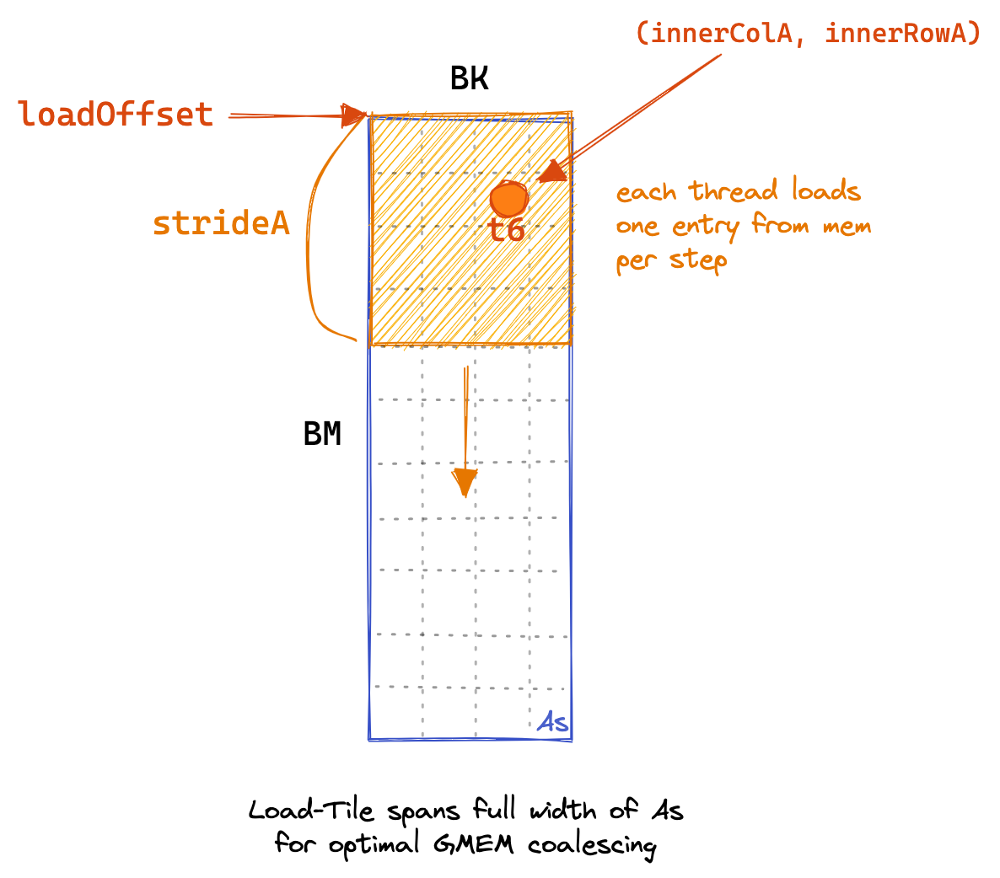

*图 4-9：k5 的 block tile 是 128×128，256 个线程一起把 As（128×8）和 Bs（8×128）填满。每个线程要搬多个元素。（原图：Boehm [1]）*


*图 4-10：每个线程负责 C 的一个 8×8 小方阵，而不是一根 8×1 的柱子。（原图：Boehm [1]）*

#### 线程数的变化

k4 有一个巧合：`BM*BN/TM = 64*64/8 = 512`，而 `BK*BN = 8*64 = 512`，`BM*BK = 64*8 = 512`。所以 512 个线程正好可以“一个线程搬一个元素”，As 和 Bs 各搬一遍就满了。

k5 把 block tile 改成 128×128，线程数变成 `BM*BN/(TM*TN) = 128*128/64 = 256`。但 As 有 `128*8=1024` 个元素，Bs 有 `8*128=1024` 个元素，256 个线程搬不完，必须每个线程搬 4 个。这就是代码注释里说的：

```cpp
// that's obviously incorrect
// in kernel 4, we play this trick cuz we gained the limitation that
// threadCount must be equal to BK * BN and BM * BK
// so we have to do somthing more
```

k5 的加载循环改成了按行分组：

```cpp
uint capableRowsA = totalThreadCountPerBlock / BK;   // 256/8 = 32
for (uint groupCount = 0; groupCount < BM; groupCount += capableRowsA) {
  As[(innerRowA + groupCount) * BK + innerColA] =
      A[(innerRowA + groupCount) * K + innerColA];
}
```

`innerRowA = tid / BK` 覆盖 0~31 行，`groupCount` 每次加 32，循环 4 次，覆盖 128 行。Bs 同理，`capableRowsB = 256/128 = 2`，每次覆盖 2 行，循环 4 次。

#### 内层循环

```cpp
float threadResults[TM * TN] = {0.0};
float regA[TM] = {0.0};
float regB[TN] = {0.0};

for (uint slice = 0; slice < BK; slice++) {
  for (uint i = 0; i < TM; i++) {
    regA[i] = As[(threadRow * TM + i) * BK + slice];
  }
  for (uint i = 0; i < TN; i++) {
    regB[i] = Bs[slice * BN + threadCol * TN + i];
  }

  for (uint resIdxM = 0; resIdxM < TM; resIdxM++) {
    for (uint resIdxN = 0; resIdxN < TN; resIdxN++) {
      threadResults[resIdxM * TN + resIdxN] +=
          regA[resIdxM] * regB[resIdxN];
    }
  }
}
```

这是一个标准的 outer product：`regA` 是 8×1 的列向量，`regB` 是 1×8 的行向量，它们的张量积是一个 8×8 的矩阵，累加到 `threadResults` 上。


*图 4-11：把 `dotIdx` 循环展开，每个时间步只把 4 个 A 和 4 个 B 装进寄存器，然后做 16 次 FMA。整个循环需要 16 个标量 SMEM 操作数；其中 Bs 的 8 个会被编译器合并成 2 条 `LDS.128`。（原图：Boehm [1]）*

| | k4 | k5 |
|---|---:|---:|
| 4096 GFLOPS | 8260.3 | 15237.5 |
| 相对 cuBLAS | 37.7% | 69.6% |
| 相对上一级 | — | 1.84× |
| 耗时 | 17 ms | 9 ms |

LDS/FMA 降了 4.5 倍，性能只涨了 1.84 倍，原因有三点：

- **寄存器压力上来了。** 64 个累加器 + 16 个操作数 + 地址/循环变量，每个线程至少 80~90 个寄存器。256 个线程 × 90 ≈ 23000 个寄存器/block，一个 SM 最多放 2 个 block（省一点能挤进 3 个），occupancy 掉到 30%~50%。
- **SMEM 不是唯一瓶颈。** k5 的 LDS/FMA 已经降到 0.25，SMEM 指令不再压倒一切；计算、地址计算、同步、寄存器 bank 开始成为新的限制。
- **Amdahl 定律。** 只优化了“SMEM 读”这一段，其他段（GMEM 加载、同步、写回）没有变，总时间不可能按 4.5 倍缩。

#### 寄存器数组

代码注释里有一句：

```cpp
// we store a slice into register arrays
// why regA and regB are register-level arrays?
// that's the compiler's thicky method to upgrade such arrays
```

这里的 `thicky` 应该是 `tricky`。意思是：固定大小、编译期索引的数组，会被编译器提升成寄存器；如果索引是运行期才知道的，就会掉到 local memory（本质上是 GMEM），性能会明显下降。

`regA[TM]`、`regB[TN]`、`threadResults[TM*TN]` 的下标都来自 `constexpr` 的循环变量，nvcc 能把它们全部展开成标量寄存器。这也是这些数组要用模板参数 `TM`、`TN` 定义，而不是用运行期变量的原因。

一个简单的验证方法：编译时加 `--ptxas-options=-v`，看输出里的 local memory 是否为 0；或者用 Nsight Compute 看 Local Memory 的统计。如果 local memory 不是 0，先查索引，再调 tile。

2D tile 比 1D tile 更划算，因为 A 和 B 的复用同时增加。但寄存器是有限的，8×8 已经接近甜点；再大，累加器就要溢出到 local memory。

---

### k6：vectorize

把 `float` 换成 `float4`，让一条指令搬 16 字节；同时转置 As，让 A 的 SMEM 读也能向量化。

k5 的瓶颈已经从“SMEM 读太多”变成“指令太多”。源码层面，每个 `dotIdx` 线程要读 16 个操作数（8 个 A + 8 个 B）；编译器能把 Bs 的 8 个合并成 2 条 `LDS.128`，但 As 的 8 个仍然是一条条标量 `LDS`，因为 As 在 K 方向的布局不连续。如果能把 4 个连续的 `float` 合并成一条 128-bit 的 `LDS.128` / `LDG.128`，A 这边的指令数就能降到 1/4。

这里有一个不对称：

- **B 本来就是连续的。** `Bs[slice*BN + threadCol*TN + i]`，`i` 连续，可以直接 `float4`。
- **A 不是连续的。** `As[(threadRow*TM+i)*BK + slice]`，`i` 变化时地址跳 `BK`，是沿列走。要让它连续，必须把 As 在 SMEM 里转置成 `[BK][BM]`。


*图 4-12：把 As 转置成 BK×BM 之后，`regM` 的 8 个值在内存里连续，可以用 `LDS.128` 一次读 4 个。（原图：Boehm [1]）*

#### 声明不变，用法变了

```cpp
// attention here: we still make As as BM * BK
// but actually we use As as BK * BM
// inorder to enhance cache
__shared__ float As[BM * BK];
__shared__ float Bs[BK * BN];
```

`As` 的大小还是 `BM*BK` 个 float，只是索引方式变成了 `As[k*BM + m]`。同一块内存，按行优先或列优先使用，面积不变，访问模式不同。

写入的时候：

```cpp
float4 tmp = reinterpret_cast<float4 *>(&A[innerRowA * K + innerColA * 4])[0];

As[(innerColA * 4 + 0) * BM + innerRowA] = tmp.x;
As[(innerColA * 4 + 1) * BM + innerRowA] = tmp.y;
As[(innerColA * 4 + 2) * BM + innerRowA] = tmp.z;
As[(innerColA * 4 + 3) * BM + innerRowA] = tmp.w;
```

从 GMEM 读进来是 `float4`（4 个连续的 A 元素），但写进 SMEM 时要竖着放，所以只能拆成 4 个标量写。B 那边不需要转置，直接 `float4` 读、`float4` 写。

#### 关于 `const`

文件顶部有一句注释：

```cpp
// in case we use reinterpret_cast, here we didn't put const before pointer to A and B
__global__ void sgemmVectorize(int M, int N, int K, float alpha, float *A, float *B, ...)
```

因为 `reinterpret_cast<float4*>(&A[...])` 会把 `const float*` 转成 `float4*`，这在 C++ 里是去掉 const，编译器会报错。更干净的做法是用 `const float4*` 读、`float4*` 写，或者保留 `const` 并用 `const_cast`；为了代码短，直接把参数改成 `float*` 也能工作。数据本身仍然是只读的，只是类型系统上不再保证。

| | k5 | k6 |
|---|---:|---:|
| 4096 GFLOPS | 15237.5 | 17354.9 |
| 相对 cuBLAS | 69.6% | 79.3% |
| 相对上一级 | — | 1.14× |
| 耗时 | 9 ms | 7.9 ms |

向量化把 A 的 GMEM 加载和 As 的 SMEM 读从标量变成了 128-bit，相关指令数降到 1/4；但 Bs 的读取之前已经被编译器向量化了，所以整体收益没有 4 倍那么夸张。再加上：

- FMA 的数量没变。64 次 FMA 还是 64 次，它才是计算的主体。
- SMEM 带宽没变。`LDS.128` 一次搬 16B，但 SMEM 的吞吐上限还在。
- 地址计算和循环开销没有完全消失。虽然少了 3/4 的 load 指令，索引、同步、写回还在。

向量化是锦上添花，不是雪中送炭。它适合在“已经算得比较多”的阶段使用；如果还在“搬得多”的阶段，应该先做 tiling。

#### 转置 As 的 bank conflict

As 的写入变成了“4 个连续的 A 元素，竖着写到 4 行”。同一个 warp 的 32 个 lane，`innerRowA = lane/4`、`innerColA = lane%4`，写入地址是 `(innerColA*4+j)*BM + innerRowA`。因为 `BM=128` 是 32 的倍数，`bank = innerRowA % 32`，而 4 个 `innerColA` 不同的 lane 会落在同一个 bank 上，这是一个 4-way bank conflict。

读的收益大于写的损失：`regM` 的 8 次标量 `LDS` 变成了 2 次 `LDS.128`，而写只发生在每轮 BK 搬一次的时候。原文的 k7/k8 想继续消 conflict，但整体反而更慢 [1]。优化是有取舍的，不能只看一个指标。

向量化省的是指令，不是带宽。它让“搬 4 个”变成一条指令，但不会让 SMEM 变快。真正决定性能的，还是搬了多少次、算了多少次。

---

### k7、k8、k9

编号从 6 跳到 10，是因为沿用原文的顺序 [1]：

- k7、k8：尝试消除 SMEM bank conflict 的两个版本。conflict 消掉了，但整体更慢，原文没有展开，本项目也没有放进来。
- k9：自动调参版本。把 `BM`、`BN`、`BK`、`TM`、`TN` 的组合跑了几百组，找出当前 GPU 上最好的一组。
- k10：warptiling，在参数空间之上再加一层 `WM`、`WN`、`WNITER`。

项目没有实现 k9，但保留了原文的两套手调参数：

```cpp
// Settings for A100
// const uint K10_NUM_THREADS = 128;
// const uint K10_BN = 128;
// const uint K10_BM = 64;
// const uint K10_BK = 16;
// const uint K10_WN = 64;
// const uint K10_WM = 32;
// const uint K10_WNITER = 1;
// const uint K10_TN = 4;
// const uint K10_TM = 4;

// Settings for A6000
const uint K10_NUM_THREADS = 128;
const uint K10_BN = 128;
const uint K10_BM = 128;
const uint K10_BK = 16;
const uint K10_WN = 64;
const uint K10_WM = 64;
const uint K10_WNITER = 4;
const uint K10_TN = 4;
const uint K10_TM = 8;
```

这段注释说明了一件事：同一份代码，换一张卡，最优参数会变。A100 的 FP32 性能弱于 A6000，SM 数也不同，所以它更适合瘦一点的 tile（BM=64、TM=TN=4、WNITER=1）；A6000/3090 更适合胖一点的 tile（BM=BN=128、TM=8、WNITER=4）。

没有写自动调参脚本，但把约束写成了 `static_assert`。调参可以慢慢试，约束错了会直接算错。

```cpp
static_assert((K10_BN % K10_WN == 0) and (K10_BM % K10_WM == 0));
static_assert((K10_BN / K10_WN) * (K10_BM / K10_WM) == NUM_WARPS);
static_assert((K10_WM * K10_WN) % (WARPSIZE * K10_TM * K10_TN * K10_WNITER) == 0);
static_assert((K10_WM % K10_WMITER == 0) and (K10_WN % K10_WNITER == 0));
static_assert((K10_NUM_THREADS * 4) % K10_BK == 0, ...);
static_assert((K10_NUM_THREADS * 4) % K10_BN == 0, ...);
static_assert(K10_BN % (16 * K10_TN) == 0, ...);
static_assert(K10_BM % (16 * K10_TM) == 0, ...);
static_assert((K10_BM * K10_BK) % (4 * K10_NUM_THREADS) == 0, ...);
static_assert((K10_BN * K10_BK) % (4 * K10_NUM_THREADS) == 0, ...);
```

逐条说明：

| 约束 | 作用 |
|---|---|
| `BN % WN == 0`、`BM % WM == 0` | warp 网格是整数个，不会切出半个 warp tile |
| `(BN/WN)*(BM/WM) == NUM_WARPS` | 每个 warp 正好分到一块 |
| `WM*WN % (32*TM*TN*WNITER) == 0` | 一个 warp tile 能被 32 个 lane 的 thread tile 整除 |
| `WM % WMITER == 0`、`WN % WNITER == 0` | 子 tile 是整数个 |
| `NUM_THREADS*4 % BK == 0` | 每次 GMEM 加载不会在 As 的最后一行留下半行 |
| `NUM_THREADS*4 % BN == 0` | 同理，不会在 Bs 的最后一行留下半行 |
| `BN % (16*TN) == 0`、`BM % (16*TM) == 0` | 线程 tile 在 M/N 方向能整齐铺开 |
| `BM*BK % (4*NUM_THREADS) == 0`、`BN*BK % (4*NUM_THREADS) == 0` | As/Bs 的总元素数能被“线程数×4”整除，每个线程正好搬 4 个 float |

一处小问题：有几条错误信息里写的是 `K9_BN`、`K9_BK`，是从 k9 复制过来没改。不影响编译，但报错时会让人愣一下。“经验与常见问题”一节把它列进了常见问题清单。

---

### k10：warptiling

这一节是全文最长的一节。先看循环结构，再看 warp 的划分，然后逐段读代码，最后回到原文的图。

#### 循环结构

k6 之前的循环大致是：

```text
for each block tile:            // block 负责 C 的一块
  for each BK step:             // 沿 K 滑动
    load As, Bs from GMEM
    for each dotIdx in BK:      // 沿 K 的细粒度
      load regA, regB from SMEM
      for each TM, TN:          // 线程 tile
        FMA
```

k10 保留了这个结构，只是把“线程 tile”那一层拆成了“warp tile → thread tile”两层。原文的循环结构图：


*图 4-13：三层循环。Loop1 是 block 沿 K 滑动，负责 GMEM→SMEM；Loop2 是线程沿 BK 滑动，负责 SMEM→寄存器；Loop3&4 是寄存器里的外积，负责寄存器→CUDA core。（原图：Boehm [1]）*

这张图对应的原则是：

> 先加载一些数据，然后在这些数据上做尽可能多的计算。

BK 循环放在最外层，意味着每次只搬一小块，但这一小块要被反复用很多次。BK 里面的计算彼此独立，所以可以并行、可以利用 ILP，也可以为将来的 double buffering 留接口。

#### warp 的划分

k1~k6 里 warp 是隐式的：代码只写 block 和 thread，warp 由硬件划分。到了 k10，需要显式回答三个问题：

1. 这个 block 里有几个 warp？128 个线程 / 32 = 4 个。
2. 每个 warp 负责 C 的哪一块？128×128 的 block tile，切成 2×2 个 64×64 的 warp tile。
3. 每个 warp 里的 32 个 lane 怎么分？每个 lane 负责 8×16 个 C 元素，32 个 lane 正好铺满 64×64。

对应代码：

```cpp
const uint warpIdx = threadIdx.x / WARPSIZE;      // 第几个 warp
const uint warpCol = warpIdx % (BN / WN);         // warp 在 N 方向的位置
const uint warpRow = warpIdx / (BN / WN);         // warp 在 M 方向的位置
```

代入 `BN=128, WN=64`，`BN/WN=2`：

| warpIdx | warpRow | warpCol | 负责的 C 区域 |
|---:|---:|---:|---|
| 0 | 0 | 0 | 行 0~63，列 0~63 |
| 1 | 0 | 1 | 行 0~63，列 64~127 |
| 2 | 1 | 0 | 行 64~127，列 0~63 |
| 3 | 1 | 1 | 行 64~127，列 64~127 |

warpIdx 先沿列走，再沿行走。这和 CUDA 的 `threadIdx.x` 最快变化一致，目的是让相邻 warp 覆盖相邻的列，SMEM 和 L2 的局部性更好。

#### 参数落位

k10 的模板参数比前面多：

| 符号 | 取值 | 含义 |
|---|---:|---|
| `BM`, `BN` | 128, 128 | 一个 block 负责的 C 子块 |
| `BK` | 16 | 每次沿 K 搬多厚 |
| `WM`, `WN` | 64, 64 | 一个 warp 负责的 C 子块 |
| `WNITER` | 4 | warp tile 在 N 方向再切几刀 |
| `TM`, `TN` | 8, 4 | 每个线程一次累加的小块 |
| `NUM_THREADS` | 128 | 4 个 warp |
| `WMITER` | 1（公式推出） | warp tile 在 M 方向再切几刀 |
| `WSUBM`, `WSUBN` | 64, 16（公式推出） | warp 子块的 M/N 尺寸 |

推导链：

```text
NUM_WARPS = 128 / 32 = 4
warp 网格 = (BM/WM) × (BN/WN) = 2 × 2 = 4        // 每个 warp 一块
WMITER = (WM × WN) / (32 × TM × TN × WNITER)
       = (64 × 64) / (32 × 8 × 4 × 4)
       = 4096 / 4096
       = 1
WSUBM = WM / WMITER = 64 / 1 = 64
WSUBN = WN / WNITER = 64 / 4 = 16
```

再把 32 个 lane 铺到 `WSUBM × WSUBN` 上：

```text
每行 lane 数 = WSUBN / TN = 16 / 4 = 4
行数        = WSUBM / TM = 64 / 8 = 8
总 lane 数  = 4 × 8 = 32        // 正好一个 warp
```

每个线程的累加器数量：

```text
TM × (WNITER × TN) = 8 × (4 × 4) = 128
```

验证总数：

```text
每 warp: 32 lane × 128 = 4096 = 64 × 64
每 block: 4 warp × 4096 = 16384 = 128 × 128
```

完全对得上。这个推导不依赖经验，全是整除关系。把这张表推出来，k10 的代码就读懂一半了。

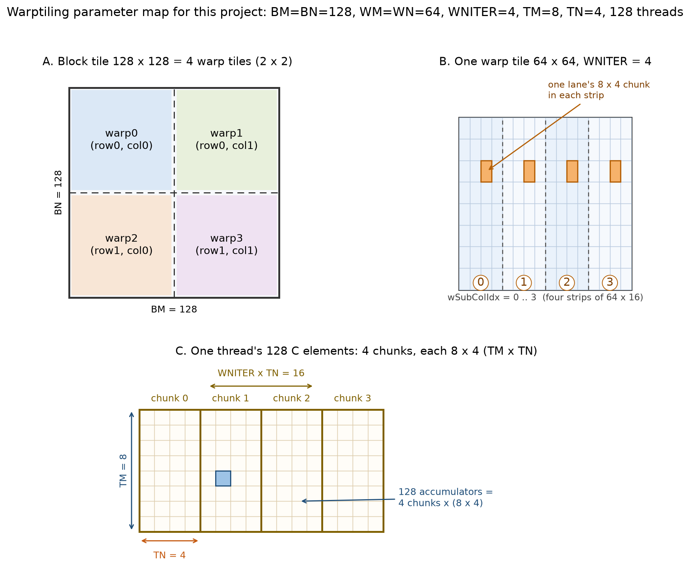

*图 4-14：把 BM=BN=128、WM=WN=64、WNITER=4、TM=8、TN=4 代进去之后的样子。A：一个 block 切成 4 个 warp tile；B：一个 warp tile 切成 4 条 64×16 的竖条，每条由 32 个 lane 铺满；C：一个线程在 4 条竖条里各拿一个 8×4 的小块，合计 128 个累加器。*

- A 图回答“4 个 warp 怎么分 128×128”。
- B 图回答“一个 warp 的 64×64 怎么切成 4 条 64×16”。
- C 图回答“一个线程的 128 个结果从哪来”。

#### 代码

**(1) 线程索引**

```cpp
const uint threadIdxInWarp = threadIdx.x % WARPSIZE;          // [0, 31]
const uint threadColInWarp = threadIdxInWarp % (WSUBN / TN);  // lane % 4
const uint threadRowInWarp = threadIdxInWarp / (WSUBN / TN);  // lane / 4
```

代入 `WSUBN/TN=4`：

| lane | threadRowInWarp | threadColInWarp |
|---:|---:|---:|
| 0~3 | 0 | 0~3 |
| 4~7 | 1 | 0~3 |
| 8~11 | 2 | 0~3 |
| … | … | … |
| 28~31 | 7 | 0~3 |

一个 warp 的 32 个 lane 被排成了一个 8 行 × 4 列的小网格。每个 lane 负责一个 8×4 的 thread tile；4 个 lane 并排，覆盖 `WSUBN=16` 列；8 行并排，覆盖 `WSUBM=64` 行。

**(2) C 指针**

```cpp
C += (cRow * BM + warpRow * WM) * N + cCol * BN + warpCol * WN;
```

`cRow*BM` 是 block 在 M 方向的起点，`warpRow*WM` 是 warp 在 block 内的行偏移；`cCol*BN` 是 block 在 N 方向的起点，`warpCol*WN` 是 warp 的列偏移。之后每个线程再在自己的 warp tile 里偏移。

**(3) GMEM → SMEM：A 转置，B 直搬**

```cpp
for (uint offset = 0; offset + rowStrideA <= BM; offset += rowStrideA) {
  const float4 tmp = reinterpret_cast<const float4 *>(
      &A[(innerRowA + offset) * K + innerColA * 4])[0];

  As[(innerColA * 4 + 0) * BM + innerRowA + offset] = tmp.x;
  As[(innerColA * 4 + 1) * BM + innerRowA + offset] = tmp.y;
  As[(innerColA * 4 + 2) * BM + innerRowA + offset] = tmp.z;
  As[(innerColA * 4 + 3) * BM + innerRowA + offset] = tmp.w;
}
```

A 这边的坐标：

```text
innerRowA = threadIdx.x / (BK / 4)   // 128/4 = 32 → 0..31
innerColA = threadIdx.x % (BK / 4)   // 0..3
rowStrideA = (NUM_THREADS * 4) / BK  // 512/16 = 32
```

`innerRowA` 覆盖 0~31 行，`offset` 每次加 32，循环 4 次，覆盖 0~127 行；`innerColA` 覆盖 0~3 个 4 列组，也就是 BK=16 列。每个线程一次搬 4 个 float，128 个线程一次搬 512 个 float；As 一共 128×16=2048 个 float，4 次搬完。

B 这边：

```text
innerRowB = threadIdx.x / (BN / 4)   // 128/32 = 4 → 0..3
innerColB = threadIdx.x % (BN / 4)   // 0..31
rowStrideB = NUM_THREADS / (BN / 4)  // 128/32 = 4
```

`innerRowB` 覆盖 0~3 行，`offset` 每次加 4，循环 4 次，覆盖 0~15 行（BK=16）；`innerColB` 覆盖 0~31 个 4 列组，也就是 BN=128 列。同样是 4 次搬完。

A 的写入是转置的：`As[(col)*BM + row]`；B 的写入是原样的：`Bs[row*BN + col]`。原因在 4.6 节：A 要在 `dotIdx` 方向上连续读，必须转置；B 本来就是按行连续，不需要。

**(4) 被注释掉的 PTX**

```cpp
// float4 tmp;
// asm("ld.global.nc.v4.f32 {%0, %1, %2, %3}, [%4];"
//     : "=f"(tmp.x), "=f"(tmp.y), "=f"(tmp.z), "=f"(tmp.w)
//     : "l"(&A[(innerRowA + offset) * K + innerColA * 4]));
```

这是实验过的手写 PTX 加载。`ld.global.nc` 的 `nc` 是 non-coherent，走只读数据缓存（也就是 `__ldg` 那条路），`v4.f32` 是一次读 4 个 float。最后没有采用，改用 `reinterpret_cast<const float4*>`，理由有三：

1. `float4` 已经能让 nvcc 生成 `LDG.E.128`，没必要手写。
2. 手写 PTX 把“指针是 16B 对齐”这个假设硬编码进去了，换一个 K 或换一个分配器就可能崩。
3. 内联汇编会挡住编译器的一些优化，比如重排和 CSE。

这段注释记录了一个“曾经想手动控制，后来发现没必要”的过程。知道什么时候不该手写，比会手写更重要。

**(5) SMEM → 寄存器**

```cpp
for (uint dotIdx = 0; dotIdx < BK; ++dotIdx) {
  for (uint wSubRowIdx = 0; wSubRowIdx < WMITER; ++wSubRowIdx) {
    for (uint i = 0; i < TM; ++i) {
      regM[wSubRowIdx * TM + i] =
          As[(dotIdx * BM) + warpRow * WM + wSubRowIdx * WSUBM +
             threadRowInWarp * TM + i];
    }
  }
  for (uint wSubColIdx = 0; wSubColIdx < WNITER; ++wSubColIdx) {
    for (uint i = 0; i < TN; ++i) {
      regN[wSubColIdx * TN + i] =
          Bs[(dotIdx * BN) + warpCol * WN + wSubColIdx * WSUBN +
             threadColInWarp * TN + i];
    }
  }

  for (uint wSubRowIdx = 0; wSubRowIdx < WMITER; ++wSubRowIdx) {
    for (uint wSubColIdx = 0; wSubColIdx < WNITER; ++wSubColIdx) {
      for (uint resIdxM = 0; resIdxM < TM; ++resIdxM) {
        for (uint resIdxN = 0; resIdxN < TN; ++resIdxN) {
          threadResults[(wSubRowIdx * TM + resIdxM) * (WNITER * TN) +
                        (wSubColIdx * TN) + resIdxN] +=
              regM[wSubRowIdx * TM + resIdxM] *
              regN[wSubColIdx * TN + resIdxN];
        }
      }
    }
  }
}
```

按“搬”和“算”分开：

- 搬：`regM` 搬 `WMITER*TM = 8` 个，`regN` 搬 `WNITER*TN = 16` 个，一共 24 个 float。As 转置、Bs 连续，编译器会把它们合并成 `2 + 4 = 6` 条 `LDS.128`（理想情况）。
- 算：`WMITER * WNITER * TM * TN = 1 * 4 * 8 * 4 = 128` 次 FMA。每个 `regM` 值被 16 个 `regN` 复用，每个 `regN` 值被 8 个 `regM` 复用。

24 个标量操作数（理想情况下 6 条 `LDS.128`），128 次 FMA。每搬 1 个操作数，平均做 5.33 次 FMA。k6 是 16 个标量操作数 / 64 次 FMA（4.0），k10 又高了一截。

`threadResults` 的索引：

```text
(wSubRowIdx * TM + resIdxM) * (WNITER * TN) + wSubColIdx * TN + resIdxN
```

因为 `WMITER=1`，退化成：

```text
resIdxM * 16 + wSubColIdx * 4 + resIdxN
```

也就是把 128 个结果按 8 行 × 16 列行主序排开。`resIdxM` 是行，`wSubColIdx*4+resIdxN` 是列。写回 C 时，`float4` 的 4 个连续元素正好在 `resIdxN` 方向。

**(6) 主循环**

```cpp
for (uint bkIdx = 0; bkIdx < K; bkIdx += BK) {
  wt::loadFromGmem<...>(...);
  __syncthreads();
  wt::processFromSmem<...>(...);
  A += BK;      // 指向下一列的 A 切片
  B += BK * N;  // 指向下一行的 B 切片
  __syncthreads();
}
```

两次同步各有作用：

- 第一次：保证所有线程都把 As/Bs 填好，再去读。
- 第二次：保证所有线程都算完当前 BK 切片，再去覆盖 As/Bs。

这两次同步也是 k10 的代价：在同步点，所有 warp 都要等最慢的那个；加载和计算没有重叠。这正是 double buffering / `cp.async` 要解决的问题，也是 93% 之后最大的一块优化空间。

**(7) 写回**

```cpp
float4 tmp = reinterpret_cast<float4 *>(
    &C_interim[(threadRowInWarp * TM + resIdxM) * N +
               threadColInWarp * TN + resIdxN])[0];

tmp.x = alpha * threadResults[i + 0] + beta * tmp.x;
tmp.y = alpha * threadResults[i + 1] + beta * tmp.y;
tmp.z = alpha * threadResults[i + 2] + beta * tmp.z;
tmp.w = alpha * threadResults[i + 3] + beta * tmp.w;
```

因为 `TN=4`，每个线程的每一行正好是 4 个连续的 float，可以一次 `float4` 读、一次 `float4` 写。这里隐含一个假设：`TN % 4 == 0`。如果以后把 `TN` 改成 8，这段还能用；改成 2，就会越界。`static_assert(K10_BN % (16*TN) == 0)` 只能保证整除，不能保证 `TN` 是 4 的倍数，所以这是一个靠约定维持的地方。

#### 为什么 k10 能到 93%

| | k5 | k6 | k10 |
|---|---:|---:|---:|
| Block tile | 128×128 | 128×128 | 128×128 |
| BK | 8 | 8 | 16 |
| 线程/Block | 256 | 256 | 128 |
| 结果/线程 | 64 | 64 | 128 |
| LDS / FMA | 0.25 | 0.25 | 0.1875 |
| 每结果 GMEM | K/64 | K/64 | K/64 |
| SMEM / Block | 8 KB | 8 KB | 16 KB |
| 4096 GFLOPS | 15237.5 | 17354.9 | 20405.1 |

表中的 `LDS / FMA` 按标量操作数计，方便比较复用结构；实际 SASS 里 Bs/regN 会被向量化成 `LDS.128`，指令数比这个比值更少。

两个容易误解的点：

1. k10 没有减少 GMEM 流量。block tile 还是 128×128，每结果 GMEM 还是 `K/64`。它优化的是 SMEM→寄存器这一段，以及 warp 级的调度。
2. k10 的 1.18× 不是纯 warptiling 的功劳。它同时把 BK 从 8 改成 16、线程从 256 改成 128、每线程结果从 64 改成 128。严格来说，这是一个组合改动。更准确的写法是“warptiling + 参数调整”，而不是“warptiling 提升 18%”。

k10 做对的事情：

- 每个线程 128 个独立累加器，ILP 拉满。一个 `dotIdx` 里有 128 次互不依赖的 FMA，编译器可以把 `LDS`、`FFMA`、地址计算交错排开，延迟藏得很好。
- warp tile 是连续的 64×64。同一个 warp 的 32 个 lane 访问的 SMEM 范围更集中，bank 行为更好分析，寄存器缓存的局部性也更好。
- 每个 warp 的 SMEM 读更整齐。`regM` 的 8 个值来自同一列、连续 8 行；`regN` 的 16 个值来自同一行、连续 16 列。转置之后，它们都能变成 `LDS.128`。
- 128 个线程/block，寄存器够用。152 个数据寄存器 + 约 20 个临时寄存器，离 255 的上限还有空间，不会 spill。256 个线程反而会让每个线程的寄存器变少，逼着缩小 tile。

寄存器账：

```text
threadResults: 128
regM:           8
regN:          16
--------------------
数据寄存器:    152
临时/地址:    ~20
--------------------
合计:         ~172 个/线程
```

128 个线程 × 172 ≈ 22016 个寄存器/block。每个 SM 有 65536 个寄存器，按 2~3 个 block 算，刚好能放下。Occupancy 大约 `(2~3)×4 / 48 ≈ 17%~25%`。这就是 2.5 节说的“低占用率 + 高 ILP”。

#### 原文的三层 tiling 图

原文的图很长，从上到下分成四层，对应“Whole GPU → Each SM → Each Warp → Each Thread”。为了在文档里看清，切成上下两半：上半张是前两层，下半张是后两层。

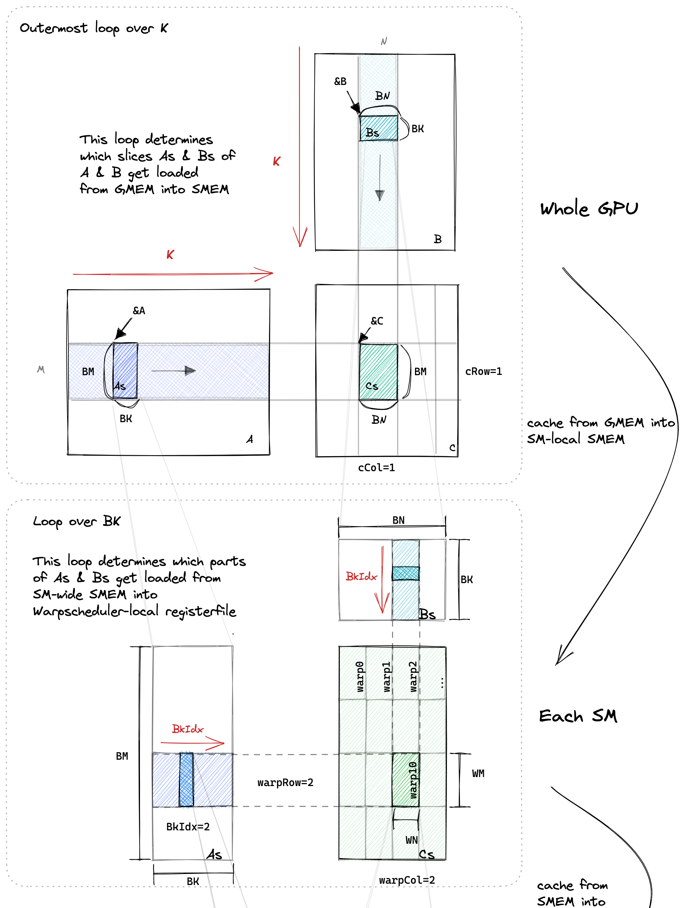

*图 4-15a：Whole GPU 的 K 循环，以及每个 SM 上 4 个 warp tile 的分工。（原图：Boehm [1]）*

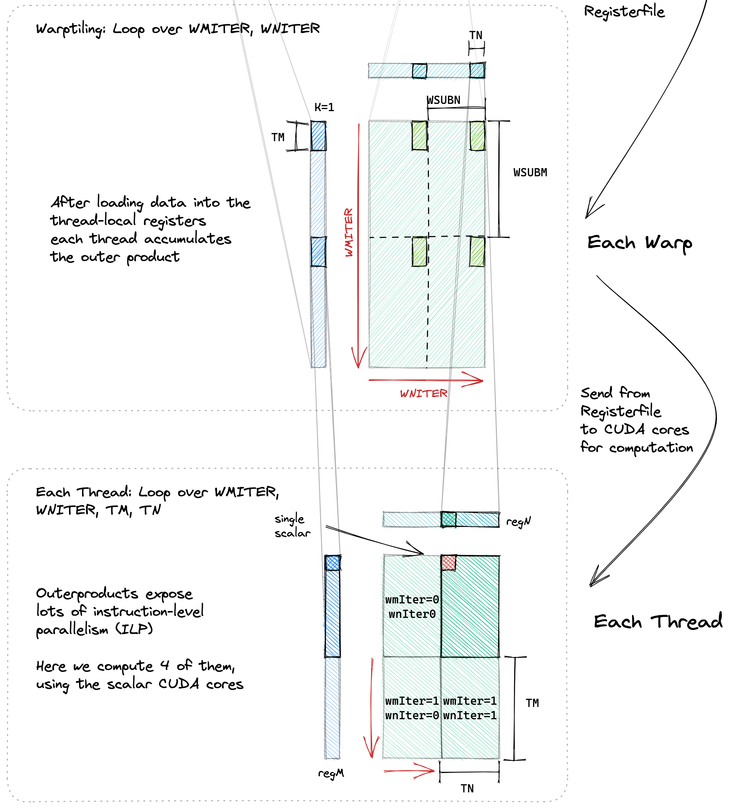

*图 4-15b：一个 warp 内部的 WMITER/WNITER 子块，以及一个线程的 8×16 累加器（4 个 8×4 小块）。（原图：Boehm [1]）*

按四层逐层说明：

**第一层：Whole GPU（上半张的最上面）**

- 左边是 A（M×K），右边是 B（K×N），下面是 C（M×N）。
- 红色箭头表示最外层的 K 循环：A 的 BM×BK 切片向右滑，B 的 BK×BN 切片向下滑。
- C 上的绿色块是当前 block 负责的 BM×BN 区域。
- 这一层回答：哪个 block 算 C 的哪一块，它要沿 K 搬哪些数据。

**第二层：Each SM（上半张的下半部分）**

- 视角拉近到一个 block。As 是 BM×BK，Bs 是 BK×BN。
- C 的 BM×BN 被切成 4 个 64×64 的 warp tile，标着 `warp0`、`warp1`、`warp2`、`warp3`。
- 红色的 `BkIdx` 表示沿 BK 的循环：每次取 As 的一列、Bs 的一行。
- 这一层回答：4 个 warp 怎么分这个 block tile，每个 warp 的 64×64 在哪。

**第三层：Each Warp（下半张的上半部分）**

- 视角再拉近到一个 64×64 的 warp tile。
- `WMITER`、`WNITER` 是 warp tile 内部的再切分：`WMITER=1` 表示 M 方向不再切，`WNITER=4` 表示 N 方向切成 4 条 64×16。
- `regM` 是从 As 里搬出来的 8 个值（一列），`regN` 是从 Bs 里搬出来的 16 个值（一行）。
- 绿色的 8×4 小格是每个 lane 的 thread tile。
- 这一层回答：一个 warp 的 32 个 lane 怎么铺满 64×64，它们各自从 SMEM 的哪里取数。

**第四层：Each Thread（下半张的最下面）**

- 视角最后拉近到一个 lane。
- `regM` 是 8 个标量，`regN` 是 16 个标量；它们做外积，得到 8×16=128 个结果。
- 图上的小格标着 `wmIter` / `wnIter` 的组合，示意 4 个 8×4 的小块拼成 8×16。
- 这一层回答：一个线程手里有几个累加器，它一次能做多少次独立 FMA。

四层连起来：

> GPU 按 block 分 C，SM 按 warp 分 block，warp 按 lane 分 warp tile，lane 按寄存器做外积。

代码变量和图上的位置：

| 代码变量 | 图上的位置 |
|---|---|
| `cRow`, `cCol` | 第一层 C 的块坐标 |
| `warpRow`, `warpCol` | 第二层 4 个 warp tile 的位置 |
| `wSubRowIdx`, `wSubColIdx` | 第三层的 WMITER/WNITER 子块 |
| `threadRowInWarp`, `threadColInWarp` | 第三层绿色小格的行列 |
| `regM`, `regN` | 第三层的两条数据流 |
| `threadResults` | 第四层的 8×16 结果网格 |

这张图可以当作 k10 的说明书。读代码卡住的时候，先判断当前在哪一层，再去找对应的变量，比对着循环硬读要快。

#### 还差什么

把“差 7%”拆成几个可能的来源。以下是量级估计，不是精确归因：

| 来源 | 可能的影响 | 说明 |
|---|---:|---|
| 没有 double buffering | 5%~10% | 两次 `__syncthreads()` 之间，加载和计算不重叠 |
| As 转置的 bank conflict | 2%~5% | 写 As 时有 4-way conflict |
| Wave quantization | 3%~5% | 1024 个 block 分给 82 个 SM，最后一波不满 |
| Tile 还不够大 | 5% 左右 | 128×128 的 AI=32，刚好在平衡点下方；256×128 的 AI=42.7 |
| SASS 级调度 / 指令混合 | 剩余 | cuBLAS 在这些细节上积累了很多 |
| 形状特化 / split-K | 对小尺寸影响大 | 4096 维用不上，但 128~512 维差距巨大 |

这也解释了停在 93% 的合理性：

- double buffering / `cp.async` 是下一个大工程，要做两级流水（GMEM→SMEM、SMEM→寄存器），还要处理同步和寄存器压力。
- bank conflict 要改 SMEM 布局（padding/swizzle），但很容易把向量化搞坏；原文的 k7/k8 就是例子 [1]。
- 256×128 tile 要重新设计 warp/thread 的映射，寄存器可能不够。
- 形状特化 / split-K 是库的做法，不是教学 kernel 的做法。

cuBLAS 本身也只有 61.5% 的 FP32 峰值。k10 是 57.3%，离它 4.2 个百分点。在一个手写 kernel 里，这 4.2 个百分点主要是工程差距。

### 93% 的含义

先把容易误解的地方说清楚：

> 93.2% 是 4096×4096×4096 这一档的 relative performance，不是所有尺寸的平均。

完整的热力图（“性能分析”一节）里：

- 128 维：k10 只有 161 GFLOPS，cuBLAS 是 8（异常，后面讲），k3 是 438，k4 是 272。k10 在这一档并不好。
- 256 维：k10 772，cuBLAS 3716，k10 只有 cuBLAS 的 20.8%。
- 512 维：k10 3387，cuBLAS 10145，33.4%。
- 1024 维：k10 11609，cuBLAS 17614，65.9%。
- 2048 维：k10 17519，cuBLAS 16055，109.1%（这个数可疑，后面讲）。
- 4096 维：k10 20405，cuBLAS 21882，93.2%。

更准确的说法是：

> 在 4096 方阵上，k10 达到 cuBLAS 的 93.2%；在中大尺寸（≥1024）上具有可比性；在小尺寸上明显落后，因为 tile 太大、block 太少。

这句话比“SGEMM 达到 cuBLAS 93%”要长，但它才是准确的。做性能记录，限定条件和数字同样重要。

---

## 性能分析

### 4096 维

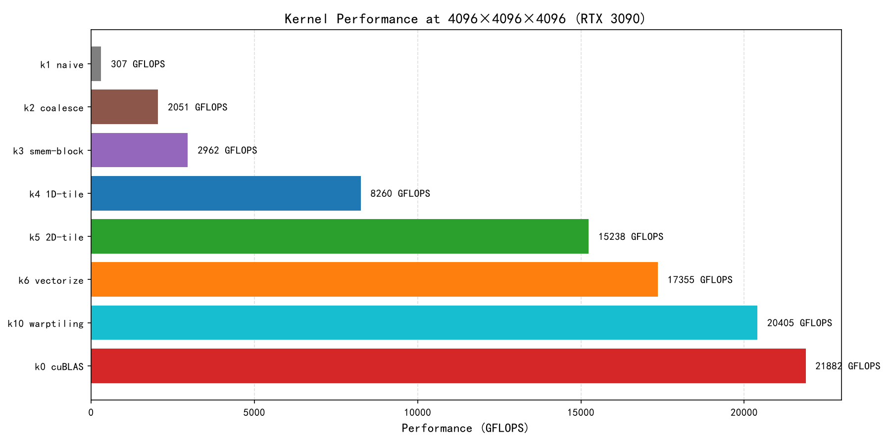

*图 5-1：4096×4096×4096，各 kernel 的绝对 GFLOPS。k10 的 20405 是这条链的终点，离 cuBLAS 的 21882 还差 1477。*

| Kernel | GFLOPS | 相对 cuBLAS | 相对上一级 | 累计相对 k1 |
|---|---:|---:|---:|---:|
| k1 naive | 306.7 | 1.4% | — | 1.00× |
| k2 coalesce | 2050.8 | 9.4% | 6.69× | 6.69× |
| k3 smem | 2961.9 | 13.5% | 1.44× | 9.66× |
| k4 1D tile | 8260.3 | 37.7% | 2.79× | 26.9× |
| k5 2D tile | 15237.5 | 69.6% | 1.84× | 49.7× |
| k6 vectorize | 17354.9 | 79.3% | 1.14× | 56.6× |
| k10 warptiling | 20405.1 | 93.2% | 1.18× | 66.5× |
| k0 cuBLAS | 21882.4 | 100% | 1.07× | 71.3× |

4096 维的 FLOPs 是 137.4 GFLOP。k10 用时约 6.73 ms，cuBLAS 约 6.28 ms，差 0.45 ms。这 0.45 ms 就是“最后 7%”的全部时间。

### 尺寸维度

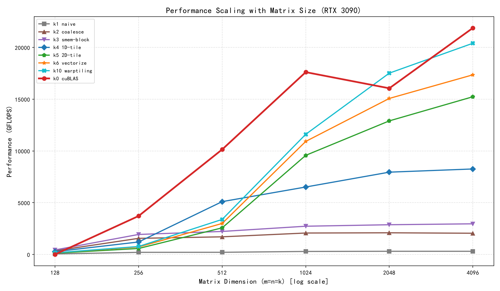

*图 5-2：横轴是 log 尺度的尺寸，纵轴是 GFLOPS。k1~k3 很快就平了；k4~k10 在 512 之后才起来；cuBLAS 在 128 处有一个明显的坑。*

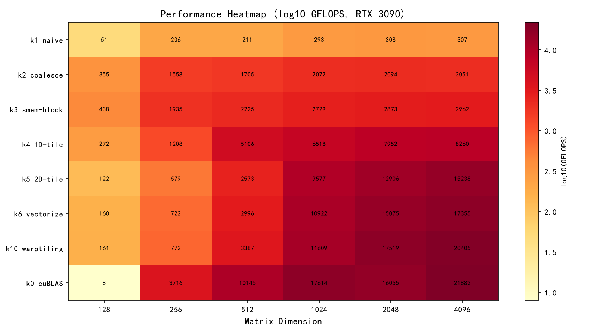

*图 5-3：8×6 的完整热力图（log10 GFLOPS）。颜色越深越接近 4.0（即 10000 GFLOPS）。*

把热力图读成表：

| Kernel | 128 | 256 | 512 | 1024 | 2048 | 4096 |
|---|---:|---:|---:|---:|---:|---:|
| k1 naive | 51 | 206 | 211 | 293 | 308 | 307 |
| k2 coalesce | 355 | 1558 | 1705 | 2072 | 2094 | 2051 |
| k3 smem | 438 | 1935 | 2225 | 2729 | 2873 | 2962 |
| k4 1D tile | 272 | 1208 | 5106 | 6518 | 7952 | 8260 |
| k5 2D tile | 122 | 579 | 2573 | 9577 | 12906 | 15238 |
| k6 vectorize | 160 | 722 | 2996 | 10922 | 15075 | 17355 |
| k10 warptiling | 161 | 772 | 3387 | 11609 | 17519 | 20405 |
| k0 cuBLAS | 8 | 3716 | 10145 | 17614 | 16055 | 21882 |

从表里可以读出三个区间。

**区间一：128~256，GPU 喂不饱。**

k10 在 128 维只有 1 个 block（128/128=1），256 维只有 4 个 block。82 个 SM，只有 1 个或 4 个在干活，剩下 78~81 个空闲。GFLOPS 上不去是必然的。

k3/k4 在小尺寸反而比 k5/k6/k10 好，因为它们的 tile 小（32 或 64），block 数多。128 维时：

- k3：4×4=16 个 32×32 block；
- k4：2×2=4 个 64×64 block；
- k5/k6/k10：1 个 128×128 block。

k3 用了 16 个 SM，k10 只用 1 个。tile 越大，单块效率越高，但并行度越低。小尺寸是并行度赢，大尺寸是单块效率赢。

**区间二：512~1024，过渡区。**

512 维：k10 3387，k4 5106。k4 还赢，因为 k4 有 64 个 64×64 block，k10 只有 16 个 128×128 block。1024 维：k10 11609，k4 6518，k10 反超，因为 64 个 block 已经够填满 82 个 SM 的大部分，tile 效率开始占主导。

**区间三：2048~4096，k10 的主场。**

2048 维：256 个 block，k10 17519；4096 维：1024 个 block，k10 20405。block 足够多，SM 基本吃饱，tile 的复用效率被充分利用。

小矩阵不是算得慢，是没活干。这也是 cuBLAS 要为不同尺寸准备不同 kernel、甚至用 split-K 的原因 [1]。

### 相对 cuBLAS


*图 5-4：4096 维归一化。k10 的 93.2% 只代表最右边这一档。*

只看这张图，容易得出“已经接近 cuBLAS”的结论。把每个尺寸的相对值都算出来：

| 尺寸 | k10 GFLOPS | cuBLAS GFLOPS | k10 / cuBLAS |
|---:|---:|---:|---:|
| 128 | 161 | 8 | 2012%（异常，无意义） |
| 256 | 772 | 3716 | 20.8% |
| 512 | 3387 | 10145 | 33.4% |
| 1024 | 11609 | 17614 | 65.9% |
| 2048 | 17519 | 16055 | 109.1% |
| 4096 | 20405 | 21882 | 93.2% |

这张表比柱状图更完整：

- 小尺寸差得远，不是一点点，是几倍。
- 2048 的反超很可疑，不能当作普遍结论。
- 4096 的 93.2% 是真的，但它是“大尺寸 + 特定 tile”的结果。

### 硬件峰值

| | GFLOPS | 占 3090 FP32 标称峰值（35.6 TFLOPS） |
|---|---:|---:|
| k10 | 20405 | 57.3% |
| cuBLAS | 21882 | 61.5% |

57% 看起来不高，但需要注意三点：

1. 35.6 TFLOPS 是 boost 频率下的理论峰值，要求每个 SM 的 128 个 FP32 core 每个周期都发射一条 FMA，且没有停顿。真实的 SGEMM 有 load、地址计算、同步、分支，不可能 100%。
2. 实际持续频率可能低于 1.70 GHz。按 1.6 GHz 算，峰值约 33.6 TFLOPS，k10 是 60.7%，cuBLAS 是 65.1%。这个数字更接近真实上限。
3. cuBLAS 也只有 61.5%。这说明 FP32 SGEMM 在 3090 上本来就不是一个能跑到 90% 峰值的 workload；瓶颈在指令混合和存储，不在算力不够。

所以，“k10 达到 cuBLAS 的 93.2%，同时达到标称峰值的 57.3%”是一个合理的结果。这两个百分比的分母不同，不能互相否定。

### 异常值

有三处需要单独标出来。

**一、128 维 cuBLAS = 8 GFLOPS。**

这个数很不合理。8 GFLOPS 意味着单次 128 维 matmul 要 0.52 ms；而原文在 A6000 上测同样的 128 维 cuBLAS 只要 15.3 µs，差了 35 倍 [1]。128 维的计算量只有 4.2 MFLOP，0.52 ms 足够做几十次。

可能的原因，按可能性排序：

1. 计时包含了不该包含的东西。比如 cuBLAS 在这个尺寸上第一次调用时做了 workspace 分配、module load 或某种同步；50 次循环里如果每次都有额外开销，会被放大。
2. GPU 时钟没起来。128 维的 50 次循环总时间可能只有几毫秒，GPU 还在低功耗状态。但这个理由解释不了 35 倍的差距。
3. cuBLAS 在这个尺寸上走了特殊路径，比如 split-K + reduction，或者某个带大量固定开销的 kernel。
4. 数据记录或绘图时出错。这是最需要排除的，也最容易被忽略。

建议单独用 `nsys profile` 抓一次 128 维的 cuBLAS 调用，看 50 次循环里到底跑了什么 kernel、每次多久。在没有 timeline 之前，不适合用这个数做结论。

**二、cuBLAS 在 2048 维反而比 1024 维慢。**

1024 维 17614，2048 维 16055，掉了 9%；4096 维又回到 21882。这个 V 形不自然。可能的原因：

- cuBLAS 的 heuristic 在 2048 维选了一个不适合的 kernel，比如 split-K 或不同的 tile；
- L2 的 working set 在 2048 维刚好卡在一个尴尬的位置；
- 时钟或功耗波动；
- 测量噪声。

这个问号直接影响“k10 在 2048 反超 cuBLAS”这个结论。在查清楚之前，不适合把“反超”写成普遍结论。

**三、k10 在 128/256/512 维明显不如 k3/k4。**

这不是异常，是必然。原因就是 5.2 节的“block 数太少”。把它标出来，是为了避免拿 4096 的 93.2% 去推“所有尺寸都 93%”。

### 测量

性能数字的可信度比大小更重要。这个项目的测量有几处可以改进：

| 项目 | 现状 | 建议 |
|---|---|---|
| 预热 | 正式计时前只跑一次验证 | 加 10~20 次 warmup，让时钟稳定 |
| 时钟 | 未锁定 | 用 `nvidia-smi -lgc` 锁频，或记录实际频率 |
| 重复次数 | 50 | 小尺寸可以加到 500~1000 次 |
| C 的累加 | `beta=3`，50 次不重置 | 每次重置 C，或令 `beta=0` |
| 误差阈值 | 绝对误差 0.01 | 改用相对误差，或用 double 参考 |
| 计时 | `cudaEvent` 包 50 次 launch | 单次 kernel 也可以用 `nsys` 看 timeline |
| 对照 | cuBLAS `GemmEx` | 记录 cuBLAS 版本、CUDA 版本、驱动版本 |

这些细节不会让 kernel 变快，但会让数字更可信。在 4096 这种大尺寸上，它们的影响可能只有 1%~2%；在 128 这种小尺寸上，足以让结论反转。

---

## 经验与常见问题

这一节整理项目里的十条经验和十个常见问题。它们比性能数字更难复制，因为每一条都对应一次具体的调试。

### 十条经验

**一、先做 coalescing，再谈其他。**

如果 k1 的访存模式不改，后面的 tiling 都建立在低效的搬运上。优化的顺序大致是：地址、复用、指令、流水线。

**二、用“每个结果搬几次”算账。**

k3 的 `LDS/FMA = 2`，k4 是 1.125，k5 是 0.25，k10 是 0.1875。这四个数字一比，就能大致判断每一步该期待多大的收益。

**三、寄存器分块是最大的杠杆。**

k3 → k4 的 2.79×，本质上不是 SMEM 变快了，而是每个操作数被复用了 8 次。寄存器是离 CUDA Core 最近的存储，让数据在寄存器里多待一会儿，比换什么内存都管用。

**四、2D tile 比 1D tile 更划算，但受寄存器限制。**

1D tile 只复用 B，2D tile 同时复用 A 和 B。8×8 的 2D tile 能把 LDS/FMA 降到 0.25；但 64 个累加器已经吃掉大量寄存器，再大就会 spill。tile 的大小，是复用和寄存器之间的谈判。

**五、向量化省的是指令，不是带宽。**

`float4` 让一条指令搬 16B，但它不会让 SMEM 或 GMEM 变快。它只在指令条数成为瓶颈时有效。如果还在“搬得多”的阶段，先做 tiling。

**六、布局即性能。**

As 转置那一下，看起来只是换了个下标，实际上是把标量 `LDS` 变成了 `LDS.128`。同一块数据，换个摆法，就是另一种性能。CUTLASS 里大量的 layout、swizzle、padding 代码，做的也是这件事 [5]。

**七、warp 要显式映射。**

k1~k6 里 warp 是隐式的；到了 k10，需要回答哪个 warp 算哪一块、哪个 lane 算哪一块。这不是为了代码好看，是为了让 SMEM 访问、寄存器分配、调度都有明确的归属。

**八、occupancy 不是目标，ILP 可以替代 TLP。**

k3 的 66% occupancy 不如 k10 的 20%。因为 k10 的每个线程有 128 个独立 FMA，ILP 足够填满流水线。不要为了“看起来占用率高”而缩小 tile；要让每个线程手里有足够的活。

**九、tile 越大，小矩阵越惨；形状特化是库的优势。**

k10 在 4096 维是 93.2%，在 256 维只有 cuBLAS 的 20.8%。同一个 kernel，换一个尺寸就是另一个结果。cuBLAS 之所以强，不是因为它有一个万能 kernel，而是因为它有很多 kernel，按形状 dispatch [1][8]。

**十、计时和验证是优化的一部分。**

没有可信的测量，就没有可信的优化。warmup、锁频、重复次数、C 的重置、误差阈值，这些细节不会让 kernel 变快，但会决定数字能不能用。

### 十个常见问题

#### 指针偏移之后，A 和 As 的宽度不一样

```cpp
// very important!!! here the pointer of A has been biased previously
// so you can mentally consider A and As start the same place
// only difference is the width
// which As is BK, A is K
As[threadARow * BK + threadACol] = A[threadARow * K + threadACol];
```

`A += blockRow * BM * K` 之后，A 的当前窗口是 BM×K 里的一小块，但它的行 stride 仍然是 K；`As` 是一个独立的 BM×BK 数组，行 stride 是 BK。两个下标长得一样，步长不一样。

症状是结果全错，或者只有第一列对。解法是在纸上画一个 4×4 的小矩阵，把 A 和 As 的偏移各写一遍。

#### `threadCount == BK*BN` 只在 k4 成立

k5 的注释说得很直白：

```cpp
// that's obviously incorrect
// in kernel 4, we play this trick cuz we gained the limitation that
// threadCount must be equal to BK * BN and BM * BK
// so we have to do somthing more
```

k4 的 512 个线程，正好等于 As（64×8）和 Bs（8×64）的元素数，所以一个线程搬一个就行。k5 只有 256 个线程，As/Bs 各有 1024 个元素，必须一个线程搬 4 个。于是有了 `capableRowsA`、`capableRowsB` 和两层循环。

不要把某个 kernel 的巧合当成通用规律。每次改 tile，先确认线程数和元素数还对得上。

#### 寄存器数组和 local memory 只隔一个编译期索引

```cpp
// why regA and regB are register-level arrays?
// that's the compiler's thicky method to upgrade such arrays
```

`regA[TM]`、`regB[TN]`、`threadResults[TM*TN]` 能待在寄存器里，是因为下标都来自 `constexpr` 的循环变量，nvcc 能把它们完全展开。如果下标是运行期才定的，编译器只能把它们放到 local memory。

local memory 听起来像“本地”，其实是 GMEM。一旦掉进去，延迟从 1 个周期变成几百个周期，性能可能掉一个数量级。

编译时加 `--ptxas-options=-v`，看输出里的 local memory 是不是 0；或者用 Nsight Compute 看 Local Memory 的统计。如果 local 不是 0，先查索引，再调 tile。

#### As 声明成 BM×BK，实际当 BK×BM 用

```cpp
// attention here: we still make As as BM * BK
// but actually we use As as BK * BM
// inorder to enhance cache
__shared__ float As[BM * BK];
```

`As` 的大小没变，还是 `BM*BK` 个 float；变的是索引方式：`As[k*BM + m]` 而不是 `As[m*BK + k]`。这在 C 里完全合法，因为数组是一维的；但读代码的人很容易被“As 是 BM×BK”这句话骗到。

如果以后要长期维护，可以把变量名改成 `As_transposed`，或者加一行注释 `// logical layout: [BK][BM]`。

#### `const` 和 `reinterpret_cast`

```cpp
// in case we use reinterpret_cast, here we didn't put const before pointer to A and B
__global__ void sgemmVectorize(..., float *A, float *B, ...)
```

`reinterpret_cast<float4*>(&A[...])` 会把 `const float*` 转成 `float4*`，编译器会报 cast away qualifiers。把参数改成 `float*` 可以编译，但类型系统不再保证只读。

更干净的做法：

```cpp
const float4* A4 = reinterpret_cast<const float4*>(A);
float4 tmp = A4[...];
```

这样既保留了 `const`，又能向量化。

#### `float4` 的 16B 对齐不是自动的

`reinterpret_cast<float4*>` 的前提是指针地址 16B 对齐。`cudaMalloc` 返回的基地址通常是 256B 对齐，所以 A、B、C 的起点没问题；但行偏移 `row * K * 4B` 不一定。

- 如果 K 是 4 的倍数，`row*K*4` 一定是 16B 的倍数，安全。
- 如果 K 不是 4 的倍数（比如 4095），某些行的起点会落在 4B/8B 边界上，`float4` 读就会错位，轻则结果错，重则 illegal memory access。

项目只测 2 的幂，所以没有暴露这个问题。如果 kernel 要处理任意 K，要么加 `K % 4 == 0` 的检查，要么在 host 端做 padding。

#### `warpSize` 不是 `constexpr`

```cpp
const int WARPSIZE = 32; // warpSize is not constexpr
```

CUDA 有一个内置变量 `warpSize`，但它是运行期值，不能拿来当模板参数或 `constexpr`。所以文件顶部定义了 `const int WARPSIZE = 32`。这在所有现代 NVIDIA GPU 上都成立，但严格来说，它不是可移植到任意加速器的写法。

内置变量不一定是编译期常量。需要 `constexpr` 的地方，自己定义。

#### inline PTX 的诱惑

k10 里有一段被注释掉的 `ld.global.nc.v4.f32`：

```cpp
// asm("ld.global.nc.v4.f32 {%0, %1, %2, %3}, [%4];"
//     : "=f"(tmp.x), "=f"(tmp.y), "=f"(tmp.z), "=f"(tmp.w)
//     : "l"(&A[(innerRowA + offset) * K + innerColA * 4]));
```

`ld.global.nc` 的 `nc` 是 non-coherent，走只读缓存；`v4.f32` 是一次读 4 个 float。它确实能生成想要的指令，但：

- `float4` 已经能让 nvcc 生成 `LDG.E.128`；
- 手写 PTX 把对齐假设硬编码，换一个 K 就可能崩；
- 内联汇编会限制编译器的重排和 CSE。

先让编译器生成想要的指令，再考虑手写。如果 SASS 里已经是 `LDG.E.128`，就没有必要再插一段 asm。

#### CMake 里还留着 75

`CMakeLists.txt` 里有一行：

```cmake
set(CUDA_COMPUTE_CAPABILITY 75)
```

这是 2080 Ti（sm_75）时代的遗留。现在跑的是 3090（sm_86），应该改成：

```cmake
set(CUDA_COMPUTE_CAPABILITY 86)
```

如果不改：

- 如果 CMake 只生成了 sm_75 的 cubin，运行时会报 `no kernel image is available for execution on the device`；
- 如果同时嵌入了 PTX，驱动会做 JIT，能跑，但第一次 launch 会慢，也可能错过 sm_86 的一些指令优化。

`notes/cuda-compile-ref.md` 里的 `sm_75` 也应一起改掉。

#### Makefile 不是编译脚本

`cuda-info/Makefile` 里只有：

```make
submit:
	git add -A
	git commit -m "$(MSG)"
	git push origin HEAD
```

它是“一键提交”的助手，不是“一键编译”。在项目根目录敲 `make` 不会生成可执行文件，只会执行 commit/push（如果 `MSG` 没设，还会报错）。

正确的方式是用 CMake，或者直接 `nvcc`。“复现”一节有命令。

#### 三个小问题

1. `static_assert` 的错误信息里还写着 `K9_BK`、`K9_BN`，是从 k9 复制过来没改。不影响编译，但报错时会让人愣一下。
2. `runner.cuh` 带了 `<sys/time.h>` 和 `<unistd.h>`。这两个是 Linux/WSL 的头文件，在原生 Windows 上用 MSVC 编译会找不到。要“Windows 原生可编译”，得把 `gettimeofday` 换成 `std::chrono`，把 `unistd.h` 去掉。
3. 验证使用绝对误差 `0.01`，这个阈值不随 K 缩放。对 4096 长度的点积可能太严，对 128 长度又可能太松。更稳妥的是相对误差，或者用 double 算一遍参考值。

### 如果重来一次

1. 先写 k1，跑通、验证、记下 306.7。baseline 是后面所有倍数的分母。
2. 用 `nsys` / `ncu` 看一眼 k1 的访存，确认“A 不合并、B 广播”这个判断。
3. 改 k2，只改映射，别动别的。一次只动一个变量，才能知道收益来自哪里。
4. 上 k3 之前，先算一遍 AI。32×32 的 tile 只有 8 FLOP/B，不可能一步登天。
5. k4 是分水岭，重点写注释。指针偏移、寄存器数组、Btmp 复用，这三件事值得画图。
6. k5 之前，先算寄存器。64 个累加器 + 16 个操作数，能不能塞进 255 个寄存器？塞不进就先改 tile。
7. k6 之前，先看 SASS。确认 `LDS` 是不是标量、`LDG` 是不是 32-bit；如果已经是 128-bit，就别白忙。
8. k10 之前，先把三层 tiling 画出来。画不出来，说明还没想清楚；画出来了，代码只是把图翻译成 C++。
9. 每次改完，都跑一遍全尺寸。不要只看 4096；小尺寸会说明这个 tile 是不是太大了。
10. 最后，写一份文档。教是最好的学。

---

## 结论与展望

### 结论

1. 七个 kernel 把 4096 维 FP32 SGEMM 从 306.7 GFLOPS 推到 20405.1 GFLOPS，累计 66.5×，达到 cuBLAS 的 93.2%。
2. 最大的单步收益来自“把地址排对”（k1→k2，6.69×）和“把数据复用起来”（k3→k4，2.79×）。前者是访存模式的收益，后者是寄存器复用的收益。
3. k10 的 warptiling 把 GPU 的三层并行显式写进了代码：block 分给 SM，warp 分给 scheduler，lane 分给 CUDA core。它没有减少 GMEM 流量，但把 SMEM→寄存器的负载降到 0.1875 LDS/FMA，并用 128 个累加器把 ILP 拉满。
4. 93.2% 只属于 4096 维。小尺寸（128~512）受并行度和 wave quantization 影响，k10 明显落后于 cuBLAS；这是 tile 太大的结果，不是 bug。
5. 最后 7% 主要是工程问题。double buffering、bank conflict、更大的 tile、shape specialization、split-K、SASS 级调度，每一项都能再挤出几个百分点，但每一项都需要一个新的项目周期。

### 下一步

| 方向 | 预期收益 | 工作量 | 说明 |
|---|---:|---|---|
| Double buffering / `cp.async` | 5%~10% | 高 | 用两块 SMEM 交替，加载和计算重叠；sm_86 支持 `cp.async`，可以绕过寄存器 |
| 消 As 转置的 bank conflict | 2%~5% | 中 | padding / swizzle；注意别把 `LDS.128` 搞坏 |
| 256×128 tile | 3%~5% | 中 | AI 从 32 提到 42.7，第一次越过平衡点；但寄存器/线程映射要重做 |
| 自动调参 | 3%~5% | 中 | 把 BM/BN/BK/TM/TN/WM/WN/WNITER 的组合跑一遍；需要大量验证 |
| Split-K / 形状特化 | 小尺寸 2~5× | 高 | 小矩阵最有效的方向，cuBLAS 就是这么做的 |
| TF32 / Tensor Core | 2~4× | 很高 | 换精度、换指令、换数据布局；这是另一个项目 |
| CUTLASS / cuBLAS 级实现 | 5%~10% | 极高 | 学 CUTLASS 的 pipeline、layout、dispatch [5] |

如果只想再往前走一小步，优先试 double buffering 和 256×128 tile：前者针对同步等待，后者针对 AI 不够。两者都不需要换精度，也不需要重写整个 kernel。

### 什么时候停下来

笔者倾向于把 k10 作为这个项目的终点。判断依据有三条：

1. 目标线：目标是“理解 GEMM 优化的全链路”吗？如果是，k10 已经到顶了；再往下是工程优化，不是原理学习。
2. 收益线：从 k6 到 k10 换了 18%，从 k10 到 cuBLAS 可能再花几倍时间，只能换 7%。边际收益递减是客观规律。
3. 学习线：k10 里学到的东西（三层 tiling、warp 映射、寄存器预算、ILP），比最后 7% 的调参更通用。把时间花在能迁移的知识上，比花在单卡最后一个百分点上更划算。

原文提到，前六个 kernel 花了两个周末做到 80%；自动调参和 warptiling 又花了四个周末，才到 94% [1]。越往后，越像工程，越不像灵感。

---

## 附录

### 完整数据表

下表来自 `figs/fig5_heatmap.png` 的标注值；4096 列以 `fig2` 的精确值为准（热力图做了取整）。单位：GFLOPS。

| Kernel | 128 | 256 | 512 | 1024 | 2048 | 4096 |
|---|---:|---:|---:|---:|---:|---:|
| k1 naive | 51 | 206 | 211 | 293 | 308 | 306.7 |
| k2 coalesce | 355 | 1558 | 1705 | 2072 | 2094 | 2050.8 |
| k3 smem | 438 | 1935 | 2225 | 2729 | 2873 | 2961.9 |
| k4 1D tile | 272 | 1208 | 5106 | 6518 | 7952 | 8260.3 |
| k5 2D tile | 122 | 579 | 2573 | 9577 | 12906 | 15237.5 |
| k6 vectorize | 160 | 722 | 2996 | 10922 | 15075 | 17354.9 |
| k10 warptiling | 161 | 772 | 3387 | 11609 | 17519 | 20405.1 |
| k0 cuBLAS | 8 | 3716 | 10145 | 17614 | 16055 | 21882.4 |

和原文（A6000）的对照：

| Kernel | 原文 A6000 [1] | 本项目的 3090 | 比例 |
|---|---:|---:|---:|
| k1 | 309.0 | 306.7 | 99.3% |
| k2 | 1986.5 | 2050.8 | 103.2% |
| k3 | 2980.3 | 2961.9 | 99.4% |
| k4 | 8474.7 | 8260.3 | 97.5% |
| k5 | 15971.7 | 15237.5 | 95.4% |
| k6 | 18237.3 | 17354.9 | 95.2% |
| k10 | 21779.3 | 20405.1 | 93.7% |
| cuBLAS | 23249.6 | 21882.4 | 94.1% |

本项目的数字整体是原文的 93%~103%，和 3090 相对 A6000 的峰值比例（35.6/38.7≈92%）基本吻合。这说明实现不是碰巧快，而是和原文同一条技术路线。

### 参数速查

| Kernel | BM | BN | BK | TM | TN | 线程/Block | 结果/线程 | SMEM/Block |
|---|---:|---:|---:|---:|---:|---:|---:|---:|
| k3 | 32 | 32 | 32 | 1 | 1 | 1024 | 1 | 8 KB |
| k4 | 64 | 64 | 8 | 8 | 1 | 512 | 8 | 4 KB |
| k5 | 128 | 128 | 8 | 8 | 8 | 256 | 64 | 8 KB |
| k6 | 128 | 128 | 8 | 8 | 8 | 256 | 64 | 8 KB |
| k10 | 128 | 128 | 16 | 8 | 4 | 128 | 128 | 16 KB |

> k3 没有 `TM`/`TN` 这两个模板参数，表中按“每个线程 1 个结果”记作 1×1。

k10 的派生参数：

```text
WM = WN = 64
WNITER = 4
WMITER = 1
WSUBM = 64
WSUBN = 16
每个 warp 的 lane 网格 = 8 × 4
每个线程的累加器 = 8 × 16 = 128
```

### 复现

**第一步：把 CMake 的架构改对。**

```cmake
# cuda-info/CMakeLists.txt
set(CUDA_COMPUTE_CAPABILITY 86)   # 3090 是 sm_86；原来是 75
```

**第二步：编译。**

```bash
cd cuda-info
cmake -B build -S .
cmake --build build -j
```

或者不用 CMake：

```bash
nvcc -O3 -arch=sm_86 -o sgemm sgemm.cu src/runner.cu -lcublas
```

**第三步：运行。**

```bash
./build/sgemm 10     # warptiling
./build/sgemm 0      # cuBLAS 基准
```

`DEVICE=0` 可以指定 GPU：

```bash
DEVICE=0 ./build/sgemm 10
```

**第四步：收集数据。**

程序会对 128、256、512、1024、2048、4096 依次输出：

```text
Average elapsed time: (...) s, performance: (...) GFLOPS. size: (...).
```

把每个 kernel（0~6、10）的输出收集起来，就是“完整数据表”一节那张表。

> k10 没有小尺寸 fallback，128 维只有 1 个 block；这不是 bug，是 tile 太大的结果。想看小尺寸的正常表现，跑 k3 或 k4。

### 术语

| 术语 | 含义 |
|---|---|
| GMEM | Global Memory，全局显存 |
| SMEM | Shared Memory，共享内存，每个 block 一块 |
| LDS | Load Shared，从 SMEM 读 |
| LDG | Load Global，从 GMEM 读 |
| STG | Store Global，写 GMEM |
| FMA | Fused Multiply-Add，乘加融合，算 2 个 FLOP |
| Warp | 32 个线程组成的调度单位 |
| Lane | warp 内的单个线程 |
| Coalescing | 合并访存，把同一个 warp 的连续地址合并成少量事务 |
| Bank Conflict | 同一个 warp 内多个线程访问同一 bank 的不同地址，导致串行化 |
| Tile / Blocking | 分块，把大矩阵切成小块，提高复用 |
| Arithmetic Intensity | 算术强度，FLOPs / Bytes |
| Roofline | 用算力上限和带宽上限画出的性能上界 |
| Occupancy | 占用率，活跃 warp 数 / 最大 warp 数 |
| ILP | Instruction-Level Parallelism，指令级并行 |
| Tile Quantization | 分块量化，矩阵尺寸不是 tile 整数倍时，最后一波 block 利用率低 |
| Double Buffering | 双缓冲，用两块 SMEM 交替，让加载和计算重叠 |
| Split-K | 把 K 维切给多个 block，最后再 reduce |
| Swizzle | 重排 block/地址映射，改善 L2 或 SMEM 的局部性 |
| TF32 | TensorFloat-32，Ampere 的 19-bit 浮点格式，用于 Tensor Core |

### 参考文献

本文使用方括号编号引用，参考文献按主题排列。

[1] Simon Boehm. *How to Optimize a CUDA Matmul Kernel for cuBLAS-like Performance: a Worklog*. December 2022. https://siboehm.com/articles/22/CUDA-MMM

[2] NVIDIA. *CUDA C++ Programming Guide*. https://docs.nvidia.com/cuda/cuda-c-programming-guide/

[3] NVIDIA. *CUDA C++ Best Practices Guide*. https://docs.nvidia.com/cuda/cuda-c-best-practices-guide/

[4] NVIDIA. *Kernel Profiling Guide*. https://docs.nvidia.com/nsight-compute/ProfilingGuide/

[5] NVIDIA. *CUTLASS: CUDA Templates for Linear Algebra Subroutines*. https://github.com/NVIDIA/cutlass

[6] wangzyon. *NVIDIA_SGEMM_PRACTICE*. https://github.com/wangzyon/NVIDIA_SGEMM_PRACTICE

[7] V. Volkov. *Understanding Latency Hiding on GPUs*. PhD thesis, 2016.

[8] NVIDIA. *Matrix Multiplication Background User's Guide*. https://docs.nvidia.com/deeplearning/performance/dl-performance-matrix-multiplication/

**图片版权**：文中标注“原图：Boehm”的图片来自 [1]，版权归 Simon Boehm 所有；这里仅用于个人学习记录，不做商业用途。`fig1`~`fig6` 为本项目生成的数据图和示意图。网页资料均访问于 2026 年 10 月。

### 文件清单

| 文件 | 用途 |
|---|---|
| `SGEMM_优化总结.md` | 本文 |
| `figs/fig1_by_dimension.png` | 各 kernel 按尺寸的性能 |
| `figs/fig2_4096.png` | 4096 维绝对性能 |
| `figs/fig3_scaling.png` | 性能随尺寸的 scaling |
| `figs/fig4_relative.png` | 相对 cuBLAS |
| `figs/fig5_heatmap.png` | 8×6 热力图 |
| `figs/fig6_param_map.png` | k10 参数落位示意图（本文绘制） |
| `figs/orig/*.png` | 原文数据组织图（版权归 [1]） |
| `cuda-info/src/kernels/*.cuh` | 七个 kernel 的源码 |
| `cuda-info/src/runner.cu` | launch 配置与总调度 |
| `cuda-info/sgemm.cu` | 主程序、验证、计时 |

---

## 常见问题

下面是十个常被问到的问题，答案尽量短。

**Q1：k2 为什么能快 6.7 倍？计算量变了吗？**

计算量没变。变的是同一个 warp 的 32 个 lane 在内存里的地址分布：k1 读 A 时 32 个 lane 落在 32 个不同的 128B 段，一次 load 被拆成 32 次 32B 事务，浪费约 8 倍；k2 让 lane 读连续的列，A 变成广播、B 变成 128B 合并，事务数降了一个数量级。

**Q2：k3 都上共享内存了，为什么只有 1.44 倍？**

SMEM 解决的是“重复读 GMEM”，不解决“读 SMEM 的次数”。k3 的每个线程仍然要做 2K 次 `LDS` 才能完成 K 次 FMA，`LDS/FMA=2`；32×32 的 tile 只有 8 FLOP/B 的复用，离平衡点 38 很远。再加上 k2 的 L1/L2 已经接住了一部分重复读，SMEM 的边际收益没有想象中大。

**Q3：为什么说 k3→k4 是最本质的一步？**

因为它是第一次让一个操作数被多个 FMA 复用。k4 把 B 的一个值缓存在寄存器里，复用 8 次；`LDS/FMA` 从 2.0 降到 1.125；每结果 GMEM 从 `K/16` 降到 `K/32`。这不是换更快的内存，是换更聪明的用法。

**Q4：k6 用了 `float4`，为什么只快 14%？**

因为 `float4` 省的是指令条数，不是带宽或 FMA 数。k6 的 FMA 还是 64 次，SMEM 吞吐上限也没变；它只是把 A 的标量 load 合成 128-bit load。Bs 的读取之前已经被编译器向量化了，所以整体收益有限。

**Q5：warptiling 到底优化了什么？它减少 GMEM 流量了吗？**

没有减少 GMEM 流量。k10 的 block tile 还是 128×128，每结果 GMEM 还是 `K/64`。它优化的是 SMEM→寄存器这一段：每个线程的结果从 64 个增加到 128 个，`LDS/FMA` 从 0.25 降到 0.1875；同时把 warp 这一层显式映射，让 SMEM 访问更集中、ILP 更足。

**Q6：为什么 k10 在 128 维上只有 161 GFLOPS？**

因为 128 维只有 1 个 128×128 的 block，82 个 SM 里只有 1 个在干活，剩下 81 个空闲。256 维也只有 4 个 block。tile 越大，单块效率越高，但并行度越低；小尺寸是并行度赢，大尺寸是单块效率赢。

**Q7：93.2% 是怎么算的？能代表所有尺寸吗？**

`20405.1 / 21882.4 = 93.25%`，只对 4096×4096×4096 这一档成立。128~512 维 k10 明显落后（256 维只有 cuBLAS 的 20.8%，512 维 33.4%），1024 维 65.9%，2048 维 109.1%（可疑），4096 维 93.2%。说 93% 时必须带上“4096 维”这个限定词。

**Q8：kernel 能处理任意尺寸吗？**

不能。k5/k6/k10 都没有边界检查：k5/k6 默认按 128 的 block tile 走（M 或 N 小于 128 时 runner 会退回 64），k10 固定 128；K 必须是 BK 的整数倍（k10 是 16）；k6/k10 的 `float4` 还要求 K 是 4 的倍数。k1/k2 有 `if` 保护，k3 要求 32 的倍数，k4 要求 64 的倍数。这是一个 benchmark 专用实现，不是通用库。

**Q9：还有哪些优化没做？为什么不做？**

double buffering / `cp.async`、消 bank conflict、256×128 tile、自动调参、split-K / 形状特化、TF32 / Tensor Core。没做的原因不是不知道，是边际收益递减、工程量大：前六个 kernel 两个周末到 80%，从 80% 到 94% 又花了四个周末；再往下是另一个项目。

**Q10：如果换 A100 或 H100，参数会怎么变？**

不能照搬。A100 有 108 个 SM、19.5 TFLOPS FP32、约 2 TB/s 带宽、164 KB SMEM；H100 的 SM 数、带宽、Tensor Core 又完全不同 [2]。BM/BN/BK/TM/TN/WM/WN/WNITER 都要重新调，最靠谱的办法是自动调参。原文在 A100 上就把 A6000 的胖配置换成了瘦配置（BM=64、TM=TN=4、WNITER=1）[1]。

---

## 致谢

首先要感谢 Simon Boehm。本文的优化路线、kernel 编号、部分插图和若干性能观察，都来自他的工作日志 [1]。这篇笔记把 GEMM 优化从一堆术语变成了一组可以按顺序复现的实验；对这个项目来说，它是最重要的一份参考资料。没有这篇工作日志，项目大概不会走到 warptiling。

还要感谢 wangzyon 的 NVIDIA_SGEMM_PRACTICE [6]，本项目的 benchmark 框架来自那里；感谢 NVIDIA 的 CUDA C++ Programming Guide、Best Practices Guide、Kernel Profiling Guide 和 CUTLASS 文档 [2-5]；感谢 V. Volkov 的博士论文 [7]，其中关于 latency hiding 的讨论帮助理解了 occupancy 与 ILP 的取舍。

最后，感谢 Simon Boehm 把这篇文章和代码公开出来。把路线、代码、图和踩过的坑都写下来，对后来者来说，比一份只讲结论的教程有用得多。


